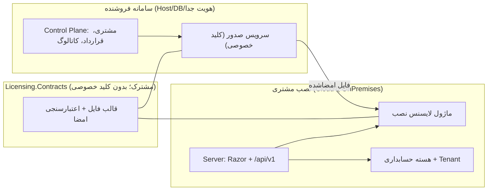

# معماری و مرزبندی مسئولیت‌ها

## وضعیت موجود
- `Server`: برنامه وب Razor Pages، PageModelها، middlewareها، تنظیمات و فایل‌های ایستا.
- `Domain`: مدل‌های دامنه و enumerationها.
- `Infrastructure/Persistence` (نام‌فضای فعلی `Data`): `DbContext`، پیکربندی EF Core و دسترسی داده.
- `ViewModels`: مدل‌های مورد استفاده صفحات/فرم‌ها.
- `Resources`: منابع چندزبانه.
- `Application`: پروژه اسکلت برای Use Caseهای آینده؛ فعلاً جریان‌های موجود به آن منتقل نشده‌اند.
- `Constants`, `Dtat`, `Dtat.Seedwork.Abstractions`, `Dtat.StateMachine*`: کتابخانه‌های کمکی و مشترک.
- `Server/Api`: API نسخه 1 (Minimal API) برای کلاینت React؛ `Server/Infrastructure/Tenancy`: تصمیم سمت سرور دسترسی به شرکت.
- `ClientApp`: کلاینت React + TypeScript + Vite + Tailwind؛ خروجی آن در `Server/wwwroot/app` و مسیر `/app`.

این ساختار هنوز Clean Architecture کامل نیست: `Server` مستقیماً به `Data` و EF Core وابسته است و بخشی از منطق کاربردی در PageModelها قرار دارد.

## معماری هدف
1. **Domain**: موجودیت‌ها، Value Objectها، قوانین دامنه و قراردادهای مستقل؛ بدون وابستگی به Web/EF Core.
2. **Application**: Use Caseها، DTOها، اعتبارسنجی کاربردی، قرارداد Repository/سرویس‌ها و orchestration.
3. **Infrastructure**: پیاده‌سازی قراردادهای داده، EF Core، سرویس‌های بیرونی و persistence.
4. **Web**: Razor Pages، PageModelها، احراز هویت/مجوزدهی وب و ترکیب وابستگی‌ها.
5. **Tests**: Unit Test مستقل و Integration Test برای اجزای متصل به دیتابیس/وب.

## جهت وابستگی هدف
- Web → Application
- Infrastructure → Application و Domain
- Application → Domain
- Domain → هیچ پروژه بیرونی

در فاز مهاجرت، نام‌ها و مسیرهای فعلی حفظ می‌شوند تا جابه‌جایی مکانیکی، رفتار را خراب نکند. پروژه‌های جدید فقط وقتی افزوده شوند که مرز واقعی مسئولیت مشخص باشد.

## پارادایم‌ها
- **OOP**: انتخاب اصلی برای مدل‌سازی موجودیت‌ها و رفتارهای دارای هویت/مسئولیت.
- **Procedural**: مناسب اسکریپت‌ها و جریان‌های ساده؛ نه دلیل برای شکستن هر عملیات به کلاس‌های اضافی.
- **Functional**: توابع خالص، LINQ و داده‌های immutable در جایی که خوانایی و تست‌پذیری را بهتر می‌کند.
- **Event-Driven**: برای رخدادهای واقعی دامنه یا یکپارچه‌سازی؛ از Event Bus بدون نیاز واقعی استفاده نشود.
- **Declarative**: تنظیمات DI، EF Core Fluent API، Routing و Validation.
- **Logic**: قواعد صریح و قابل تست در Domain/Application؛ بدون افزودن چارچوب منطق جداگانه مگر نیاز روشن.
- **Concurrent/Async**: عملیات I/O به‌صورت async با `CancellationToken`؛ از `.Result`/`.Wait()` و اجرای موازی روی یک DbContext اجتناب شود.

## اصول طراحی
- **SOLID**: مسئولیت متمرکز؛ توسعه‌پذیری بدون اصلاح گسترده؛ جانشینی صحیح؛ Interfaceهای کوچک؛ وابستگی به abstraction در مرزهای مناسب.
- **DRY**: فقط تکرار معنادار را حذف کن؛ دو رفتار مشابه اما با قواعد تغییر متفاوت لزوماً نباید ادغام شوند.
- **KISS**: ساده‌ترین راه‌حل قابل نگهداری را انتخاب کن.
- **YAGNI**: قابلیت آینده‌نگر بدون نیازمندی فعلی نساز.
- **SoC**: UI، منطق کاربردی، دامنه و persistence را جدا نگه دار.
- **LoD**: زنجیره‌های طولانی دسترسی به اشیای داخلی را کاهش بده؛ متدهای معنادار و قراردادهای روشن ترجیح دارند.

## DDD (Domain-Driven Design)
- مدل دامنه باید زبان مشترک کسب‌وکار را منعکس کند؛ نام کلاس‌ها و عملیات بر اساس مفهوم دامنه انتخاب شوند.
- Entity، Value Object، Aggregate و Domain Event فقط در صورت وجود مرز و قاعده واقعی دامنه معرفی شوند.
- Aggregate Root مرز سازگاری قواعد را مشخص می‌کند؛ از Repository عمومی برای هر جدول بدون نیاز دامنه اجتناب شود.
- منطق کسب‌وکار در PageModel یا EF Core Configuration قرار نگیرد.
- Bounded Contextها فقط زمانی جدا شوند که واژگان/قواعد یا چرخه تغییر مستقل دارند؛ برای اسکلت اولیه context مصنوعی ایجاد نشود.

## الگوهای طراحی — فقط در صورت نیاز
- **Singleton**: فقط سرویس stateless و thread-safe؛ نه برای DbContext یا داده وابسته به درخواست.
- **Factory / Abstract Factory**: ساخت شیء پیچیده یا خانواده‌ای از پیاده‌سازی‌ها.
- **Builder**: ساخت تدریجی شیء پیچیده با چند گزینه.
- **Adapter**: سازگارکردن API خارجی با قرارداد داخلی.
- **Decorator**: افزودن رفتار جانبی بدون تغییر پیاده‌سازی اصلی، مثل caching/logging هدفمند.
- **Facade**: ساده‌سازی API چند جزء پیچیده.
- **Proxy**: کنترل دسترسی/بارگذاری/ارتباط؛ با دقت نسبت به رفتار پنهان.
- **Observer**: انتشار رخداد به چند مصرف‌کننده؛ برای رخدادهای دامنه با قرارداد روشن.
- **Strategy**: تعویض الگوریتم/سیاست در زمان اجرا.
- **Command**: نمایش عملیات به‌صورت درخواست مستقل، فقط اگر به صف/تاریخچه/dispatch نیاز باشد.
- **Iterator**: عموماً از abstractionهای استاندارد .NET استفاده شود.
- **State**: رفتارهای متفاوت بر اساس وضعیت‌های معتبر؛ نه جایگزین enum ساده.

## MVC، MVVM، Layered، Clean، Monolith و Microservices
Razor Pages خودش مدل Page/PageModel دارد و نیازی نیست پروژه را به‌زور MVC یا MVVM نام‌گذاری کنیم. تفکیک لایه‌ای و جهت وابستگی از انتخاب برچسب معماری مهم‌تر است. Modular Monolith نقطه شروع است؛ Microservices تنها با دلیل عملیاتی/دامنه‌ای انتخاب می‌شود.


## Frontend و API (2026-10-20)

```
Browser ──(Cookie HttpOnly, same origin)──▶ ASP.NET Core (Server)
  ├─ /Account/Login, /, /Admin/*   Razor Pages (ورود و صفحات موجود — مسیر بازگشت)
  ├─ /app/*                        index.html کلاینت React (wwwroot/app)
  └─ /api/v1/*                     Minimal API ──▶ CompanyAccessService ──▶ DatabaseContext (EF Core / SQL Server)
```

- **جریان ورود:** کلاینت هیچ فرم ورودی ندارد. پاسخ 401 از API کاربر را به `/Account/Login?ReturnUrl=/app/...` می‌برد؛ صفحه ورود فقط `ReturnUrl` محلی را می‌پذیرد (و `ReturnUrl` که به `/Account/Login*` برگردد نادیده می‌گیرد). بدون `ReturnUrl` امن، ورود موفق کاربر شرکتی را به `/app/` (انتخاب شرکت و دوره مالی، D-031) و حساب Master زیرساختی را (که شرکت ندارد) به خانهٔ Razor `/` می‌برد (`LoginModel.GetDefaultDestination`). `/Account/LoginSuccess` دیگر صفحه‌ای نمایش نمی‌دهد؛ فقط برای لینک‌های قدیمی با `[Authorize]` به همان مقصد پیش‌فرض Redirect می‌کند.
- **قرارداد API v1** (JSON، camelCase، همه نیازمند ورود، پاسخ‌ها `no-store`):

| Method | مسیر | پاسخ | توضیح |
|---|---|---|---|
| GET | `/api/v1/session` | `{ username, fullName, accountKind, isAdministrator }` | هویت تأییدشده نشست |
| GET | `/api/v1/antiforgery/token` | `{ headerName, requestToken }` | Cookie ضد جعل را صادر می‌کند |
| POST | `/api/v1/session/logout` | 204 / 400 | نیازمند هدر `X-XSRF-TOKEN` |
| GET | `/api/v1/companies` | `[{ id, name, nationalId, roleName }]` | فقط شرکت‌های قابل دسترس؛ حساب زیرساختی: `[]` |
| GET | `/api/v1/companies/{id}/overview` | `{ company, fiscalPeriods: [{ id, title, startDate, endDate, status }] }` / 404 | تاریخ‌ها ISO `yyyy-MM-dd` (میلادی)؛ 404 برای شرکت غیرمجاز یا ناموجود |
| GET | `/api/v1/context` | `{ current \| null, entry, directSelection \| null, companies: [{ id, name, nationalId, roleName, fiscalPeriods: [{ id, title, startDate, endDate, status, isSelectable, accessMode }] }] }` | `entry`: `directEntry` \| `selectionRequired` \| `noCompany` \| `noEligiblePeriod` (D-031)؛ `current` فقط در صورت اعتبار فعلی؛ `accessMode`: `readWrite` (Open) \| `readOnly` (Closed) \| `null` (Archived؛ غیرقابل‌ورود) (D-032) |
| POST | `/api/v1/context` | `{ company, fiscalPeriod }` / 400 / 401 / 404 / 409 | بدنه `{ companyId, fiscalPeriodId }`؛ هدر `X-XSRF-TOKEN`؛ 404 یکسان برای شرکت غیرمجاز، دوره ناموجود و دوره شرکت دیگر؛ 409 دوره غیرقابل‌انتخاب |
| DELETE | `/api/v1/context` | 204 / 400 | فراموش‌کردن انتخاب؛ نیازمند `X-XSRF-TOKEN` |

- **خطاها:** 401 (نشست نیست/منقضی یا نشست قدیمی بدون شناسه)، 403، 404، 400 (Anti-forgery) و 500 به‌صورت `application/problem+json` با عنوان قابل نمایش؛ جزئیات فنی فقط در Log.
- **مرز مسئولیت:** قواعد دسترسی و داده فقط در Backend. کلاینت پاسخ‌ها را در زمان اجرا با قرارداد بررسی می‌کند (`ClientApp/src/api/types.ts`) و فقط نمایش (از جمله تبدیل تاریخ به شمسی) را انجام می‌دهد.
- **ساختار فعلی Backend:** هنوز Modular Monolith با یک پروژه وب است. منطق جدید دسترسی در یک سرویس کوچک و قابل تست قرار گرفته و Endpointها فقط هماهنگ‌کننده هستند. انتقال آن به پروژه `Application` زمانی انجام می‌شود که Use Case حسابداری واقعی (و قرارداد مستقل از EF) وجود داشته باشد؛ ایجاد Interface/Repository صرفاً برای لایه‌بندی انجام نشد (D-006).


## ترتیب Middleware (2026-10-20)
`SecurityHeaders` ← (Development: DeveloperExceptionPage | سایر: GlobalException، ExceptionHandler `/Errors/Error`، HSTS) ← Exception Handler اختصاصی `/api` (problem+json) ← HTTPS Redirection ← Static Files ← محافظ First-run ← Routing ← Authentication (+ اعتبارسنجی مجدد نشست) ← **Rate Limiter** ← Authorization ← Culture ← Razor Pages / API / Fallback `/app`.


## وضعیت مرجع و معماری تجاری هدف (2026-10-21)
مبنا: `main`@`1d39dbf`. ساختار بالا (Server/Domain/Infrastructure/Application اسکلت/ClientApp) وضعیت واقعی است؛ بخش زیر **طرح هدف با وضعیت `NotImplemented`** است (D-020..D-029).



- جهت وابستگی: `Server → Licensing.Contracts`؛ `Domain` همچنان به Server/Infrastructure وابسته نیست. `Licensing.Contracts` به EF Core و Server وابسته نیست.
- بسته نصب مشتری شامل کد صدور یا کلید خصوصی نیست (D-021، D-024).
- تصمیم هر درخواست حسابداری سمت سرور: هویت ← عضویت شرکت (D-013) ← لایسنس/زیرسیستم ← مجوز عملیاتی ← وضعیت دوره مالی (D-025). نمایش در React فقط بازتاب است.
- این طرح D-002 (Modular Monolith برای هسته) را نقض نمی‌کند.
- **انحراف‌های پیاده‌سازی از تصمیم/هدف (ثبت‌شده؛ بدون اصلاح در این مأموریت):** (۱) مجوز عملیاتی تعریف شده ولی مصرف نمی‌شود؛ (۲) `UserCompanyMemberships.UserId` بدون FK؛ (۳) `Application` هنوز اسکلت است و `Server` مستقیم به EF/`DbContext` وابسته است؛ (۴) کد مرده Activation (D-028).
- **مرز سامانه مرکزی و حسابداری (D-041، D-047 `Accepted`; قابلیت‌های لایسنس کامل `NotImplemented`):** Vendor در همین مخزن با Host، Solution، دیتابیس، هویت، تنظیمات، CI و انتشار مستقل ساخته می‌شود؛ تنها قرارداد مشترک مجاز `Licensing.Contracts` است. `Server` نباید به پروژه‌های Vendor ارجاع دهد و بسته مشتری فقط از `Server/Server.csproj` منتشر می‌شود. **گارد موجود G2:** `scripts/publish.sh` و `scripts/publish.ps1` فراخوانی‌های کنترل محتوای انتشار را دارند؛ تست fixture در `scripts/tests/publish-content-guard.test.sh` نمونهٔ DLL فروشنده و مواد کلید خصوصی را رد می‌کند. اجرای CI #40212722972 برای Vendor build/test، انتشار مشتری Linux/Windows و اسکن اسرار موفق بود. این شواهد به معنی وجود همهٔ گاردهای G1–G6 یا آمادگی Production نیست؛ هر گارد دیگر باید جداگانه با کد/Workflow مشخص راستی‌آزمایی شود. هیچ DB/Migration مشتری برای Vendor استفاده نمی‌شود. فعال‌سازی آنلاین/آفلاین: D-042؛ هویت مدیران مرکزی و ممیزی: D-043؛ ساخت اولین شرکت و گذار نصب‌های موجود: D-044.

## انتخاب شرکت و دوره مالی (D-031)
- **جریان:** ورود (صفحه Razor موجود، بدون تغییر ظاهر) → `/app/` → کلاینت `GET /api/v1/context` را می‌خواند و بر اساس `entry` که **سرور** تعیین کرده یکی از این‌ها را نشان می‌دهد: ورود مستقیم (تأیید خودکار با `POST`)، صفحه انتخاب، یا صفحه مسدود (`noCompany`/`noEligiblePeriod`). هر ورود جدید دوباره می‌پرسد.
- **ذخیره:** Cookie محافظت‌شده `.Faranou.WorkContext` وابسته به کاربر و `SessionId` همان ورود؛ در هر خواندن با دیتابیس اعتبارسنجی می‌شود (`WorkContextService`، `WorkContextCookie`، `FiscalPeriodSelectionPolicy` در `Server/Infrastructure/Tenancy/`).
- **ترتیب نمایش (اصلاح 2026-10-23):** در صفحهٔ انتخاب اول «دورهٔ مالی» (پنل راست) و سپس شرکت‌های مجاز همان دوره (پنل چپ) نمایش داده می‌شود. سال‌ها در کلاینت از دوره‌های واقعی شرکت‌ها بر اساس `startDate|endDate` گروه‌بندی می‌شوند؛ قرارداد API و اعتبارسنجی سرور تغییر نکرده است. جزئیات: `docs/WORK_CONTEXT_SELECTOR_UI.md`.
- **کلاینت:** `WorkContextSelector`، `BlockedAccess`، نوار زمینه در `AppShell`، و کیت کوچک `components/ui` (Button، Badge، Alert، ChoiceCard، آیکون‌های SVG محلی). فونت و دارایی‌ها محلی؛ بدون CDN.


## مقیاس‌پذیری ابری و کاربران هم‌زمان (Issue #49، 2026-10-22)

- هدف کسب‌وکار: پشتیبانی آزمون‌پذیر از حداقل 100 کاربر مجازی هم‌زمان؛ وضعیت فعلی ظرفیت `NotVerified` است تا آزمون بار واقعی روی commit و محیط مشخص انجام شود.
- نقطه شروع معماری همچنان Modular Monolith است: یک برنامه ASP.NET Core، API هم‌مبدأ، EF Core و SQL Server. افزایش منابع و profiling مقدم بر جداکردن سرویس‌هاست؛ microservices الزام مقیاس‌پذیری نیست.
- اجرای چند نمونه Web فقط پس از بررسی state وابسته به نمونه، Cookie/Data Protection keys، فایل‌های موقت، rate limiting per-instance، graceful shutdown و health/readiness انجام شود. وجود چند نمونه روی یک میزبان به‌تنهایی HA نیست.
- هر انتخاب cache توزیع‌شده، queue، broker، Kubernetes یا rate limiting توزیع‌شده نیازمند شواهد و در صورت تغییر معماری، ADR است؛ افزودن پیش‌دستانه آن‌ها ممنوع نیست اما بدون نیاز واقعی توصیه نمی‌شود.
- معیارها و شکاف‌های تأییدشده در `docs/CLOUD_CONCURRENCY_READINESS.md` ثبت شده‌اند. بار، latency، SQL contention و ظرفیت connection pool از روی کد به‌تنهایی قابل اثبات نیستند.

## گروه‌های شرکتی و گزارش گروه (D-033..D-035، 2026-10-22)
```
نصب (مرز استقرار/دیتابیس) ─┬─ Company (واحد جداسازی؛ TenantId = Companies.Id؛ مشتری = CustomerAccount، NotImplemented) ── FiscalPeriod, CompanyRole, UserCompanyMembership
                  └─ CorporateGroup (OwnerCompanyId) ── CorporateGroupMember (بازه) ── Company
                     OwnershipRelationship (Company ↔ Company، بازه، درصدها) — مستقل از گروه
                     ConsolidationProfile / ConsolidationRun ── ConsolidationRunCompany (Company + FiscalPeriod)
```
- **جای کد:** قواعد خالص در `Domain/CorporateGroups/` (بدون وابستگی به EF/Web)؛ نگاشت EF در `Infrastructure/Persistence/Configurations`؛ سرویس‌های کاربردی و سنجش دسترسی در `Server/Infrastructure/CorporateGroups/` هم‌الگو با `Server/Infrastructure/Tenancy/` (پروژه `Application` هنوز اسکلت است؛ Interface/Repository صرفاً برای لایه‌بندی ساخته نشد، D-006).
- **تصمیم دسترسی:** همه از `CompanyAccessService` (عضویت فعال + `HasPermissionAsync`)؛ عضویت شرکت در گروه دسترسی نمی‌دهد (D-034).
- **مرز نصب:** نصب فقط مرز استقرار/دیتابیس است، نه مرز مشتری؛ مشتری/مستأجر همان `CustomerAccount` (D-020، `NotImplemented`) است و فقط در نصب اختصاصی با نصب منطبق است. گروه فقط شرکت‌های همان دیتابیس را می‌پذیرد؛ نصب‌های دیگر فقط از راه بسته داده امضاشده در آینده (D-035). معماری توزیع‌شده پیاده نشد. گروه/مالکیت بین شرکت‌های چند مشتری در نصب ابری مشترک تصمیم باز (`NeedsApproval`) و پیش‌شرط API/UI گروه است (D-033 اصلاح، `CORPORATE_GROUPS.md` ۶.۱).
- **خارج از این مرحله:** API/UI گروه، دفتر و سند، گزارش عددی، تعدیلات، تطبیق درون‌گروهی (`docs/CORPORATE_GROUPS.md` بخش ۸).


## ماژول بازرگانی خارجی — D-061 / Issue #397

### مرز اجرایی فاز اول
- Trade یک Bounded Context مستقل درون مخزن است؛ Domain/Application/Infrastructure آن در Modules/Trade نگهداری می‌شود.
- در فاز اول همان Host و همان SQL Server database استفاده می‌شود؛ جدول‌های Trade فقط در schema trade قرار می‌گیرند و TradeDbContext/Migration history خود را دارند.
- پروژه‌های Trade به پروژه‌های حسابداری، Server یا Infrastructure/Persistence حسابداری Reference نمی‌دهند. Host بعداً adapterهای authorization، entitlement و composition را پیاده می‌کند.
- فعلاً Event Bus، broker، سرویس توزیع‌شده یا دیتابیس جدا اضافه نمی‌شود. مرزهای داخلی و قراردادهای port، مسیر استخراج آینده را حفظ می‌کنند.

### مرزهای امنیتی و داده
- در این مخزن Company.Id = TenantId؛ هر رکورد شرکت‌محور Trade باید TenantId داشته باشد.
- طبق D-013، Global Query Filter عمداً مرز امنیتی نیست؛ queryهای Trade باید TenantId تأییدشده را صریحاً اعمال کنند.
- `TradeAuthorizationAdapter` در Host از principal احراز‌شده، `WorkContextService` و `CompanyAccessService` استفاده می‌کند؛ شناسه‌های کلاینت فقط درخواست‌اند، نه منبع مجوز. این adapter هنوز به endpointهای تجاری متصل نشده است.
- TRADE_IMPORT entitlement تجاری است و از permissionهای فرم/عملیات/گزارش جدا می‌ماند.
- Trade از همان `Domain.FiscalPeriod` و `WorkContext` هسته استفاده می‌کند؛ هیچ موجودیت یا انتخابگر دوره مستقل ندارد (D-062). مجوزهای تخصصی فرم/عملیات بازرگانی در کاتالوگ مشترک نقش‌های شرکت تعریف می‌شوند؛ وضعیت دوره طبق `FiscalPeriodSelectionPolicy` مشترک است.
- گزارش چندشرکتی all-or-nothing است: هر شرکت داخل scope باید مجوز لازم داشته باشد؛ scope خالی یا دسترسی جزئی رد می‌شود.

### استخراج آینده
برای Microservice واقعی، Trade باید دیتابیس مستقل، قرارداد API/Integration نسخه‌دار، هویت سرویس‌به‌سرویس، Outbox/Inbox در نقاط consistency، deployment و observability مستقل بگیرد. این گام‌ها Deferred هستند تا نیاز واقعی/تصمیم مستقل وجود داشته باشد؛ modularity به‌تنهایی Microservice نیست.


## تکمیل سیاست‌های اجرایی Trade — D-063 / Issue #399
- بنیاد ماژول در PR #398 در main ادغام شده است؛ کد مبنا `6c09765cefe8742668c34deda1c86b881f970332` است. این موضوع به معنی تکمیل قابلیت‌های تجاری یا entitlement runtime نیست.
- هر Voyage یک شرکت مالک دارد؛ شرکت‌های دیگر با allocation/share line مشارکت می‌کنند و این تخصیص به‌تنهایی دسترسی به اسناد شرکت مالک نمی‌دهد.
- ImportCase می‌تواند چند دوره را پوشش دهد؛ هر سند/عملیات تراکنشی FiscalPeriodId دوره جاری WorkContext را ذخیره می‌کند. اسناد دوره قبل immutable از نظر انتساب دوره باقی می‌مانند و به دوره جدید منتقل نمی‌شوند.
- گزارش چندشرکتی عملیاتی از موج اول با all-or-nothing authorization در همه جفت‌های Company/FiscalPeriod و audit scope ارائه می‌شود؛ این قابلیت گزارش تلفیقی مالی نیست.
- entitlement تجاری TRADE_IMPORT از S1 و پیش از استفاده از قابلیت‌های Trade enforce می‌شود؛ Production در نبود یا خطای اعتبارسنجی fail-closed است.
