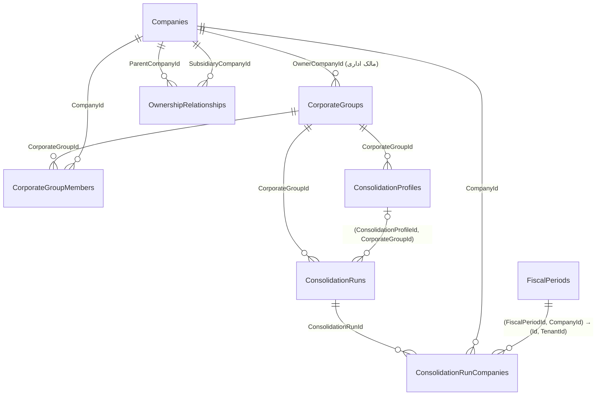

# مدل داده گروه‌های شرکتی و تلفیق

> تصمیم: D-033 (مدل و مرز)، D-034 (گزارش و مجوز). مفاهیم و قواعد: [`CORPORATE_GROUPS.md`](CORPORATE_GROUPS.md). راهبرد Migration عمومی: [`database-migrations.md`](database-migrations.md).

## ۱) نمودار روابط

## ۲) جداول
همه موجودیت‌ها به‌جز `ConsolidationRunCompanies` از `Domain.Seedwork.Entity` ارث می‌برند (`Id` از نوع `uniqueidentifier` بدون مقدار پیش‌فرض دیتابیس، `Ordering`، `InsertDateTime`) تا با الگوی فعلی یکسان باشند. همه کلیدهای خارجی `Restrict` (`ON DELETE NO ACTION` در SQL Server) هستند: سوابق مالی و ممیزی حذف آبشاری نمی‌شوند و غیرفعال‌سازی/پایان بازه جایگزین حذف است.

### `CorporateGroups`
| ستون | نوع | توضیح |
|---|---|---|
| `Code` | `varchar(40)` NOT NULL | یکتا در نصب |
| `Name` | `nvarchar(200)` NOT NULL | |
| `OwnerCompanyId` | `uniqueidentifier` NOT NULL | FK → `Companies.Id`؛ مالک اداری، نه مالک داده اعضا |
| `IsActive` | `bit` NOT NULL | |
| `CreatedAtUtc` | `datetime2` NOT NULL | |
| `CreatedByUserId` | `uniqueidentifier` NOT NULL | بدون FK، هم‌سو با `UserCompanyMemberships.UserId` (D-009/D-029) |
| `UpdatedAtUtc` | `datetime2` NULL | |

ایندکس‌ها: یکتا `(Code)`؛ `(OwnerCompanyId, IsActive)`.

### `CorporateGroupMembers`
| ستون | نوع | توضیح |
|---|---|---|
| `CorporateGroupId` | `uniqueidentifier` NOT NULL | FK → `CorporateGroups` |
| `CompanyId` | `uniqueidentifier` NOT NULL | FK → `Companies` |
| `MemberRole` | `int` NOT NULL | `Parent=1`، `Subsidiary=2`، `Associate=3`، `JointVenture=4`، `ReportingOnly=5` |
| `ValidFrom` | `date` NOT NULL | |
| `ValidTo` | `date` NULL | باز = تا اطلاع ثانوی |
| `CreatedAtUtc`, `CreatedByUserId` | | ممیزی |
| `EndedAtUtc`, `EndedByUserId` | NULL | ممیزی پایان عضویت |

ایندکس‌ها: یکتا `(CorporateGroupId, CompanyId, ValidFrom)` (پشتوانه دیتابیسی ضد تکرار)؛ `(CompanyId)`. CHECK: `ValidTo IS NULL OR ValidTo >= ValidFrom` و `MemberRole BETWEEN 1 AND 5`. عدم هم‌پوشانی بازه‌ها در سرویس با تراکنش `Serializable` کنترل می‌شود (SQL Server محدودیت اعلانی برای هم‌پوشانی بازه ندارد).

### `OwnershipRelationships`
| ستون | نوع | توضیح |
|---|---|---|
| `ParentCompanyId` | `uniqueidentifier` NOT NULL | FK → `Companies` |
| `SubsidiaryCompanyId` | `uniqueidentifier` NOT NULL | FK → `Companies` |
| `OwnershipPercentage` | `decimal(9,6)` NOT NULL | `0..100` |
| `VotingPercentage` | `decimal(9,6)` NOT NULL | `0..100` |
| `ControlBasis` | `int` NOT NULL | `Control=1`، `JointControl=2`، `SignificantInfluence=3`، `Investment=4` |
| `ValidFrom` / `ValidTo` | `date` / `date` NULL | |
| `CreatedAtUtc`, `CreatedByUserId` | | |

ایندکس‌ها: یکتا `(ParentCompanyId, SubsidiaryCompanyId, ValidFrom)`؛ `(SubsidiaryCompanyId)`. CHECK: مادر ≠ فرعی، درصدها بین ۰ و ۱۰۰، `ControlBasis BETWEEN 1 AND 4`، `ValidTo >= ValidFrom`. هم‌پوشانی، جمع درصدها، کنترل یگانه و چرخه کنترلی در سرویس (تراکنش `Serializable`).

### `ConsolidationProfiles`
| ستون | نوع | توضیح |
|---|---|---|
| `CorporateGroupId` | FK → `CorporateGroups` | کلید جایگزین `(Id, CorporateGroupId)` برای FK ترکیبی اجرا |
| `Name` | `nvarchar(120)` | یکتا در گروه |
| `AccountingFramework` | `int` | `IranianNationalStandards=1`، `Ifrs=2` |
| `ReportingCurrencyCode` | `varchar(3)` | کد ISO 4217، مثلاً `IRR`؛ CHECK: سه حرف بزرگ لاتین (مقایسه با `Latin1_General_BIN` تا به Collation دیتابیس وابسته نباشد) |
| `FiscalPeriodMappingPolicy` | `int` | فقط `RequireCoveringPeriod=1` |
| `IsActive`, `CreatedAtUtc`, `CreatedByUserId` | | |

سیاست حذف معاملات درون‌گروهی عمداً ستون ندارد: موتور آن وجود ندارد و ستونی که مصرف نشود فقط تعهد ساختگی است (YAGNI؛ D-006).

### `ConsolidationRuns`
| ستون | نوع | توضیح |
|---|---|---|
| `CorporateGroupId` | FK → `CorporateGroups` | |
| `ConsolidationProfileId` | NULL | FK ترکیبی `(ConsolidationProfileId, CorporateGroupId)` → `ConsolidationProfiles(Id, CorporateGroupId)`؛ پروفایل گروه دیگر در دیتابیس رد می‌شود |
| `Kind` | `int` | `Aggregate=1`، `Consolidated=2` |
| `PeriodStart` / `PeriodEnd` | `date` | CHECK: `PeriodEnd >= PeriodStart`؛ CHECK: اجرای تلفیقی (`Kind = 2`) پروفایل دارد |
| `Status` | `int` | `Pending=1`، `ScopeResolved=2`، `Completed=3` (رزرو موتور)، `Failed=4`، `Cancelled=5` |
| `FailureCode` | `varchar(80)` NULL | کد ماشینی بدون داده حساس |
| `StartedAtUtc` / `CompletedAtUtc` | `datetime2` / NULL | |
| `ExecutedByUserId` | `uniqueidentifier` | |

ایندکس: `(CorporateGroupId, StartedAtUtc)`.

### `ConsolidationRunCompanies`
کلید اصلی `(ConsolidationRunId, CompanyId)`.
| ستون | توضیح |
|---|---|
| `ConsolidationRunId` | FK → `ConsolidationRuns` |
| `CompanyId` | FK → `Companies` |
| `FiscalPeriodId` | FK ترکیبی `(FiscalPeriodId, CompanyId)` → `FiscalPeriods(Id, TenantId)`؛ **دیتابیس دوره شرکت دیگر را نمی‌پذیرد** |
| `MemberRole` | نقش عضویت در لحظه اجرا (تصویر لحظه‌ای) |

نسخه/Hash داده ورودی هر شرکت ستون ندارد چون دفتری برای نسخه‌گذاری وجود ندارد؛ در گام «گزارش تجمیعی» افزوده می‌شود.

### قیدهای CHECK (۱۵ مورد، SQL دستی Migration)
بازه‌ها (`ValidTo >= ValidFrom`، `PeriodEnd >= PeriodStart`)، درصدهای `0..100`، مادر ≠ فرعی، کد ارز سه حرف بزرگ لاتین، اجرای تلفیقی با پروفایل، و بازه مجاز هر ستون Enum (`MemberRole` در دو جدول، `ControlBasis`، `Kind`، `Status`، `AccountingFramework`، `FiscalPeriodMappingPolicy`). فهرست دقیق: `ADD_CORPORATE_GROUPS_EPILOGUE` در `scripts/generate_migrations.py` که گارد CI آن را دقیقاً با Migration مقایسه می‌کند.

### تغییر روی جدول موجود
`FiscalPeriods`: افزودن **کلید جایگزین (UNIQUE CONSTRAINT)** `AK_FiscalPeriods_Id_TenantId` روی `(Id, TenantId)`. چون `Id` کلید اصلی است، این قید روی داده موجود همیشه برقرار است و هیچ ستونی تغییر نمی‌کند؛ هزینه آن ساخت یک ایندکس یکتا روی جدول است (در جدول‌های بزرگ در پنجره نگهداری اجرا شود).

### داده پایه
هشت ردیف کاتالوگ `PermissionDefinitions` (کدهای `CORPORATE_GROUPS.md` بخش ۵) با `IF NOT EXISTS` و شناسه ثابت درج می‌شوند؛ اجرای دوباره اثری ندارد و ردیف موجود با همان کد بازنویسی نمی‌شود. هیچ شرکت، گروه، نقش یا عدد مالی درج نمی‌شود و هیچ مجوزی به نقشی تخصیص داده نمی‌شود (تخصیص تصمیم مدیر هر شرکت است).

## ۳) طرح جداول آینده (`NotImplemented`)
- `ConsolidationAdjustments` (سرآیند: اجرا، شرح، وضعیت تأیید، تأییدکننده، زمان‌ها) و `ConsolidationAdjustmentLines` (حساب گزارش گروه، شرکت طرف، بدهکار/بستانکار `decimal(19,4)`، CHECK یک‌طرفه بودن هر ردیف، توازن در سرویس). به جدول حساب‌ها وابسته است که هنوز وجود ندارد.
- `IntercompanyMatches`: زوج شرکت، حساب‌ها، مبلغ هر طرف، اختلاف، وضعیت تطبیق.
- `GroupAccountMappings`: نگاشت نسخه‌دار حساب شرکت به حساب گزارش گروه در محدوده پروفایل.
- `ExchangeRates`: نرخ `decimal(19,8)`، تاریخ، منبع.
- `ExternalReportingSources` و `ImportedTrialBalanceSnapshots` (D-035).

## ۴) راهبرد Migration
- Migration افزایشی `20261022150943_AddCorporateGroups` (بعد از `WidenUserPasswordHash`): فقط `CREATE TABLE`، `CREATE INDEX`، یک `ADD CONSTRAINT UNIQUE` روی `FiscalPeriods`، قیدهای CHECK و درج idempotent کاتالوگ مجوز. هیچ `DROP`، `ALTER COLUMN` یا تغییر داده موجود ندارد.
- Migrationهای قبلی بازنویسی نشدند. چون شبیه‌ساز پایتونی مخزن `CreateTable` نمی‌سازد، خود Migration با `dotnet ef migrations add` نوشته شد، SQL دستی به آن افزوده شد و فایل Designer و Snapshot با `scripts/generate_migrations.py` تولید شدند؛ گاردها برای بررسی جداول جدید گسترش یافتند (جزئیات و جدول تغییرات ابزار: `database-migrations.md` بخش `AddCorporateGroups`).
- برنامه در Production خودش Migration اعمال نمی‌کند (`Database:ApplyMigrations=false`)؛ اعمال با اسکریپت بازبینی‌شده `dotnet ef migrations script --idempotent` و پشتیبان‌گیری قبلی.
- بازگشت: `Down` جداول جدید و قید `FiscalPeriods` را حذف می‌کند؛ ردیف‌های کاتالوگ مجوز را **حذف نمی‌کند** اگر به نقشی تخصیص داده شده باشند (حذف فقط ردیف‌های بدون تخصیص).
