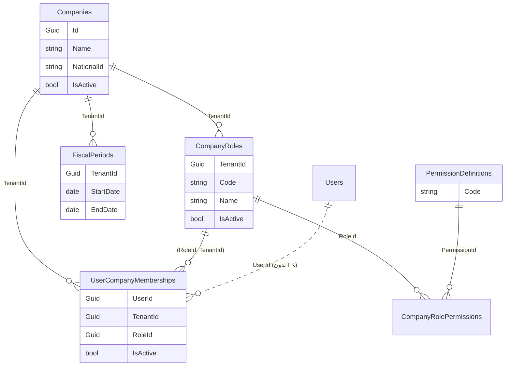
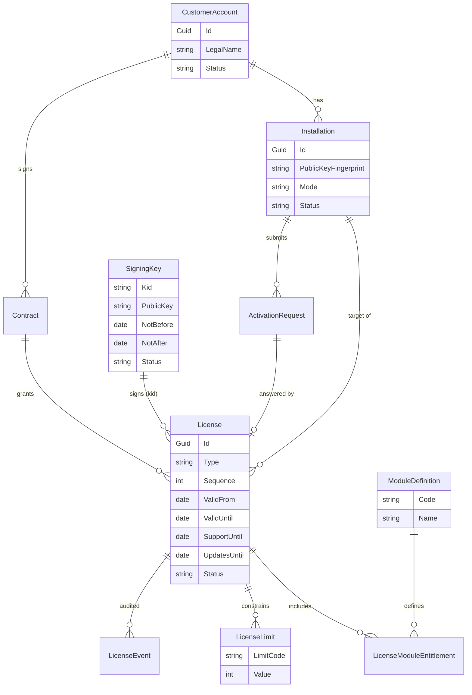
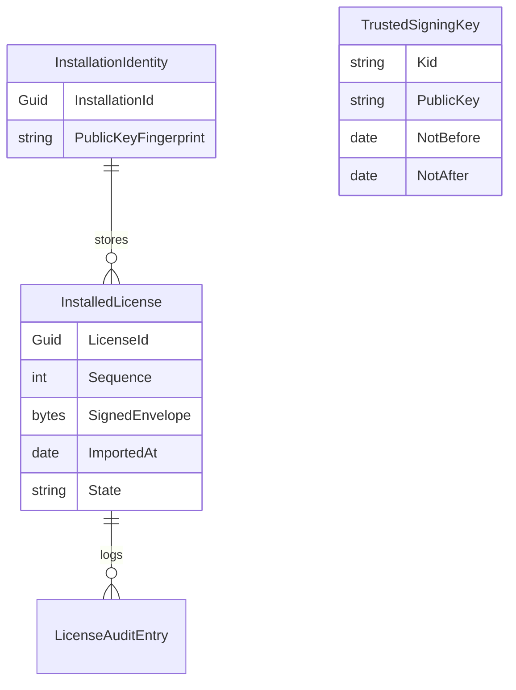
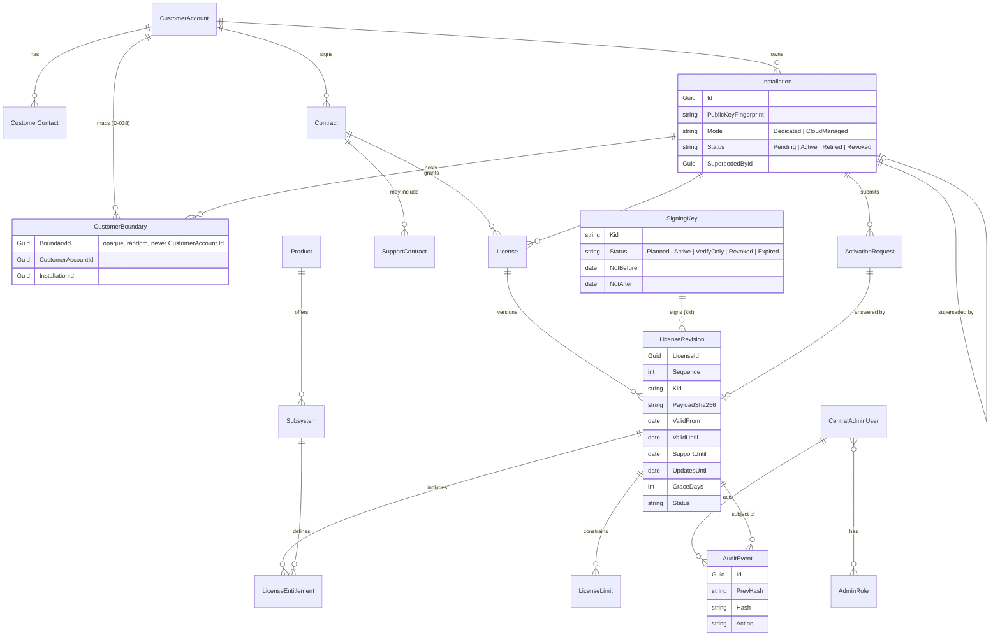

# مدل داده لایسنس و تفکیک جداول واقعی از پیشنهادی

> جداول بخش «واقعی» از `Infrastructure/Persistence/Configurations/*` و Migrationهای `main` (commit `1d39dbf`) استخراج شده‌اند. جداول بخش «پیشنهادی» **وجود ندارند** (`NotImplemented`) و تا تأیید کارفرما Migration برایشان نوشته نمی‌شود (D-020..D-025).

## ۱) جداول واقعی مرتبط با Tenant و دسترسی (`Implemented`)

نکات (مبتنی بر کد):
- خط‌چین `Users → UserCompanyMemberships`: ستون `UserId` **کلید خارجی ندارد** (فقط FK به `Companies` و ترکیبی `(RoleId, TenantId)`).
- `SecurityAuditEvent` جدول ممیزی امنیتی است و در نمودار برای سادگی نیامده است.
- هیچ Global Query Filter وجود ندارد؛ جداسازی با `CompanyAccessService` و فیلتر صریح است (D-013).
- نام دقیق ستون‌ها/جدول‌ها را قبل از استفاده از Migration/Configuration تأیید کنید؛ نمودار خلاصه است.

## ۲) جداول پیشنهادی (`Proposed`، `NotImplemented`)

### الف) دیتابیس سامانه فروشنده (جدا از دیتابیس نصب مشتری)

### ب) دیتابیس نصب مشتری (حداقلی؛ بدون داده تجاری فروشنده)

کلید خصوصی نصب در دیتابیس عادی ذخیره نمی‌شود مگر محافظت‌شده؛ محل ذخیره `NeedsApproval` (D-027). `LicenseAuditEntry` می‌تواند از `SecurityAuditEvent` موجود استفاده کند (تصمیم در ADR آتی).

## ۳) ابهام‌ها و تصمیم‌های لازم

| موضوع | وضعیت |
|---|---|
| نگاشت `PermissionDefinition` به `ModuleCode` (ستون یا کاتالوگ ثابت) | `NeedsApproval` (D-025) |
| رابطه `Company` ابری با `CustomerAccount` (ستون ارجاعی یا جدول رابط در دیتابیس ابری) | **تعیین‌تکلیف‌شده با D-038 (2026-10-23):** ستون ارجاعی به `CustomerAccount` ساخته **نمی‌شود**؛ فقط شناسه مرز مات و تصادفی `Companies.CustomerBoundaryId` (هرگز برابر `CustomerAccount.Id`). نگاشت `CustomerAccount` ← (نصب، مرز) فقط در سامانه کنترلی فروشنده است: `NotImplemented` |
| محل ذخیره کلید خصوصی نصب | انتخاب provider طبق D-058/OD-08 پذیرفته شده؛ recovery و انتقال همچنان باز است |
| جایگزینی/اصلاح FK برای `UserCompanyMemberships.UserId` | تصمیم جداگانه؛ بدون اثر بر این طرح |
| لایسنس در سطح نصب یا شرکت (پیش‌فرض: نصب) | `NeedsApproval` |

## ۴) قواعد داده‌ای

- هیچ ستون یا FK از جداول نصب مشتری به جداول فروشنده نیست.
- تاریخچه لایسنس‌ها و رخدادها حذف نمی‌شود؛ تغییر وضعیت با رخداد ثبت می‌شود.
- انقضا یا ابطال هرگز ردیف داده حسابداری را حذف/تغییر نمی‌دهد (D-026).

## ۵) تکمیل فاز صفر — 2026-10-24 (`Proposed`، `NotImplemented`)

> این بخش ERD بخش ۲-الف را **جایگزین** می‌کند (در تعارض نام‌ها `LicenseRevision`/`AuditEvent` به‌جای فیلدهای `License`/`LicenseEvent` بخش ۲-الف ملاک است؛ بخش ۲-ب و جداول واقعی بخش ۱ بدون تغییرند). `License` فیلد `Type` (`Perpetual` | `Term`، D-022 بند ۱) را دارد؛ `LicenseRevision` بازه‌ها و `Sequence` را. هیچ جدول، ستون یا Migration ساخته نشده است. نام‌ها پیشنهادی‌اند و پیش از Migration با مالک محصول نهایی می‌شوند (D-041 بند ۵). نام `Activation` خالی عمداً به کار نرفته تا با سازوکار قدیمی `ActivationKeys` (D-028، کد مرده) اشتباه نشود؛ نام پیشنهادی `ActivationRequest`.

### الف) ERD تکمیلی دیتابیس فروشنده

### ب) فهرست موجودیت‌ها، ضرورت و مالکیت

| موجودیت | ضروری؟ | مالک داده | روابط و توضیح |
|---|---|---|---|
| `CustomerAccount` | بله | فروشنده | مشتری تجاری فرانو (خریدار). با شرکت حسابداری مشتری یکی **نیست** (D-020). |
| `CustomerContact` | بله (برای قرارداد و اطلاع‌رسانی) | فروشنده | n:1 به `CustomerAccount`. اطلاعات تماس کمینه؛ حساب ورود نیست و هرگز به نصب مشتری نمی‌رود. |
| `Product` | بله | فروشنده | محصول قابل فروش (مثلاً نرم‌افزار حسابداری فرانو). 1:n به `Subsystem`. |
| `Subsystem` (در ERD قدیم: `ModuleDefinition`) | بله | فروشنده | کد پایدار؛ فهرست نهایی `NeedsApproval` (OD-02، OD-15). |
| `Contract` | بله | فروشنده | n:1 به `CustomerAccount`؛ 1:n به `License`. |
| `SupportContract` | بله (حق پشتیبانی/به‌روزرسانی مستقل از حق استفاده است، D-022) | فروشنده | تاریخ شروع/پایان، دامنه، وضعیت. مقادیر `supportUntil`/`updatesUntil` هنگام صدور از آن به Payload کپی می‌شوند. |
| `License` | بله | فروشنده | هویت پایدار لایسنس (`licenseId`)؛ n:1 به `Contract` و به `Installation` هدف. |
| `LicenseRevision` | بله | فروشنده | هر صدور، تغییر، تمدید یا تعلیق یک نسخهٔ **تغییرناپذیر** با `sequence` یکنواخت، `kid`، هش بایت‌های Payload و بازه‌های اعتبار. نسخه‌ها ویرایش یا حذف نمی‌شوند (D-022 بند ۴). |
| `LicenseEntitlement` (قدیم: `LicenseModuleEntitlement`) | بله | فروشنده | زیرسیستم‌های فعال‌شده در هر نسخه. |
| `LicenseLimit` | بله | فروشنده | سقف‌ها (حداقل `maxCompanies`؛ `maxUsers` `Deferred`). |
| `Installation` | بله | فروشنده (ثبت) + نصب (هویت محلی) | مالک مستقیم (`CustomerAccount`) فقط برای نصب `Dedicated` و تهی‌پذیر است؛ در نصب `CloudManaged` چندمشتری تنها مرجع، `CustomerBoundary` است و دو منبع نباید ناسازگار باشند؛ اثرانگشت کلید عمومی؛ وضعیت؛ پیوند «جایگزین‌شده با» برای اتصال مجدد (OD-06). |
| `ActivationRequest` | بله | فروشنده | درخواست دریافت‌شده (آفلاین یا آنلاین) با `requestId` یک‌بارمصرف و نتیجه؛ n:1 به `Installation`، 0..1 به نسخهٔ لایسنس پاسخ. |
| `CustomerBoundary` | بله (برای ابر مشترک و نگاشت D-038) | فروشنده | نگاشت `BoundaryId` مات ← (`CustomerAccount`، `Installation`) با یکتایی (`CustomerAccountId`، `InstallationId`) طبق D-038 و **تنها مرجع** مالکیت در ابر مشترک؛ تولیدکنندهٔ `BoundaryId` (فروشنده یا اپراتور نصب) `NeedsApproval` است. در دیتابیس نصب فقط `Companies.CustomerBoundaryId` است؛ هیچ FK یا ستون ارجاعی به `CustomerAccount` در نصب ساخته نمی‌شود. |
| `SigningKey` | بله | کلید عمومی: فروشنده + نصب؛ کلید خصوصی: فقط محیط امن فروشنده | چرخهٔ عمر: برنامه‌ریزی‌شده، فعال، فقط-تأیید (کلید بازنشسته که لایسنس‌های قبلی را هنوز تأیید می‌کند)، ابطال‌شده، منقضی. |
| `CentralAdminUser` و `AdminRole` | بله | فروشنده | هویت جدا، MFA، نقش‌ها (D-043). هرگز ردیف `Users` نصب نیست (D-029). |
| `AuditEvent` | بله | فروشنده | Append-only با زنجیرهٔ هش (D-043). |

### پ) جداول سمت نصب مشتری (تکمیل بخش ۲-ب)

| موجودیت | محتوا | یادداشت |
|---|---|---|
| `InstallationIdentity` | `InstallationId`، اثرانگشت کلید عمومی | کلید خصوصی در ستون عادی ذخیره نمی‌شود؛ محل: OD-08. |
| `InstalledLicense` | پاکت امضاشده، `Sequence`، تاریخ ورود، وضعیت | فقط آخرین نسخهٔ معتبر + تاریخچه برای ممیزی. |
| `TrustedSigningKey` | `Kid`، کلید عمومی، بازهٔ اعتبار، امضای ریشه | فقط کش «بستهٔ اعتماد»: ردیفی که با کلید ریشهٔ داخل برنامه امضا نشده باشد نادیده گرفته می‌شود (T29)؛ چرخش: OD-07. |
| `LicenseAuditEntry` | رخدادهای ورود/رد/تغییر وضعیت | ممیزی محلی؛ انتخاب بین جدول جدا و `SecurityAuditEvent` در ADR آتی. |
| `LicenseTimeHighWater` | بیشینهٔ زمان مشاهده‌شده | برای «ساعت مؤثر» (OD-05). |
| `CustomerOfflineRevocationState` | آخرین sequence، payload digest، revoked IDs، previous/current TPM anchor digest، generation و envelope امضاشده؛ pending envelope برای recovery | فقط دیتابیس همان نصب مشتری؛ singleton با RowVersion؛ migration مستقل `20261031120000_AddCustomerOfflineRevocationState`. TPM NV Extend hash-chain خارج از backup دیتابیس است (D-057). |
 
### ت) قواعد مالکیت داده

- **داده حسابداری، کاربران و شرکت‌های مشتری:** فقط در دیتابیس نصب؛ هرگز در فروشنده.
- **داده تجاری (مشتری، قرارداد، قیمت، تماس):** فقط در فروشنده؛ هرگز در نصب. در پاکت فقط `customerRef` مات و کمینه است.
- **کلید خصوصی صدور:** فقط محیط امن فروشنده (OD-07). **کلید خصوصی نصب:** فقط همان نصب (OD-08). کلید عمومی هر دو طرف در هر دو سو مجاز است.
- **ارتباط `Company` با `CustomerAccount`:** فقط از مسیر `CustomerBoundary` در فروشنده و `Companies.CustomerBoundaryId` مات در نصب؛ مستقیم هرگز (D-038). یک `CustomerAccount` می‌تواند چند `Installation` و در هر نصب چند `Company` داشته باشد (D-020).
- هیچ ستون یا FK از جداول نصب مشتری به جداول فروشنده نیست (بخش ۴ همین سند).

## ۶) طرح تکمیلی Issue #384 — persistence فعال‌سازی restart-safe (Approved behavior; schema in PR #387)
مالک محصول رفتار restart-safe، الزام reactivation پس از تغییر OS-installation identity و ایجاد جداول مشتری را تأیید کرده است. طرح schema در PR #387 در حال بررسی CI است؛ تا merge و migration test، روی main اعمال‌شده محسوب نمی‌شود.

### موجودیت‌های مشتری
- InstallationIdentity: تاریخچهٔ نسخه‌دار کلیدهای هویت نصب شامل InstallationId، OS-installation marker digest، public-key fingerprint و SPKI، KeyId/KeyVersion، ProviderName، AssuranceLevel (`HardwareTpm` یا `SoftwareProtected`)، زمان/فاعل تأیید ریسک نرم‌افزاری (در صورت انتخاب)، State، LastVerifiedAtUtc و RowVersion. برای هر InstallationId فقط یک ردیف Current با filtered unique index مجاز است؛ نسخه‌های Retired حفظ می‌شوند. هیچ private key یا secret در جدول ذخیره نمی‌شود. انتخاب SoftwareProtected فقط پس از تأیید صریح و ثبت زمان/عامل مجاز است.
- InstalledLicense: تاریخچهٔ پاکت‌های معتبر شامل InstallationIdentityId، LicenseId، Sequence، InstallationId، Kid، Algorithm، PayloadJson دقیق امضاشده، SignatureBase64، EnvelopeJson اصلی، PayloadDigest، زمان import، State (Current/Superseded) و RowVersion. قید FK با DeleteBehavior.Restrict به InstallationIdentity؛ unique index روی (InstallationId, Sequence) و (LicenseId, Sequence)، و filtered unique index برای یک Current به ازای هر InstallationId. پاکت نامعتبر در این جدول ذخیره نمی‌شود و فقط رخداد رد در audit ثبت می‌شود.
- جایگزینی license در تراکنش: ابتدا signature، trusted key، payload، installation binding، sequence، time و revocation اعتبارسنجی می‌شود؛ سپس رکورد قبلی Current به Superseded و رکورد جدید به Current تبدیل و audit ثبت می‌شود. unique filtered index و RowVersion رقابت همزمان را مهار می‌کنند؛ تاریخچه حذف نمی‌شود.
- restart فقط state را load و دوباره verify می‌کند؛ فایل ورودی دوباره درخواست نمی‌شود مگر نصب identity mismatch/خرابی state/recovery کنترل‌شده.
- CustomerOfflineRevocationState از D-057 مستقل باقی می‌ماند؛ InstalledLicense جایگزین revocation state store نیست.

### هویت OS و کلید نصب
- MachineGuid به‌تنهایی نه راز است و نه اثبات سخت‌افزاری؛ فقط marker کمکی است.
- طراحی باید marker نصب ویندوز را با کلید نصب non-exportable و امضای challenge/اثبات possession bind کند. Private key در DB، backup عادی، log یا package قرار نمی‌گیرد.
- نصب مجدد OS با marker جدید، حتی اگر سخت‌افزار ثابت باشد، activation جدید می‌خواهد. patch/update عادی که marker نصب را حفظ کند، activation را حفظ می‌کند.
- Migration افزایشی مشتری `20261031130000_AddCustomerLicensePersistence` در PR #387 افزوده شده است؛ هیچ جدول Vendor تغییر نمی‌کند. recovery و re-enrollment پس از فقدان کلید همچنان تابع OD-06/OD-08 است.

## ۹) تکمیل مدل بر اساس D-059 — Company-scoped entitlements

- Installation یک Base License/LicenseId دارد؛ Revision یا Amendment تغییرات افزونه را به همان LicenseId و Installation متصل می‌کند و sequence را strictly increasing نگه می‌دارد.
- maxCompanies در scope نصب باقی می‌ماند. UserSeat، Module و Feature در scope هر Company نگهداری/ارزیابی می‌شوند.
- Feature entitlement نوع‌دار است (enabled، max_count یا enum) و کاتالوگ آن توسعه‌پذیر است. کدهای نمونه: analytic account levels/count، cost centers، budgeting، warehouses و POS.
- Seat count بر اساس عضویت فعال هر Company محاسبه می‌شود؛ یک User در دو Company دو Seat مصرف می‌کند.
- کاهش حد، هیچ داده یا عضویت موجودی را حذف نمی‌کند. وضعیت over-limit قابل گزارش است؛ ایجاد/افزایش جدید تا رفع overage رد می‌شود.
- Offline از آخرین envelope/amendment معتبر و پذیرفته‌شده استفاده می‌کند؛ sync آنلاین یا فایل امضاشده است و telemetry دارای LastSyncedAt/freshness است.
- این بخش مدل منطقی مصوب است؛ schema/EF entities/migration فقط در Issues #390–#394 با بررسی جداگانه و Customer/Vendor DB boundary مناسب ایجاد می‌شوند. D-059 به‌تنهایی مجوز migration نیست.

## ۹) مدل پیشنهادی برای سه حوزه و Activation Wizard (D-060) — NotImplemented

این بخش مدل مفهومی است، نه مجوز ساخت Migration. نام جدول/Entity نهایی باید در Issueهای کدنویسی و با بررسی مدل موجود تثبیت شود.

### 9.1 Vendor CRM & Commercial
- CustomerAccount — طرف تجاری/خریدار.
- CustomerContact — مخاطب مجاز تجاری/فنی (بدون credential مشتری).
- CommercialContract — قرارداد، دوره، شرایط و پشتیبانی.
- SalesOrder و SalesOrderLine — خرید پایه یا add-on برای Installation/Company.
- PaymentRecord / PaymentAllocation — پرداخت و تطبیق؛ مرجع مالی تجاری، نه دفتر حسابداری مشتری.
- SupportEntitlement / SupportCase — سطح/تاریخ پشتیبانی و سابقه درخواست.

### 9.2 Licensing & Entitlement Engine
- InstallationLicense — یک LicenseId پایه برای Installation.
- LicenseRevision / LicenseAmendment — sequence و payload امضاشدهٔ revisionهای همان LicenseId.
- CompanyEntitlement — نگاشت opaque Company reference به سقف‌ها/ماژول‌ها/Featureها/Seat.
- FeatureDefinition — کاتالوگ پایدار و type-safe Featureها.
- LicenseRevocation / SigningKeyReference / EntitlementAudit — وضعیت ابطال، شناسه provider کلید و ممیزی؛ private key در DB ذخیره نمی‌شود.

### 9.3 Customer Deployment & Sync
- InstallationIdentity / InstalledLicense — موجودیت‌های Customer موجود/در حال تکمیل در #384؛ وضعیت دقیق کد باید در PRها بررسی شود.
- ActivationRequest — nonce، request ID، Installation binding، public-key fingerprint، schema version، expiry و وضعیت پردازش؛ private key ندارد.
- ActivationReceipt / SyncAcknowledgement — ACK امضاشده و idempotency key/hash/sequence.
- CompanySetupRecord — پیوند opaque entitlement reference به Company محلی و وضعیت setup؛ نباید credential در آن ذخیره شود.
- SyncCheckpoint — LastSyncedAt، sequence/cursor و freshness metadata؛ payload telemetry باید حداقلی و قابل ممیزی باشد.

### 9.4 مرز هویت و رمز
User/Identity در Customer Host محلی است. برای هر Company می‌توان مدیر اولیه جدا و membership مستقل ایجاد کرد؛ یک User می‌تواند در چند Company عضویت داشته باشد. Password فقط به شکل ASP.NET Core Identity hash در store موجود Customer ذخیره می‌شود. هیچ Password، password hash، refresh token یا credential در Vendor Commercial tables یا request/license/ACK files قرار نمی‌گیرد.

**وضعیت:** همه موارد بالا به‌جز موجودیت‌های صریحاً ذکرشده در کد فعلی، صرفاً مدل پیشنهادی و NotImplemented هستند؛ قبل از هر DDL باید schema فعلی، روابط، unique constraints، tenant isolation و migration rollout جداگانه بررسی و تأیید شوند.
