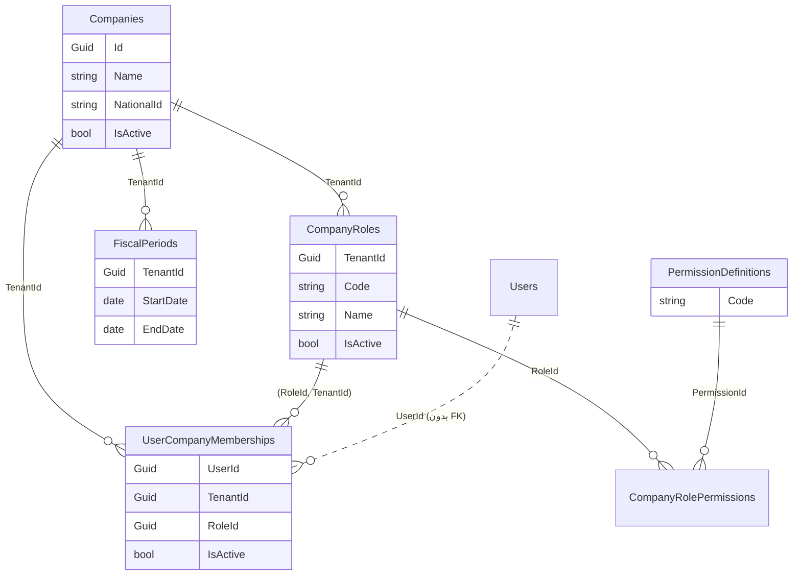
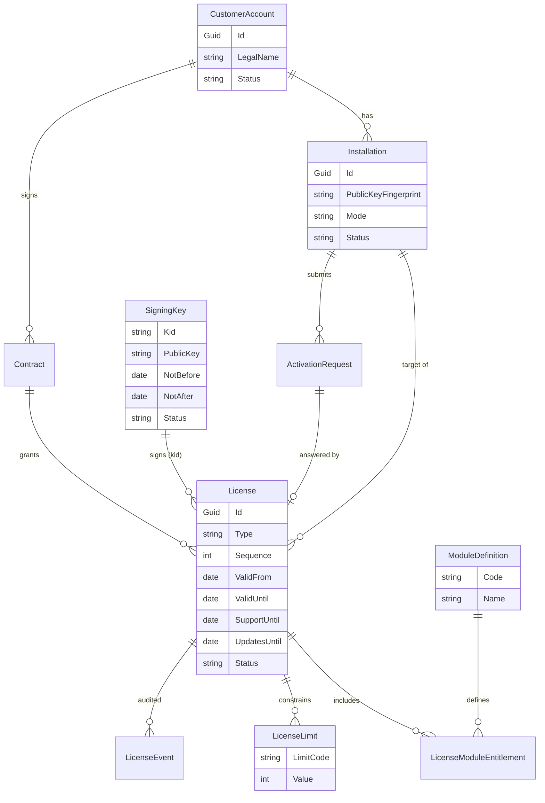
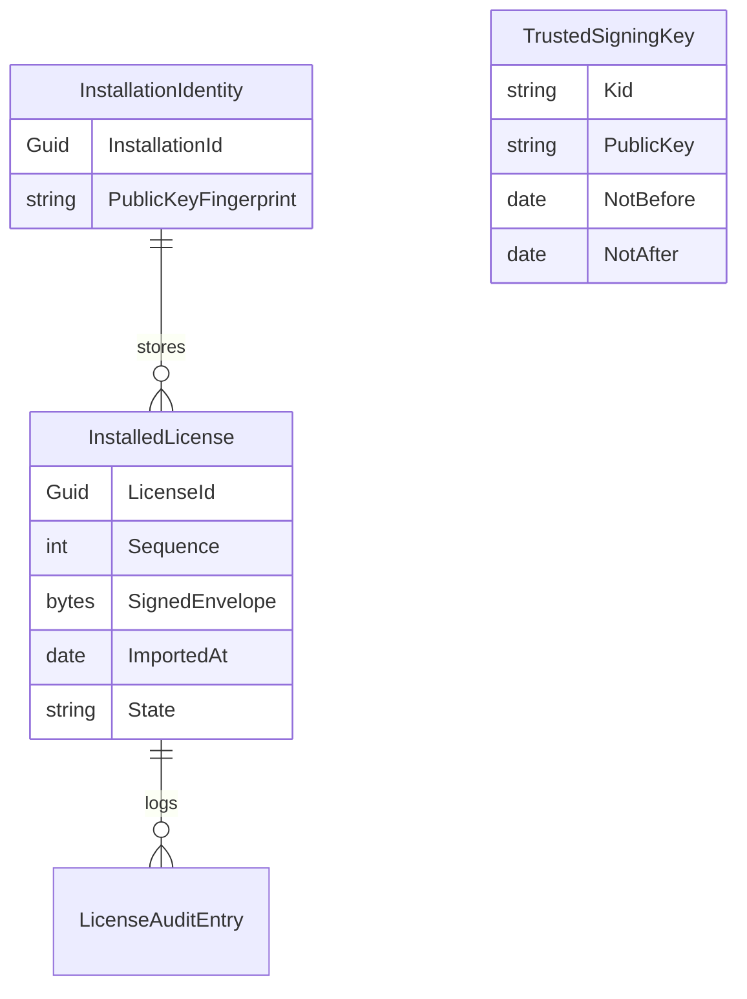

# مدل داده لایسنس و تفکیک جداول واقعی از پیشنهادی

> جداول بخش «واقعی» از `Infrastructure/Persistence/Configurations/*` و Migrationهای `main` (commit `1d39dbf`) استخراج شده‌اند. جداول بخش «پیشنهادی» **وجود ندارند** (`NotImplemented`) و تا تأیید کارفرما Migration برایشان نوشته نمی‌شود (D-020..D-025).

## ۱) جداول واقعی مرتبط با Tenant و دسترسی (`Implemented`)

نکات (مبتنی بر کد):
- خط‌چین `Users → UserCompanyMemberships`: ستون `UserId` **کلید خارجی ندارد** (فقط FK به `Companies` و ترکیبی `(RoleId, TenantId)`).
- `SecurityAuditEvent` جدول ممیزی امنیتی است و در نمودار برای سادگی نیامده است.
- هیچ Global Query Filter وجود ندارد؛ جداسازی با `CompanyAccessService` و فیلتر صریح است (D-013).
- نام دقیق ستون‌ها/جدول‌ها را قبل از استفاده از Migration/Configuration تأیید کنید؛ نمودار خلاصه است.

## ۲) جداول پیشنهادی (`Proposed`، `NotImplemented`)

### الف) دیتابیس سامانه فروشنده (جدا از دیتابیس نصب مشتری)

### ب) دیتابیس نصب مشتری (حداقلی؛ بدون داده تجاری فروشنده)

کلید خصوصی نصب در دیتابیس عادی ذخیره نمی‌شود مگر محافظت‌شده؛ محل ذخیره `NeedsApproval` (D-027). `LicenseAuditEntry` می‌تواند از `SecurityAuditEvent` موجود استفاده کند (تصمیم در ADR آتی).

## ۳) ابهام‌ها و تصمیم‌های لازم

| موضوع | وضعیت |
|---|---|
| نگاشت `PermissionDefinition` به `ModuleCode` (ستون یا کاتالوگ ثابت) | `NeedsApproval` (D-025) |
| رابطه `Company` ابری با `CustomerAccount` (ستون ارجاعی یا جدول رابط در دیتابیس ابری) | `NeedsApproval` |
| محل ذخیره کلید خصوصی نصب | `NeedsApproval` |
| جایگزینی/اصلاح FK برای `UserCompanyMemberships.UserId` | تصمیم جداگانه؛ بدون اثر بر این طرح |
| لایسنس در سطح نصب یا شرکت (پیش‌فرض: نصب) | `NeedsApproval` |

## ۴) قواعد داده‌ای

- هیچ ستون یا FK از جداول نصب مشتری به جداول فروشنده نیست.
- تاریخچه لایسنس‌ها و رخدادها حذف نمی‌شود؛ تغییر وضعیت با رخداد ثبت می‌شود.
- انقضا یا ابطال هرگز ردیف داده حسابداری را حذف/تغییر نمی‌دهد (D-026).
