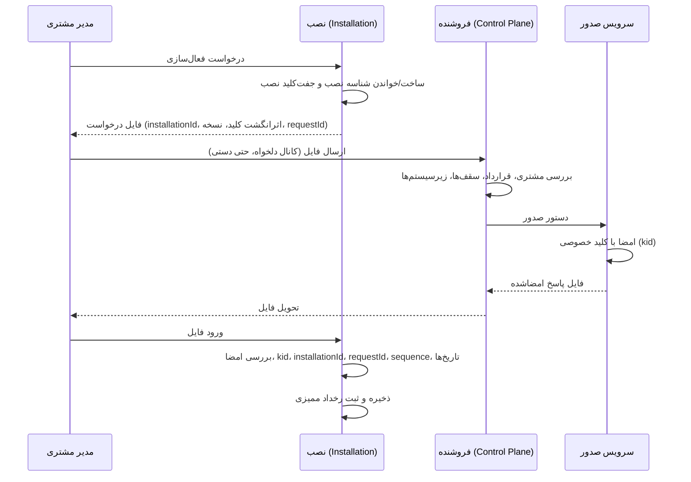
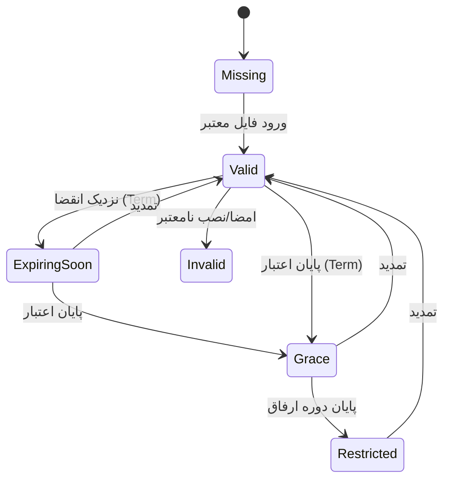
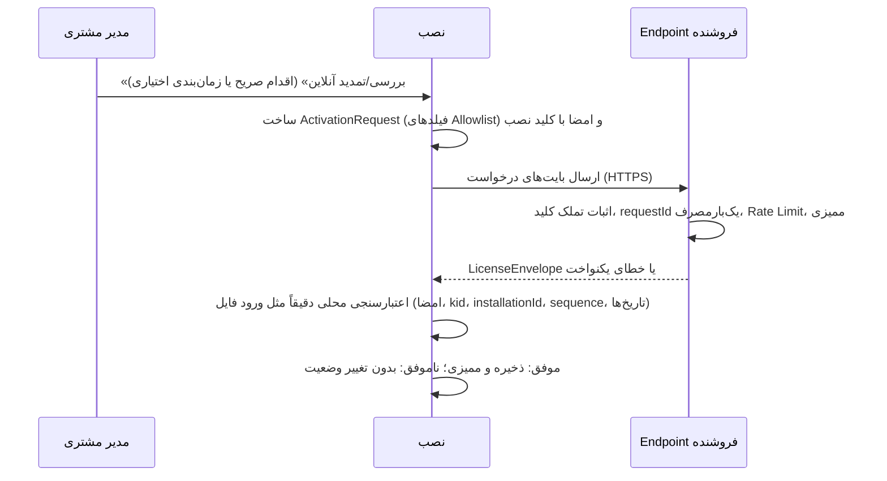
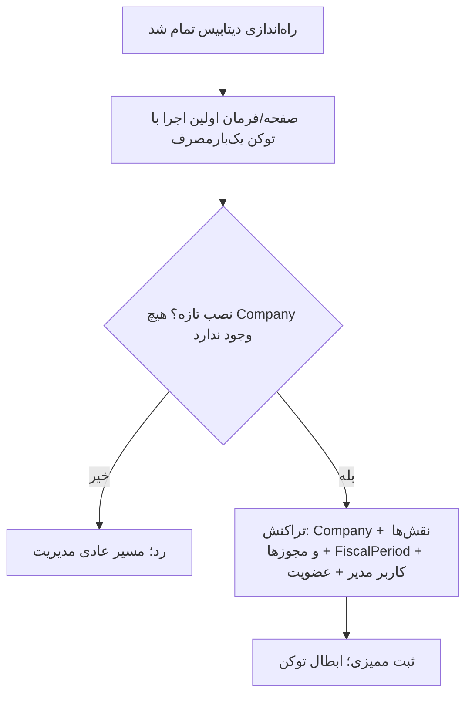

# گردش‌کارهای لایسنس (طرح هدف)

> همه گردش‌کارها `NotImplemented` هستند (D-023..D-027). هیچ‌کدام ادعای پیاده‌سازی یا تست‌شدن ندارند.

## ۱) فعال‌سازی اولیه آفلاین

## ۲) تمدید

مانند فعال‌سازی ولی با `sequence` بزرگ‌تر و بدون تغییر `installationId`. پیش از انقضا هشدار نمایش داده می‌شود. فایل با `sequence` کمتر یا مساوی رد می‌شود.

## ۳) چرخه عمر وضعیت لایسنس در نصب

- `Perpetual`: انقضای حق استفاده ندارد؛ پایان پشتیبانی/به‌روزرسانی وضعیت را به `Restricted` نمی‌برد.
- در `Restricted`: مشاهده، گزارش، **خروجی/پشتیبان‌گیری**، ورود لایسنس مجاز؛ ثبت/ویرایش/تأیید در زیرسیستم‌های مشمول ممنوع (D-026).
- دوره ارفاق پیش‌فرض ۳۰ روز قابل تنظیم (`NeedsApproval`).

## ۴) ایجاد شرکت

1. کاربر ایجاد شرکت می‌خواهد.
2. سرور مجوز عملیاتی را می‌سنجد (D-025).
3. سرور لایسنس معتبر و `maxCompanies` را می‌سنجد.
4. در صورت رد: پاسخ خطای قابل فهم؛ داده موجود دست‌نخورده.

## ۵) تعویض سخت‌افزار / بازیابی

- با کلید نصب در Backup: بازیابی و ادامه کار.
- بدون کلید: درخواست «اتصال مجدد»؛ تأیید هویت؛ صدور لایسنس جدید؛ بازنشستگی شناسه قدیمی با ممیزی (D-027؛ `NeedsApproval`).

## ۶) چرخش کلید امضا

فروشنده کلید جدید با `kid` جدید می‌سازد؛ کلید عمومی در نسخه جدید نرم‌افزار یا با فایل اعتماد امضاشده به نصب‌ها می‌رسد؛ لایسنس‌های قبلی تا انقضا معتبر می‌مانند (جزئیات `NeedsApproval`).

## ۷) تعلیق/ابطال

در سامانه فروشنده ثبت می‌شود و فقط با فایل جدید یا ارتباط مجدد به نصب می‌رسد؛ تعلیق فوری نصب آفلاین ممکن نیست (D-023).

## ۸) فعال‌سازی و تمدید آنلاین (فاز صفر 2026-10-24، `Proposed`؛ D-042)

قالب و اعتبارسنج همان آفلاین است؛ فقط حمل تغییر می‌کند.

- شکست شبکه یا فروشنده هرگز وضعیت لایسنس فعلی را تغییر نمی‌دهد و عملیات حسابداری را نمی‌بندد.
- در درخواست هیچ داده حسابداری، کاربر یا شرکت نیست.

## ۹) انتقال، بازیابی و اتصال مجدد (`Proposed`؛ D-027، OD-06)

| سناریو | کلید نصب در دسترس؟ | روند | اقدام فروشنده | ممیزی |
|---|---|---|---|---|
| تعویض سخت‌افزار با Backup کامل | بله | بازیابی روی سرور جدید؛ همان شناسه و کلید؛ لایسنس همچنان معتبر | هیچ | نصب: رخداد بازیابی؛ در تماس بعدی فروشنده می‌تواند ببیند |
| بازیابی دیتابیس بدون کلید نصب | خیر | «اتصال مجدد»: کلید و `installationId` **جدید**، فایل درخواست | تأیید هویت مشتری؛ بازنشستگی نصب قدیمی (`Retired`، پیوند «جایگزین‌شده با»)؛ صدور لایسنس جدید برای کلید جدید | رخداد فروشنده با تأییدکنندهٔ دوم (D-043) |
| کپی ماشین (هر دو نسخه کلید دارند) | بله | قابل جلوگیری یا تشخیص آفلاین نیست (T6) | در صورت ارتباط آنلاین هر دو، فروشنده دو درخواست با یک `installationId` می‌بیند و علامت می‌گذارد | رخداد «شناسهٔ تکراری» |
| لایسنس دائمی نصب قدیمی بعد از اتصال مجدد | بله (کلید قدیمی) | آفلاین ابطال‌شدنی نیست؛ محدودیت پذیرفته و در قرارداد اعلام می‌شود | ثبت بازنشستگی؛ پیگیری حقوقی/قراردادی | — |

## ۱۰) ساعت سیستم و «ساعت مؤثر لایسنس» (`Proposed`؛ OD-05)

1. هر ارزیابی لایسنس فقط از `TimeProvider` تزریق‌شده می‌خواند (امروز مسیر زمان یکدست نیست؛ ر.ک. `OD-05`).
2. `ساعت مؤثر = max(ساعت سیستم، LicenseTimeHighWater، issuedAt آخرین لایسنس معتبر)`. این مقدار در هر ارزیابی و هر نوشتن ممیزی به‌روز می‌شود و هرگز کاهش نمی‌یابد.
3. اگر `ساعت سیستم` از `LicenseTimeHighWater` بیش از آستانهٔ تحمل (پیشنهاد: ۲۴ ساعت) عقب‌تر باشد: رخداد ممیزی + هشدار به مدیر؛ ارزیابی با «ساعت مؤثر» ادامه می‌یابد. این رفتار قفل‌کننده نیست.
4. جهش بزرگ رو به جلو نیز ثبت می‌شود (احتمال خرابی ساعت)؛ لایسنس دائمی تحت تأثیر قرار نمی‌گیرد. برای جلوگیری از قفل دائمی با یک پرش تصادفی (مثلاً سال 2099)، پیشروی `LicenseTimeHighWater` در هر ارزیابی سقف دارد (پیشنهاد: ۴۸ ساعت)؛ پرش بزرگ‌تر فقط پس از تأیید صریح مدیر پذیرفته می‌شود و ورود لایسنس تازهٔ امضاشده آن را بازنشانی می‌کند.
5. **محدودیت:** بازگردانی کامل دیتابیس/ماشین `LicenseTimeHighWater` را هم به عقب می‌برد؛ در آفلاین قابل کشف نیست (T5).
6. زمان معتبر آنلاین (NTP یا فروشنده) فقط اختیاری و هرگز الزام نیست.

## ۱۱) ساخت اولین شرکت و مدیر (`Proposed`؛ D-044، OD-14)

- توکن: فقط روی کنسول سرور یا فایل با مجوز مالک‌تنها، ذخیرهٔ هش‌شده، انقضای کوتاه، مصرف در همان تراکنش؛ شرط بازبودن، نشانگر دائمی «راه‌اندازی‌نشده» است (نه صرفاً نبود `Company`)؛ Rate Limit روی تلاش‌ها.
- بدون رمز ثابت؛ رمز اولیه توسط مدیر تعیین می‌شود (حداقل طول مطابق سیاست `PasswordHashService`/Master).
- در حالت لایسنس `Missing` ساخت شرکت اول مجاز است؛ سقف `maxCompanies` پس از ورود لایسنس اعمال می‌شود.

## ۱۲) معرفی تدریجی لایسنس برای نصب‌های موجود (`Proposed`؛ D-044، OD-10)

| حالت `EnforcementMode` | رفتار | شرط ورود |
|---|---|---|
| `Off` | هیچ ارزیابی؛ رفتار امروز | پیش‌فرض نسخه‌های پیش از L3 |
| `Observe` | ارزیابی و ممیزی؛ بدون هیچ محدودیت | نخستین نسخهٔ دارای ماژول لایسنس |
| `Enforce` | سیاست کامل (حالت محدود، سقف‌ها)؛ از نسخهٔ اعمال به بعد حداقل ثابت در کد است و فقط لایسنس امضاشده می‌تواند آن را پایین بیاورد (T28) | تأیید مالک + لایسنس اولیه صادرشده برای مشتریان موجود |

بازگشت از `Enforce` به `Observe` با پیکربندی ممکن است و هیچ داده‌ای را تغییر نمی‌دهد.

## ۱۳) جلوگیری از دورزدن سقف شرکت و زیرسیستم از طریق API (`Proposed`؛ D-025)

1. یک نقطهٔ سیاست سمت سرور (مثلاً فیلتر Endpoint یا سیاست Authorization) پیش از اجرای هر عملیات شرکت‌/زیرسیستم‌دار؛ بررسی پراکنده ممنوع است.
2. ورودی کلاینت (کد ماژول، شناسهٔ شرکت، شمارنده) هرگز منبع حقیقت نیست؛ تعداد شرکت‌ها از DB خوانده می‌شود و کد ماژول از نگاشت سمت سرور می‌آید.
3. ترتیب: هویت و نشست ← عضویت فعال ← لایسنس/زیرسیستم ← مجوز عملیاتی ← وضعیت دورهٔ مالی (D-025).
4. شمارش و ایجاد شرکت در یک تراکنش با سطح ایزولاسیون مناسب انجام شود تا درخواست هم‌زمان سقف را دور نزند (الگوی موجود: تراکنش Serializable در `CustomerBoundaryEndpoints`).
5. آزمون ماتریسی: دسترسی مستقیم URL، تغییر بدنهٔ درخواست، درخواست هم‌زمان، عضویت/نقش غیرفعال، لایسنس `Restricted`.
6. تا ورود ماژول‌های حسابداری، تنها نقطهٔ آزمون‌پذیر سقف، ایجاد شرکت است؛ این هنوز مسیر ایجاد شرکت پشتیبانی‌شده‌ای ندارد (D-044).
