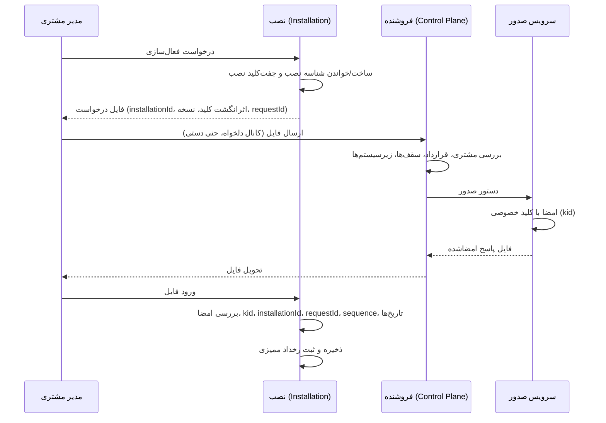
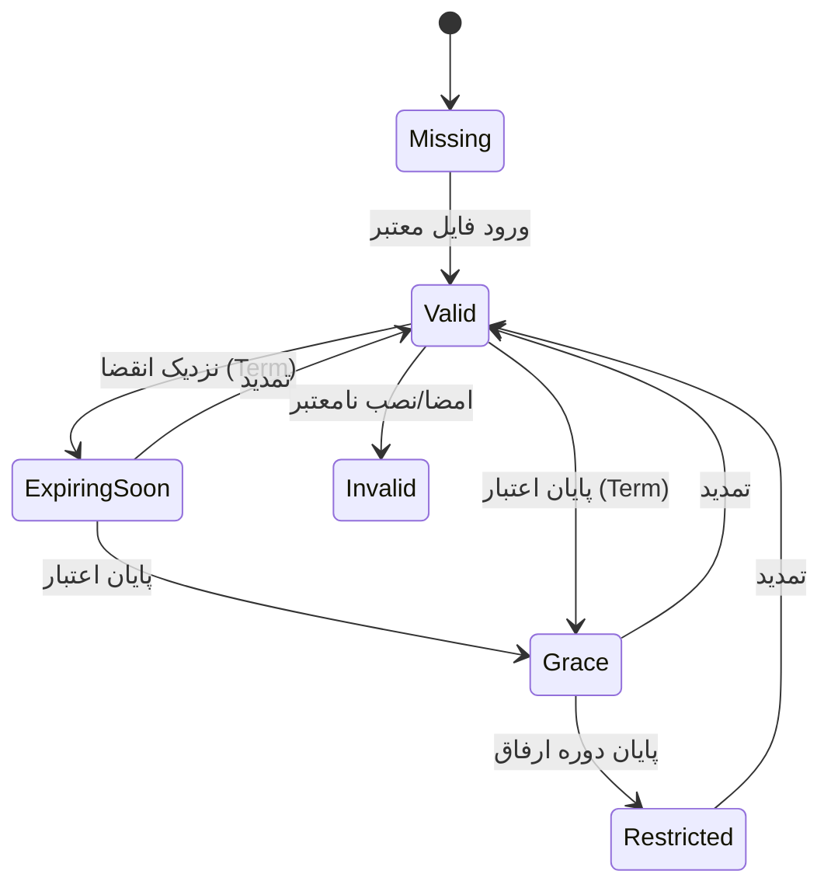
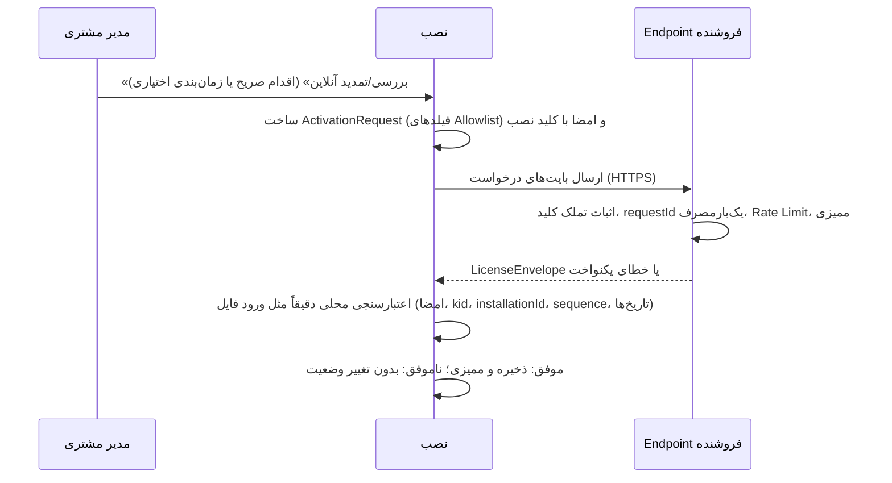
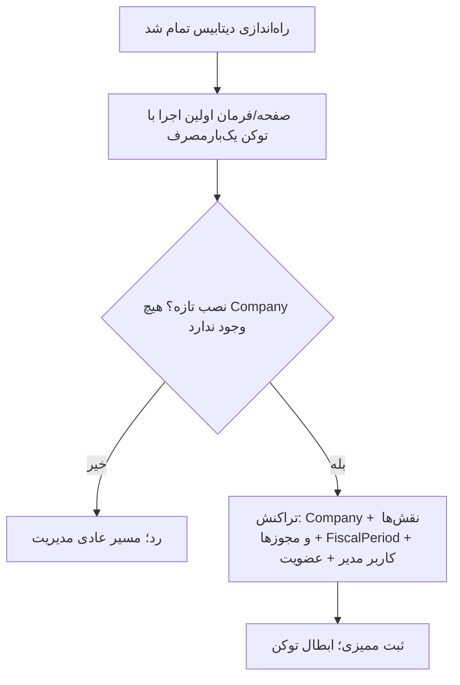

# گردش‌کارهای لایسنس (طرح هدف)

> همه گردش‌کارها `NotImplemented` هستند (D-023..D-027). هیچ‌کدام ادعای پیاده‌سازی یا تست‌شدن ندارند.

## ۱) فعال‌سازی اولیه آفلاین

## ۲) تمدید

مانند فعال‌سازی ولی با `sequence` بزرگ‌تر و بدون تغییر `installationId`. پیش از انقضا هشدار نمایش داده می‌شود. فایل با `sequence` کمتر یا مساوی رد می‌شود.

## ۳) چرخه عمر وضعیت لایسنس در نصب

- `Perpetual`: انقضای حق استفاده ندارد؛ پایان پشتیبانی/به‌روزرسانی وضعیت را به `Restricted` نمی‌برد.
- در `Restricted`: مشاهده، گزارش، **خروجی/پشتیبان‌گیری**، ورود لایسنس مجاز؛ ثبت/ویرایش/تأیید در زیرسیستم‌های مشمول ممنوع (D-026).
- دوره ارفاق پیش‌فرض ۳۰ روز قابل تنظیم (`NeedsApproval`).

## ۴) ایجاد شرکت

1. کاربر ایجاد شرکت می‌خواهد.
2. سرور مجوز عملیاتی را می‌سنجد (D-025).
3. سرور لایسنس معتبر و `maxCompanies` را می‌سنجد.
4. در صورت رد: پاسخ خطای قابل فهم؛ داده موجود دست‌نخورده.

## ۵) تعویض سخت‌افزار / بازیابی

- با کلید نصب در Backup: بازیابی و ادامه کار.
- بدون کلید: درخواست «اتصال مجدد»؛ تأیید هویت؛ صدور لایسنس جدید؛ بازنشستگی شناسه قدیمی با ممیزی (D-027؛ `NeedsApproval`).

## ۶) چرخش کلید امضا

فروشنده کلید جدید با `kid` جدید می‌سازد؛ کلید عمومی در نسخه جدید نرم‌افزار یا با فایل اعتماد امضاشده به نصب‌ها می‌رسد؛ لایسنس‌های قبلی تا انقضا معتبر می‌مانند (جزئیات `NeedsApproval`).

## ۷) تعلیق/ابطال

در سامانه فروشنده ثبت می‌شود و فقط با فایل جدید یا ارتباط مجدد به نصب می‌رسد؛ تعلیق فوری نصب آفلاین ممکن نیست (D-023).

## ۸) فعال‌سازی و تمدید آنلاین (فاز صفر 2026-10-24، `Proposed`؛ D-042)

قالب و اعتبارسنج همان آفلاین است؛ فقط حمل تغییر می‌کند.

- شکست شبکه یا فروشنده هرگز وضعیت لایسنس فعلی را تغییر نمی‌دهد و عملیات حسابداری را نمی‌بندد.
- در درخواست هیچ داده حسابداری، کاربر یا شرکت نیست.

## ۹) انتقال، بازیابی و اتصال مجدد (`Proposed`؛ D-027، OD-06)

| سناریو | کلید نصب در دسترس؟ | روند | اقدام فروشنده | ممیزی |
|---|---|---|---|---|
| تعویض سخت‌افزار با Backup کامل | بله | بازیابی روی سرور جدید؛ همان شناسه و کلید؛ لایسنس همچنان معتبر | هیچ | نصب: رخداد بازیابی؛ در تماس بعدی فروشنده می‌تواند ببیند |
| بازیابی دیتابیس بدون کلید نصب | خیر | «اتصال مجدد»: کلید و `installationId` **جدید**، فایل درخواست | تأیید هویت مشتری؛ بازنشستگی نصب قدیمی (`Retired`، پیوند «جایگزین‌شده با»)؛ صدور لایسنس جدید برای کلید جدید | رخداد فروشنده با تأییدکنندهٔ دوم (D-043) |
| کپی ماشین (هر دو نسخه کلید دارند) | بله | قابل جلوگیری یا تشخیص آفلاین نیست (T6) | در صورت ارتباط آنلاین هر دو، فروشنده دو درخواست با یک `installationId` می‌بیند و علامت می‌گذارد | رخداد «شناسهٔ تکراری» |
| لایسنس دائمی نصب قدیمی بعد از اتصال مجدد | بله (کلید قدیمی) | آفلاین ابطال‌شدنی نیست؛ محدودیت پذیرفته و در قرارداد اعلام می‌شود | ثبت بازنشستگی؛ پیگیری حقوقی/قراردادی | — |

## ۱۰) ساعت سیستم و «ساعت مؤثر لایسنس» (`Proposed`؛ OD-05)

1. هر ارزیابی لایسنس فقط از `TimeProvider` تزریق‌شده می‌خواند (امروز مسیر زمان یکدست نیست؛ ر.ک. `OD-05`).
2. `ساعت مؤثر = max(ساعت سیستم، LicenseTimeHighWater، issuedAt آخرین لایسنس معتبر)`. این مقدار در هر ارزیابی و هر نوشتن ممیزی به‌روز می‌شود و هرگز کاهش نمی‌یابد.
3. اگر `ساعت سیستم` از `LicenseTimeHighWater` بیش از آستانهٔ تحمل (پیشنهاد: ۲۴ ساعت) عقب‌تر باشد: رخداد ممیزی + هشدار به مدیر؛ ارزیابی با «ساعت مؤثر» ادامه می‌یابد. این رفتار قفل‌کننده نیست.
4. جهش بزرگ رو به جلو نیز ثبت می‌شود (احتمال خرابی ساعت)؛ لایسنس دائمی تحت تأثیر قرار نمی‌گیرد. برای جلوگیری از قفل دائمی با یک پرش تصادفی (مثلاً سال 2099)، پیشروی `LicenseTimeHighWater` در هر ارزیابی سقف دارد (پیشنهاد: ۴۸ ساعت)؛ پرش بزرگ‌تر فقط پس از تأیید صریح مدیر پذیرفته می‌شود و ورود لایسنس تازهٔ امضاشده آن را بازنشانی می‌کند.
5. **محدودیت:** بازگردانی کامل دیتابیس/ماشین `LicenseTimeHighWater` را هم به عقب می‌برد؛ در آفلاین قابل کشف نیست (T5).
6. زمان معتبر آنلاین (NTP یا فروشنده) فقط اختیاری و هرگز الزام نیست.

## ۱۱) ساخت اولین شرکت و مدیر (`Proposed`؛ D-044، OD-14)

- توکن: فقط روی کنسول سرور یا فایل با مجوز مالک‌تنها، ذخیرهٔ هش‌شده، انقضای کوتاه، مصرف در همان تراکنش؛ شرط بازبودن، نشانگر دائمی «راه‌اندازی‌نشده» است (نه صرفاً نبود `Company`)؛ Rate Limit روی تلاش‌ها.
- بدون رمز ثابت؛ رمز اولیه توسط مدیر تعیین می‌شود (حداقل طول مطابق سیاست `PasswordHashService`/Master).
- در حالت لایسنس `Missing` ساخت شرکت اول مجاز است؛ سقف `maxCompanies` پس از ورود لایسنس اعمال می‌شود.

## ۱۲) معرفی تدریجی لایسنس برای نصب‌های موجود (`Proposed`؛ D-044، OD-10)

| حالت `EnforcementMode` | رفتار | شرط ورود |
|---|---|---|
| `Off` | هیچ ارزیابی؛ رفتار امروز | پیش‌فرض نسخه‌های پیش از L3 |
| `Observe` | ارزیابی و ممیزی؛ بدون هیچ محدودیت | نخستین نسخهٔ دارای ماژول لایسنس |
| `Enforce` | سیاست کامل (حالت محدود، سقف‌ها)؛ از نسخهٔ اعمال به بعد حداقل ثابت در کد است و فقط لایسنس امضاشده می‌تواند آن را پایین بیاورد (T28) | تأیید مالک + لایسنس اولیه صادرشده برای مشتریان موجود |

بازگشت از `Enforce` به `Observe` با پیکربندی ممکن است و هیچ داده‌ای را تغییر نمی‌دهد.

## ۱۳) جلوگیری از دورزدن سقف شرکت و زیرسیستم از طریق API (`Proposed`؛ D-025)

1. یک نقطهٔ سیاست سمت سرور (مثلاً فیلتر Endpoint یا سیاست Authorization) پیش از اجرای هر عملیات شرکت‌/زیرسیستم‌دار؛ بررسی پراکنده ممنوع است.
2. ورودی کلاینت (کد ماژول، شناسهٔ شرکت، شمارنده) هرگز منبع حقیقت نیست؛ تعداد شرکت‌ها از DB خوانده می‌شود و کد ماژول از نگاشت سمت سرور می‌آید.
3. ترتیب: هویت و نشست ← عضویت فعال ← لایسنس/زیرسیستم ← مجوز عملیاتی ← وضعیت دورهٔ مالی (D-025).
4. شمارش و ایجاد شرکت در یک تراکنش با سطح ایزولاسیون مناسب انجام شود تا درخواست هم‌زمان سقف را دور نزند (الگوی موجود: تراکنش Serializable در `CustomerBoundaryEndpoints`).
5. آزمون ماتریسی: دسترسی مستقیم URL، تغییر بدنهٔ درخواست، درخواست هم‌زمان، عضویت/نقش غیرفعال، لایسنس `Restricted`.
6. تا ورود ماژول‌های حسابداری، تنها نقطهٔ آزمون‌پذیر سقف، ایجاد شرکت است؛ این هنوز مسیر ایجاد شرکت پشتیبانی‌شده‌ای ندارد (D-044).

## ۱۲) Provisioning مشتری با یک لایسنس مشخص (D-054، Issue #228/#235)

1. کاربر Vendor نصب مقصد را انتخاب می‌کند؛ API فقط لایسنس‌هایی را نمایش می‌دهد که envelope امضاشدهٔ آن‌ها با کلید عمومی مورد اعتماد تأیید شده و برای همان مشتری/نصب فعال و در بازهٔ اعتبار هستند.
2. درخواست شامل licenseId و برای LicensePayload v1 در صورت نیاز subset زیرسیستم‌های installation-scoped است. برای LicensePayload v2، `companyReference` فقط selector شرکت از مجموعهٔ payload امضاشده است؛ ورودی مرورگر مرجع معتبر محسوب نمی‌شود و Vendor باید عضویت آن را در envelope بررسی و مقدار نهایی را از همان envelope بردارد. sequence یا فهرست کامل entitlement از کلاینت دریافت نمی‌شود.
3. Vendor در تراکنش Serializable، همان لایسنس را از دیتابیس Vendor resolve می‌کند، آخرین VendorSignedLicenseEnvelope را می‌خواند و digest، signature و binding را کنترل می‌کند. برای LicensePayload v1، sequence و زیرمجموعهٔ installation-scoped در provisioning schema v4 قرار می‌گیرد. برای LicensePayload v2، PR #683 انتخاب `CompanyReference` را فقط از `CompanyEntitlements` در payload امضاشده انجام می‌دهد و payload v5 را با ماژول‌های همان Company آماده می‌کند؛ اما Gate دوکلیدی خاموش است (`Provisioning:CompanyReferenceIssuance:Enabled=false` به‌صورت پیش‌فرض و `CustomerConsumerReady=false` در کد). بنابراین در وضعیت فعلی resolver همچنان با `provisioning_company_reference_mapping_required` fail-closed می‌شود و هیچ بستهٔ v5 صادر نمی‌شود؛ هیچ entitlement شرکتی به سطح Installation flatten نمی‌شود.
4. پیش از امضای بستهٔ Provisioning، Vendor دوباره بررسی می‌کند که لایسنس همان مشتری/نصب و فعال باشد، تاریخ اعتبار نگذشته باشد و sequence payload هنوز آخرین revision امضاشده باشد. در صورت تعلیق، انقضا، تغییر نصب یا صدور revision جدید، امضا رد می‌شود.
5. پیش از هر Export مجدد نیز همین اعتبارسنجی انجام می‌شود. پس از Export موفق، مشتری آفلاین نمی‌تواند تعلیق بعدی یا revision جدید Vendor را کشف کند؛ این محدودیت در قرارداد پذیرفته شده است.
6. idempotency شامل licenseId و sequence امضاشده، به‌علاوهٔ تنظیمات و زیرسیستم مؤثر است. retry یک requestId قدیمی به revision تاریخی خودش متصل می‌ماند و به revision جدیدتر منتقل نمی‌شود.
7. درخواست‌های تاریخی schema v3 نه backfill می‌شوند و نه به لایسنس حدس‌زده وصل می‌شوند. `Licensing.Contracts` نسخهٔ v5 را به‌صورت additive می‌شناسد. سمت Customer، `CustomerProvisioningPackageVerifier` از PR #686 با `allowCompanyReference=true` v5 را می‌پذیرد و `ApplyAsync` آن را اتمیک اعمال می‌کند؛ اما چون Gate صدور Vendor خاموش است، در عمل هنوز فقط بسته‌های v1-v4 در جریان‌اند. canonical bytes نسخه‌های v1-v3 حفظ شده‌اند؛ Vendor درخواست v3 را دوباره امضا یا Export نمی‌کند و LicenseId/Sequence مفقود را حدس نمی‌زند.
8. برای MaxCompanies و Company-scoped Module/Feature/Seat candidate builderهای Vendor در #393 موجودند؛ سفارش/پرداخت، persistence خرید و amendment و Approval تجاری هنوز NotImplemented هستند. سمت مشتری، PRهای #684 (`5f4baf82`؛ schema `CompanySetupRecords` و Migration `20261116070805_AddCompanySetupRecords`)، #686 (`b0eefa37`؛ مصرف‌کنندهٔ v5 با ترتیب Entitlement→Duplicate→Capacity و کدهای رد `provisioning_license_not_installed`/`provisioning_not_entitled_for_company`/`provisioning_company_reference_conflict`/`provisioning_company_capacity_exceeded`) و #687 (`f8a98713`؛ استخراج `CustomerCompanyEntitlementResolver`) ادغام شده‌اند و `maxCompanies` با سیاست block-new شمرده می‌شود؛ اما Gate صدور Vendor (`CustomerConsumerReady=false`) بسته مانده و هیچ بستهٔ v5 عملیاتی صادر نمی‌شود. Migration مشتری روی دیتابیس واقعی اجرا نشده است؛ LicensePayload v2 در مسیر provisioning عملیاتی fail-closed می‌ماند و هیچ کنترل ناقص یا تخمینی جایگزین binding معتبر نمی‌شود. PR #699 در Issue #698 ادغام شده و چهار کد رد ثابت شرکت‌محور در allow-list محدود Vendor پذیرفته می‌شوند؛ Vendor CI روی HEAD نهایی ۳/۳، Semgrep یک Job و .NET CI هفت Job موفق بوده‌اند. CI push روی main پس از Merge در بازبینی 2026-11-18 تأیید نشده است. گام‌های باقی‌مانده: فعال‌سازی دوکلیدی Gate (نیازمند تأیید مالک) و سیاست Restore/Clone.

## ۱۴) Add-on amendment، bootstrap و entitlement sync (D-059)

### خرید افزونه
1. Vendor سفارش/خرید افزونه را برای CustomerAccount و Installation مشخص ثبت می‌کند؛ Company scope برای Seat/Module/Feature صریح است.
2. پس از کنترل تجاری و maker-checker لازم، amendment روی همان LicenseId صادر می‌شود؛ sequence از آخرین revision پذیرفته‌شده بزرگ‌تر است.
3. payload دقیق امضا می‌شود؛ Customer signature، Installation binding، LicenseId و sequence را بررسی و اتمیک import می‌کند.
4. replay، downgrade، amendment متعلق به نصب/شرکت دیگر و revision نامعتبر رد و ممیزی می‌شود.

### bootstrap مدیر Offline و ساخت شرکت
1. اولین مدیر در Customer Host رمز را محلی تعیین می‌کند؛ رمز یا hash از مرز Customer عبور نمی‌کند.
2. bootstrap یک‌بارمصرف و اتمیک است؛ تا تکمیل آن login عادی ممنوع است.
3. ساخت Company جدید با maxCompanies بررسی می‌شود؛ Cloud از authority مرکزی و Offline از entitlement امضاشده آخرین revision استفاده می‌کند.

### همگام‌سازی
- Online: درخواست/پاسخ احراز هویت‌شده و ضد replay؛ بدون ارسال داده حسابداری/رمز مدیر.
- Offline: export/import فایل امضاشده با همان validation، sequence و binding.
- قطع شبکه نباید license معتبر پذیرفته‌شده را باطل کند؛ usage داده نشده در Vendor stale است تا sync بعدی.

## ۱۴) دروازه شروع برنامه و Activation Wizard (D-060 / #396)

### 14.1 بررسی وضعیت قبل از ورود
1. Customer Host در Startup و روی هر درخواست حساس، state نصب را از persistence/authority سمت سرور می‌خواند؛ React/browser state یا InstallationId ارسالی کاربر معتبر نیست.
2. Unlicensed: صفحه ورود عادی نمایش داده نمی‌شود؛ کاربر به Activation Wizard هدایت می‌شود.
3. Active: هویت نصب و envelope معتبرند؛ صفحه ورود عادی نمایش داده می‌شود.
4. Restricted: لایسنس معتبر ولی مدت‌دار منقضی است؛ مسیر ورود کنترل‌شده برای read/export/recovery مجاز باقی می‌ماند و UI وضعیت تمدید را نشان می‌دهد.
5. InvalidOrUntrusted: امضا، sequence، installation binding یا revocation نامعتبر/نامعلوم است؛ fail-closed و مسیر پشتیبانی/recovery نمایش داده می‌شود.
6. ReactivationRequired: OS identity یا کلید نصب تغییر کرده؛ فرایند کنترل‌شده recovery/reactivation لازم است.

Unlicensed با Restricted یا InvalidOrUntrusted یکی نیست. تصمیم دسترسی سمت سرور enforce می‌شود؛ مخفی‌کردن صفحه یا route در React کنترل امنیتی نیست.

### 14.2 فرم نصب چندشرکتی
- فرم Company referenceهای داخل envelope را نشان می‌دهد؛ کاربر نام و اطلاعات محلی شرکت الف/ب را برای هر reference تکمیل/تأیید می‌کند.
- زیرسیستم‌ها، Featureها، سقف شرکت/کاربر و مقادیر خریداری‌شده برای هر Company از payload امضاشده پر می‌شوند و UI حق افزایش آن‌ها را ندارد.
- برای هر Company مدیر اولیه محلی و عضویت/نقش ساخته می‌شود. حساب User در سطح نصب یکتا است؛ می‌توان مدیرهای جدا برای شرکت‌ها تعریف کرد و یک User هم می‌تواند عضو چند Company باشد. عضویت چندشرکتی برای هر Company یک Seat مصرف می‌کند.
- رمز هر مدیر فقط در فرم محلی Customer Host گرفته و به Identity hash تبدیل می‌شود. رمز/hash/token در Vendor، فایل تبادل، log، audit detail یا telemetry قرار نمی‌گیرد.
- ایجاد Companyهای بعدی پس از فعال‌سازی تحت #392 و maxCompanies است؛ اطلاعات provisioning v4 تکرار/جایگزین نمی‌شود.

## ۱۵) تبادل فایل کلید/لایسنس در Offline (D-060 / #394 / #396)

### 15.1 کد فعال‌سازی و بسته درخواست Customer

کد فعال‌سازی را Vendor با مدت اعتبار قابل تنظیم و مصرف یک‌باره صادر می‌کند و به CustomerAccount/Installation مشخص bind می‌کند. کد مجوز امضاشده نیست؛ فقط اجازه شروع/تکمیل صدور LicenseEnvelope را می‌دهد. در Cloud کد در Customer Wizard و از طریق API احراز هویت‌شده redeem می‌شود. در Offline اپراتور کد را در Vendor Host و پس از دریافت درخواست Installation redeem می‌کند. کد در فایل انتقال، log یا telemetry قرار نمی‌گیرد.

### 15.1 بسته درخواست Customer
Customer Host یک .request.json نسخه‌دار صادر می‌کند که فقط metadata لازم، InstallationId، public SPKI/key version، assurance level، nonce/request ID، زمان/انقضا، contract version و proof-of-possession را حمل می‌کند. Private key، password و داده حسابداری در آن نیست.

### 15.2 پاسخ Vendor
Vendor پس از بررسی Customer/Installation و خرید/تأیید، یک .license.json شامل envelope یا amendment امضاشده صادر می‌کند. Customer فایل را import می‌کند؛ signature، exact signed bytes، Installation binding، nonce، sequence، validity، revocation و idempotency بررسی و سپس به‌صورت اتمیک ذخیره می‌شود.

### 15.3 انتقال متن/رسانه
- .txt فقط wrapper متنی Base64/armored برای همان بایت‌های دقیق بسته است؛ متن قابل ویرایش و بدون امضا مجوز نیست.
- QR فقط برای شناسه/challenge کوتاه‌عمر و کوچک اختیاری است؛ payload کامل entitlement و private key داخل QR قرار نمی‌گیرد.
- انتقال می‌تواند از طریق USB یا شبکه داخلی انجام شود؛ هیچ مسیر به Vendor برای اتصال به Customer DB وجود ندارد.
- Customer برای ACK/usage/status یک بسته امضاشده جدا صادر می‌کند؛ Vendor sequence و request ID را idempotently ثبت می‌کند و freshness را با زمان آخرین sync نشان می‌دهد.

این گردش‌کار هنوز Accepted / NotImplemented است تا PR کد و CI مرتبط ادغام شوند.

## ۱۴) قرارداد نسخه‌دار entitlement و amendment (Issue #390)

1. نصب دارای یک LicenseId پایه است. Envelope بیرونی v1 می‌ماند؛ payload می‌تواند v1 یا v2 باشد.
2. اعتبارسنج ابتدا envelope bounds، algorithm، trusted kid و امضای دقیق PayloadJson را بررسی می‌کند؛ سپس JSON را parse می‌کند. payload v2 علاوه بر آن باید strict schema و canonical byte representation داشته باشد.
3. payload v1 همچنان فقط allowlist نصب‌محور finance/sales/inventory/treasury را می‌پذیرد؛ v1 هیچ entitlement ضمنی برای Trade ندارد.
4. payload v2 سقف `maxCompanies` را در Installation نگه می‌دارد و module/feature/maxUsers را برای هر opaque CompanyReference جداگانه بیان می‌کند. `TRADE_IMPORT` فقط به‌صورت Company-scoped پذیرفته می‌شود.
5. هر feature باید در catalog شناخته‌شده باشد، نوع ثابت catalog را رعایت کند، دقیقاً یک مقدار typed داشته باشد و ماژول مالک آن برای همان Company اعطا شده باشد.
6. amendment پس از اعتبارسنجی مستقل امضا، باید LicenseId، InstallationId و ProductCode قبلی را حفظ و Sequence بزرگ‌تری داشته باشد. Sequence می‌تواند از عدد قبلی بیشتر باشد و الزاماً +1 نیست؛ تکرار/کاهش رد می‌شود.
7. این contract rule به‌تنهایی state یا replay ledger ایجاد نمی‌کند. #391 باید sequence پذیرفته‌شده را اتمیک در Customer ذخیره و هم‌زمانی/replay را کنترل کند؛ #393 صدور amendment را در Vendor و از مسیر خرید/Approval/Signer اضافه می‌کند.
8. support و update end-dateها مستقل از expiry هستند. Perpetual license با پایان support/update منقضی نمی‌شود.

## ۱۶) گردش‌کارهای S1 — پشتیبانی، Update، فعال‌سازی مجدد و انقضا (D-097..D-102؛ `Accepted` رفتاری، `NotImplemented`)

این بخش تصمیم‌های مالک محصول در مأموریت S1-0 (Issue #696) را به گردش‌کار ترجمه می‌کند. هیچ‌یک پیاده‌سازی نشده‌اند و هر قابلیت به Issue/PR مستقل با معیار پذیرش خودش نیاز دارد.

### 16.1 تمدید پشتیبانی و Update مستقل (D-097)
1. Vendor برای هر Customer/Installation، دورهٔ پشتیبانی و Update را مستقل از License مدیریت می‌کند؛ تمدید فقط از مسیر amendment امضاشده با sequence افزایشی (#393) به `supportUntilUtc`/`updatesUntilUtc` payload اعمال می‌شود.
2. مشتری فاقد پشتیبانی در داشبورد Vendor با وضعیت هشدار متمایز نمایش داده می‌شود؛ سوابق خدمات، تماس‌ها و تمدیدها در CRM سبک (D-102) append-only ثبت می‌شوند.
3. پایان پشتیبانی/Update نرم‌افزار Perpetual را غیرفعال نمی‌کند (D-022/D-059)؛ فقط دسترسی به Updateهای جدید محدود می‌شود.

### 16.2 فعال‌سازی مجدد سخت‌افزاری — Online و Offline (D-099؛ توسعهٔ D-058/Issue #384)
1. پس از نصب مجدد Windows یا تغییر سخت‌افزاری مهم، Customer Host با possession کلید غیر-exportable یک درخواست reactivation نسخه‌دار می‌سازد: InstallationId، SPKI/key version جدید، مشخصات سخت‌افزاری نسخه‌دار، requestId/nonce، زمان/انقضا و امضا. تغییر RAM یا کارت شبکه به‌تنهایی درخواست تولید نمی‌کند (تشخیص نسخه‌دار و قابل تنظیم است).
2. **Online:** درخواست مستقیماً به Vendor ارسال می‌شود؛ **Offline:** فایل درخواست صادر و به Vendor منتقل می‌شود (الگوی .request.json بخش ۱۱).
3. Vendor مشخصات قبلی و جدید را مقایسه می‌کند، تاریخچهٔ Installation را نگه می‌دارد و درخواست را به صف تأیید مالک می‌گذارد؛ هیچ پاسخ امضاشده‌ای بدون تأیید صریح مالک صادر نمی‌شود.
4. تأیید مالک: هویت تأییدکننده، زمان و علت audit می‌شود؛ پاسخ جدید امضا و به Installation، requestId، کلید جدید (SPKI) و License revision مشخص bind می‌شود؛ Customer آن را با همان validation ورود لایسنس اعمال می‌کند.
5. رد درخواست: فقط عدم صدور binding جدید است؛ نه Revocation و نه حذف دادهٔ مشتری. نتیجهٔ رد نیز audit می‌شود.
6. اثرانگشت سخت‌افزار به‌تنهایی اثبات هویت نیست؛ اثبات فقط با possession کلید نصب معتبر است. TPM ترجیحی است ولی شرط اجباری نیست؛ رفتار VM/vTPM در OD-22 باز است.

### 16.3 Update با تأیید مدیر مشتری (D-101)
1. بررسی نسخه و اطلاع از Update می‌تواند خودکار باشد؛ نصب بدون تأیید صریح مدیر Customer انجام نمی‌شود.
2. بستهٔ Update پیش از اجرا بررسی می‌کند: امضا (D-045)، Hash، نسخهٔ مقصد و سازگاری با نسخهٔ فعلی؛ هر عدم‌انطباق fail-closed رد می‌شود.
3. پیش از نصب، پشتیبان‌گیری ثبت و مسیر بازیابی بررسی می‌شود؛ Update بدون مسیر بازگشت اجرا نمی‌شود.
4. مشتری Offline همان بستهٔ امضاشده را از طریق فایل دریافت می‌کند؛ بایت‌های بستهٔ Online و Offline یکسان‌اند.

### 16.4 پایان Support، پایان License و انقضای Cloud (D-097/D-098)
1. پایان پشتیبانی/Update: هیچ رفتار runtime نصب عوض نمی‌شود؛ فقط Updateهای جدید از دسترس خارج می‌شوند و داشبورد Vendor هشدار متمایز نشان می‌دهد.
2. پایان License مدت‌دار در Dedicated/Offline: طبق D-059 بند ۷ به Restricted می‌رود (read/export/recovery مجاز؛ نوشتن مسدود؛ بدون grace ضمنی).
3. پایان License در Cloud (D-098): ورود عادی کاربران مسدود می‌شود؛ صفحهٔ وضعیت انقضا و راهنمای تمدید نمایش داده می‌شود؛ مسیر تمدید آنلاین (#394) و بازیابی/حفظ داده برای نقش‌های authorized باز می‌ماند؛ هیچ داده‌ای حذف نمی‌شود.

### 16.5 مسیر recovery
1. بازیابی Backup با همان کلید روی همان سخت‌افزار، یا جابه‌جایی‌ای که از آستانهٔ تغییر سخت‌افزاری نسخه‌دار عبور نمی‌کند، طبق پیشنهاد OD-06(a) می‌تواند بدون صدور binding جدید و با ثبت audit انجام شود؛ این استثنا به معنی مجازبودن انتقال آزاد Installation به سخت‌افزار متفاوت نیست.
2. **تعویض سخت‌افزاری مهم نیازمند reactivation و تأیید مالک Vendor است، حتی اگر کلید قبلی هنوز در دسترس باشد**؛ در این مورد D-099 (تصمیم Accepted و جدیدتر) بر پیشنهاد قدیمی‌تر OD-06(a) مقدم است. درخواست باید با همان کلید نصب موجود اثبات possession شود، مشخصات قبلی/جدید مقایسه و پاسخ جدید به Installation/request/key/revision bind شود.
3. گم‌شدن کلید: گردش‌کار reactivation با تأیید مالک Vendor؛ احراز هویت/مالکیت پس از گم‌شدن کلید قبلی در OD-21 باز است. possession کلید جدید، هویت Installation قبلی را اثبات نمی‌کند؛ تا تعیین OD-21، تأیید مالک Vendor تنها gate این مسیر است و هیچ مسیر خودکاری وجود ندارد.
4. در همهٔ حالت‌ها دادهٔ حسابداری هرگز حذف نمی‌شود و مسیر Backup/Export همیشه برای نقش‌های مجاز باز می‌ماند (D-026/S-08).

### 16.6 سفارش، پرداخت و صدور مستقل + هشدار مطالبات (D-108)

1. Vendor Order با مبلغ کل، ارز و در صورت وجود تاریخ سررسید ثبت می‌شود. Order می‌تواند بدون هیچ Payment وارد گردش صدور شود.
2. هر Payment دستی و مستقل ثبت می‌شود. ثبت‌کننده فقط وضعیت Recorded ایجاد می‌کند؛ تأییدکننده مستقل با vendor.payments.verify آن را Verified یا Rejected می‌کند. ثبت‌کننده نمی‌تواند تأییدکننده باشد.
3. صدور هر Line گردش Maker-Checker جداگانه با vendor.licenses.issue دارد. Payment verification نه شرط ایجاد/تأیید درخواست صدور است و نه آن را خودکار تأیید می‌کند؛ صدور نیز Payment را تأیید نمی‌کند.
4. پس از تأیید صدور، Builder و Signer طبق مسیر اتمیک موجود اجرا می‌شوند. اگر Signer در دسترس نباشد، صدور fail-closed است و هیچ Envelope/Sequence/Audit ناقص commit نمی‌شود. پس از صدور، تحویل و ACK طبق #394 و مسیر آنلاین/فایل امضاشده ادامه می‌یابد.
5. Paymentهای Verified به‌صورت جمع Order محاسبه می‌شوند. وضعیت Order از مبلغ کل و جمع Verifiedها در زمان خواندن مشتق می‌شود: Unpaid، PartiallyPaid یا Paid. Paymentهای Recorded/Rejected از جمع کسر نمی‌شوند.
6. اگر مبلغ باقی‌مانده مثبت باشد، سفارش در فهرست پیگیری پرداخت‌نشده می‌ماند؛ با عبور از سررسید، برچسب Overdue و مبلغ باقی‌مانده نمایش داده می‌شود. بدون تاریخ سررسید، وضعیت Unpaid/Partial باقی می‌ماند و Overdue محاسبه نمی‌شود.
7. داشبورد/گزارش Vendor در زمان درخواست، سفارش‌های Unpaid، Partial و Overdue و مبلغ باقی‌مانده را query می‌کند. محاسبه با TimeProvider و query صفحه‌بندی‌شده انجام می‌شود؛ scheduler، BackgroundService، broker، SMS یا Email در نسخه اول لازم نیست.
8. هشدار مطالبات فقط اعلان/گزارش تجاری داخلی Vendor است. پایان Support/Update و وضعیت License از قواعد مستقل D-097/D-098 پیروی می‌کند؛ عدم پرداخت به‌خودی‌خود لایسنس Perpetual را قفل نمی‌کند و تاریخ‌های Support/Update را تغییر نمی‌دهد.
