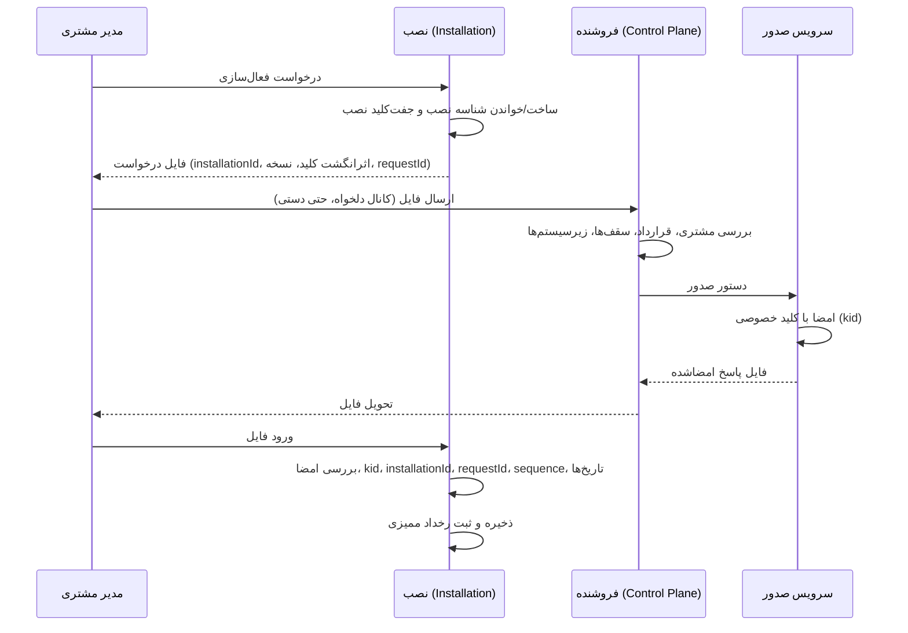
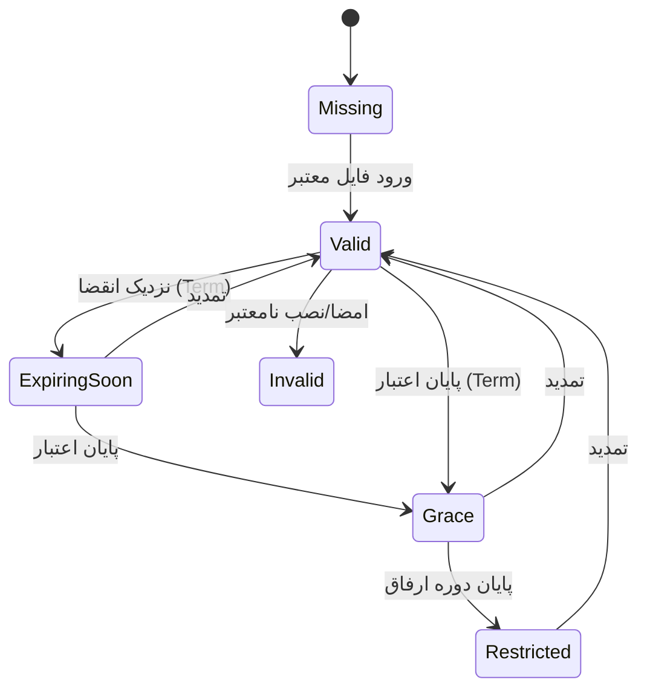

# گردش‌کارهای لایسنس (طرح هدف)

> همه گردش‌کارها `NotImplemented` هستند (D-023..D-027). هیچ‌کدام ادعای پیاده‌سازی یا تست‌شدن ندارند.

## ۱) فعال‌سازی اولیه آفلاین

## ۲) تمدید

مانند فعال‌سازی ولی با `sequence` بزرگ‌تر و بدون تغییر `installationId`. پیش از انقضا هشدار نمایش داده می‌شود. فایل با `sequence` کمتر یا مساوی رد می‌شود.

## ۳) چرخه عمر وضعیت لایسنس در نصب

- `Perpetual`: انقضای حق استفاده ندارد؛ پایان پشتیبانی/به‌روزرسانی وضعیت را به `Restricted` نمی‌برد.
- در `Restricted`: مشاهده، گزارش، **خروجی/پشتیبان‌گیری**، ورود لایسنس مجاز؛ ثبت/ویرایش/تأیید در زیرسیستم‌های مشمول ممنوع (D-026).
- دوره ارفاق پیش‌فرض ۳۰ روز قابل تنظیم (`NeedsApproval`).

## ۴) ایجاد شرکت

1. کاربر ایجاد شرکت می‌خواهد.
2. سرور مجوز عملیاتی را می‌سنجد (D-025).
3. سرور لایسنس معتبر و `maxCompanies` را می‌سنجد.
4. در صورت رد: پاسخ خطای قابل فهم؛ داده موجود دست‌نخورده.

## ۵) تعویض سخت‌افزار / بازیابی

- با کلید نصب در Backup: بازیابی و ادامه کار.
- بدون کلید: درخواست «اتصال مجدد»؛ تأیید هویت؛ صدور لایسنس جدید؛ بازنشستگی شناسه قدیمی با ممیزی (D-027؛ `NeedsApproval`).

## ۶) چرخش کلید امضا

فروشنده کلید جدید با `kid` جدید می‌سازد؛ کلید عمومی در نسخه جدید نرم‌افزار یا با فایل اعتماد امضاشده به نصب‌ها می‌رسد؛ لایسنس‌های قبلی تا انقضا معتبر می‌مانند (جزئیات `NeedsApproval`).

## ۷) تعلیق/ابطال

در سامانه فروشنده ثبت می‌شود و فقط با فایل جدید یا ارتباط مجدد به نصب می‌رسد؛ تعلیق فوری نصب آفلاین ممکن نیست (D-023).
