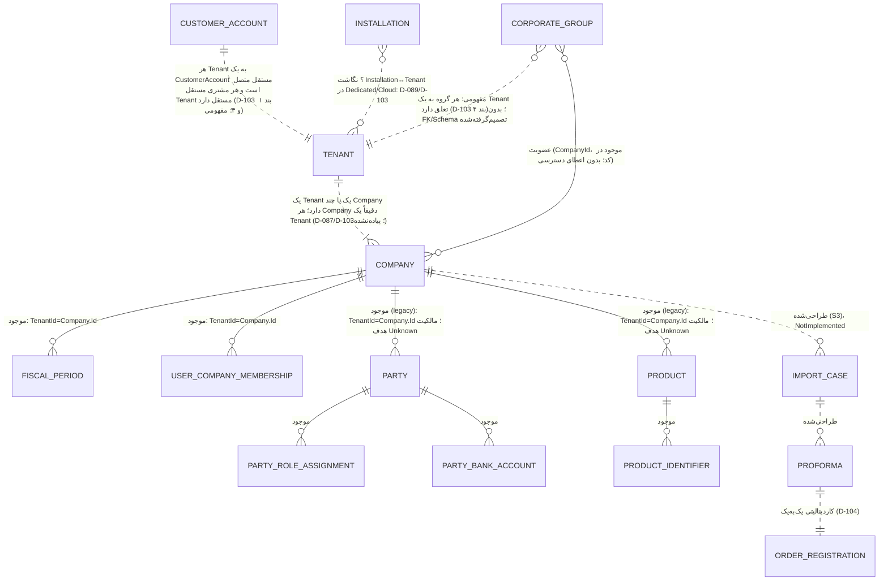

# ممیزی Tenant/Company برای Trade (TRADE_TENANT_COMPANY_AUDIT)

**تاریخ:** 2026-11-18
**مبنای مخزن:** `origin/main@89c0064` («docs(vendor): reconcile post-merge status and blockers (#703)»)
**وضعیت سند:** گزارش ممیزی (فقط مستندات). هیچ کد، Schema، Migration، Backfill، API یا UI تغییر نکرده است.
**مرجع تصمیم:** D-087، D-088، D-089 (`Accepted`)، D-103 (`Accepted`)، D-090..D-096 (`Proposed`)، D-030 (واژگان وضعیت).
**منابع قبلی که این سند یکپارچه می‌کند:** `handoffs/ISSUE-397-s3-0-tenant-company-audit.md`، `…s3-0e-tenant-company-ownership-audit.md`، `…s3-0h-consolidated-tenant-company-migration-plan.md`. این سند آن‌ها را بازنویسی نمی‌کند؛ ادعاهای آن‌ها را فقط جایی «تأییدشده» می‌نویسد که در همین گذر دوباره با کد مقایسه شده باشد.

## راهنمای برچسب شواهد

| برچسب | معنا |
|---|---|
| **[V]** | در همین گذر روی `main@89c0064` از کد/تست خوانده یا اجرا شد |
| **[S]** | از ممیزی‌های قبلی S3-0 نقل شده و در این گذر دوباره بررسی نشد |
| **[D]** | از ADR/مستند است، نه از کد |
| **Unknown** | شاهد کافی وجود ندارد؛ از نام کلاس یا ستون حدس زده نشده است |

## ۱. خلاصه

1. **مدل فعلی تاریخی است [V].** هیچ Entity یا جدول `Tenant` وجود ندارد؛ هر ستون `TenantId` در Core و Trade عملاً `Company.Id` را نگه می‌دارد. این وضعیت با تست قرارداد (`LegacyTenantIdEntityContractTests`) قفل شده است: پنج Entity در Trade و ده ستون در Core.
2. **مدل هدف تصویب‌شده است [D].** Tenant مرز مشتری/فضای کاری، Company شخصیت حقوقی/عملیاتی درون آن، `CorporateGroup` مفهومی مستقل (D-087، D-103). مدل هدف هنوز `NotImplemented` است.
3. **مسیر دسترسی Trade در محدودهٔ بررسی‌شده fail-closed است [V]**: نشست ← عضویت فعال و Company ← دوره ← entitlement ← مجوز. شناسهٔ Company از `WorkContext` سمت سرور می‌آید، نه از Client.
4. **جداسازی داده فقط با فیلتر صریح در Store است [V].** Global Query Filter وجود ندارد و طبق تصمیم‌های فعلی خودسرانه اضافه نمی‌شود؛ این یک ریسک نگهداشت است، نه نقص قطعی.
5. **شکاف اصلی مدل هدف:** منبع معتبر Company→Tenant، جدول Tenant و ستون `CompanyId` مستقل وجود ندارند. هیچ‌کدام بدون ممیزی کامل، تصمیم D-090 و تأیید Schema ساخته نمی‌شوند.
6. **Trade امروز در Production غیرفعال است [V]**: `DenyAllTradeModuleEntitlement` متصل است. در مسیرهای بررسی‌شده (`PartyStore` و `ProductStore` [V]) شناسهٔ scope از context معتبر سمت سرور می‌آید و هر Query/Include فیلتر `TenantId == tenantId && !IsDeleted` دارد. تست‌های موجود Gate، Adapter و `CompanyAccessService` دسترسی غیرمجاز بین Companyها و Claim جعلی را رد می‌کنند (بخش ۸)؛ اما تست دو-Tenant روی خودِ Storeهای Trade با SQL Server یافت نشد. این نتیجه فقط به همین مسیرهای بررسی‌شده محدود است؛ مسیرهای نقل‌شده از ممیزی‌های قبلی با برچسب [S] باقی‌اند، نبود Global Query Filter برای مسیرها و Storeهای جدید آینده ریسک است (R-1) و دسترسی مستقیم به دیتابیس خارج از دامنهٔ این ادعاست. ریسک‌های زیر برای هنگام فعال‌سازی‌اند.

## ۲. مدل فعلی (شواهد)

| مورد | شاهد | برچسب |
|---|---|---|
| `TradeEntity.TenantId` یک `Guid` است و فقط از `RequireIdentifier` عبور می‌کند؛ `CompanyId` ندارد | `Modules/Trade/Trade.Domain/Common/TradeEntity.cs:18,26` | [V] |
| پنج Entity فعلی Trade: Party، PartyRoleAssignment، PartyBankAccount، Product، ProductIdentifier | `LegacyTenantIdEntityContractTests.LegacyTradeEntities` | [V] |
| ده ستون legacy در Core: CompanyEmployee، CompanyEmployeeAssignment، CompanyEmployeePhoto، CompanyMembershipRequest (`DestinationTenantId`)، CompanyOrganizationalUnit، CompanyPosition، CompanyRole، FiscalPeriod، SecurityAuditEvent، UserCompanyMembership | همان تست، `LegacyCoreEntities` | [V] |
| `Company` ستون Tenant ندارد؛ `Company.Id` تنها مالک legacy است | `TheCompanyEntity_HasNoTenantColumn_SoCompanyIdIsTheOnlyLegacyOwner` | [V] |
| `TradeAuthorizationAdapter` مقدار `current.Company.CompanyId` را در فیلد `TenantId` از `TradeAccessContext` می‌گذارد | `Server/Infrastructure/Trade/TradeAuthorizationAdapter.cs` (ساخت `TradeAccessContext`) | [V] |
| `CompanyAccessService` همهٔ پرسش‌ها را با `membership.TenantId == companyId` می‌سنجد | `Server/Infrastructure/Tenancy/CompanyAccessService.cs:108,212,245 (و 163 با الگوی Contains)` | [V] |
| Entity یا جدول Tenant وجود ندارد | جست‌وجوی `class Tenant` بدون نتیجه؛ تست بالا | [V] |
| `Company.CustomerBoundaryId` ستون nullable با تخصیص اپراتوری است و Tenant نیست | `OwnershipScopeArchitectureTests.TheOwnershipContract_HasNoCustomerBoundaryMember`، `NoSourceFile_UsesCustomerBoundaryIdAsTheTenantBoundary` | [V] |
| Migration Trade هیچ FK به `Companies` ندارد؛ فقط FK درون Trade | S3-0h §2 (V11) | [S] |
| Trade با `TradeDbContext`، Schema `trade` و History جدا (`dbo.__TradeMigrationsHistory`) Migrate می‌شود | S3-0h §2 (V8)؛ `Server.dll --migrate --include-trade` در `docs/TRADE_MODULE.md` | [S]/[D] |

## ۳. مدل هدف

طبق D-087 و D-103 [D]:

- Tenant مرز مشتری/فضای کاری و جداسازی داده است؛ هر مشتری مستقل Vendor یک Tenant مستقل دارد.
- هر Company دقیقاً به یک Tenant تعلق دارد؛ هر Tenant یک یا چند Company دارد.
- `CorporateGroup` مفهوم مستقل است و از مرز CustomerAccount عبور نمی‌کند (D-037، D-038، D-103 بند ۴).
- `CustomerAccount`، `Installation`، `Tenant`، `Company` چهار مفهوم جدا هستند. در کد Core امروز فقط `InstallationIdentity` (نصب محلی) و در Vendor `VendorCustomer` و `VendorInstallation` وجود دارند [V]؛ کلاس یا جدولی به نام `CustomerAccount` در این گذر پیدا نشد.
- دامنه فقط کلید lookup برای ساخت context ورود است، نه مبنای مالکیت یا مجوز (D-103 بند ۶).
- Shared و Dedicated یک مدل منطقی دارند؛ دیتابیس اختصاصی جایگزین کنترل منطقی نیست (D-087).
- TenantId و CompanyId از Client، Claim یا فایل Import پذیرفته نمی‌شوند (D-103 بند ۹).

## ۴. ماتریس مالکیت Entityها

ستون «وضعیت فعلی» همان معنای واقعی داده در کد امروز است. «مالکیت هدف» از ADRها و طراحی آمده؛ هر جا مالک تصمیم نگرفته یا شاهد نبود، **Unknown** نوشته شده است.

### ۴.۱ Trade (موجود)

| Entity/Table | وضعیت فعلی | معنای واقعی شناسه‌ها | مالکیت هدف | Scope یکتایی | ریسک |
|---|---|---|---|---|---|
| `trade.Parties` (Party) | `TenantId` + `Code`؛ فیلتر صریح در `PartyStore` [V] | `TenantId = Company.Id` | **Unknown**: Company-owned (S3-0h §6.6 G3) یا Tenant-shared. مالک باید تصمیم بگیرد | امروز یکتایی کد در `TenantId` (= Company)؛ هدف: Unknown | متوسط: تغییر معنا هنگام گذار؛ کد تکراری بین Companyهای یک Tenant ممکن می‌شود یا نمی‌شود، بسته به تصمیم |
| `PartyRoleAssignment` | `TenantId`؛ کلید مرکب `TenantId + Id` برای فرزند→والد [D: TRADE_MODULE.md] | `TenantId = Company.Id` | تابع Party | تابع Party | متوسط |
| `PartyBankAccount` | همان | همان | تابع Party | تابع Party | بالا: داده مالی حساس؛ Unknown بودن مالکیت Party به آن سرایت می‌کند |
| `trade.Products` (Product) | `TenantId`؛ فیلتر صریح در `ProductStore` [V] | `TenantId = Company.Id` | **Unknown** (مثل Party) | امروز در `TenantId`؛ هدف: Unknown | متوسط |
| `ProductIdentifier` | همان؛ `ExcludeFromMigrations` در پیکربندی [S] | `TenantId = Company.Id` | تابع Product | تابع Product | متوسط |
| ارجاع‌ها (کشور، ارز، واحد، Incoterm؛ روش پرداخت فقط در PR #705 ادغام‌نشده) | ثابت در کد، بدون دیتابیس [V: `TradeReferenceData`] | ندارد | Global | کد | پایین. فقط «روش پرداخت مجاز هر Company» هنوز منبع ندارد (بخش ۷ سند S3_READINESS) |
| `TradeDocumentNumber` | Value Object خالص، بدون جدول [V: `Trade.Domain/Common`] | ندارد | تابع Entity صاحب شماره | **Company** (D-086، D-103 §۳ معماری S3) | پایین تا زمانی که ذخیره نشود |

### ۴.۲ Trade (طراحی‌شده، هنوز وجود ندارد: `NotImplemented`)

| Entity | مالکیت هدف | Scope یکتایی | وضعیت و ریسک |
|---|---|---|---|
| ImportCase، ImportCaseItem | Company-owned با Tenant | شماره پرونده خارجی در هر Company [D: D-086] | Blocked تا تأیید D-090 (Proposed) و PR-4 (A1) طبق `TRADE_S3_READINESS.md` §۴؛ G6 فقط فعال‌سازی Shared را مسدود می‌کند |
| Proforma، ProformaRevision | Company-owned با Tenant | شماره Proforma در هر Company | Blocked؛ فرمول مبلغ باز است |
| OrderRegistration، Amendment | Company-owned با Tenant | شماره ثبت‌سفارش در هر Company؛ شماره ابطال‌شده دوباره استفاده نمی‌شود | Blocked |
| Voyage | Company-owned، یک `OwnerCompanyId`؛ سایر شرکت‌ها فقط با Allocation/Share [D: D-063] | Unknown | چندشرکتی؛ ریسک نشت بین Company در یک Tenant اگر Share به Tenant گسترش یابد |
| BillOfLading، CustomsDeclaration، PortWarehouseReceipt | Company-owned | Unknown | S4؛ تجمیع بین چند بارنامه فقط درون یک Company یا طبق D-063 |
| ForexCommitment، تسهیلات، CostAllocation | Company-owned | Unknown | وابسته به فرمول‌های باز (OD-014..018) |
| فایل‌های اسناد | Company-owned، باینری خارج SQL [D: S3 §9] | Unknown | NotImplemented |

### ۴.۳ Core و نصب

| Entity/Table | وضعیت فعلی | معنای واقعی شناسه‌ها | مالکیت هدف | ریسک |
|---|---|---|---|---|
| Company | بدون ستون Tenant؛ `CustomerBoundaryId` nullable [V] | `Id` ریشه | Company زیر Tenant | بالا: بدون Tenant، منبع Company→Tenant نامعلوم است |
| Tenant | وجود ندارد [V] | — | ریشهٔ مرز مشتری | شکاف اصلی |
| FiscalPeriod | `TenantId = Company.Id` [V] | همان | Company-owned | متوسط |
| CompanyRole، UserCompanyMembership | `TenantId = Company.Id` [V] | همان | Company-owned (OD-4 باز برای نقش) | متوسط |
| SecurityAuditEvent | `TenantId` nullable؛ نویسنده‌ها گاهی `companyId`، گاهی null [V: فهرست تست؛ نویسنده‌ها: S] | ترکیبی | system/tenant/company (OD-5) | متوسط |
| CompanyEmployee و ملحقات HR | `TenantId = Company.Id` [V: فهرست تست] | همان | Company-owned | پایین برای Trade |
| User، UserSession، LoginLog | Identity Realm نصب [S] | — | بدون تغییر | پایین |
| PermissionDefinition | کاتالوگ سراسری [S] | — | Global | پایین |
| InstallationIdentity، InstalledLicense | Installation [V: `Domain/InstallationIdentity.cs`] | — | Installation-owned | پایین |
| CorporateGroup، CorporateGroupMember، OwnershipRelationship، ConsolidationRunCompany | از ابتدا `CompanyId`/`OwnerCompanyId` دارند [S؛ وجود `CorporateGroup` در `Domain/CorporateGroups` [V]] | Company واقعی | Cross-company relationship درون یک مرز Tenant | بالا: عضویت گروه دسترسی نمی‌دهد (قاعدهٔ AGENTS §5.3) و باید همین بماند |
| CustomerAccount | کلاس/جدول در Core یافت نشد [V]؛ مفهوم در Vendor با `VendorCustomer` | **Unknown** | Vendor-side | وابسته به GLM؛ دست‌نخورده |
| VendorCustomer، VendorInstallation | دیتابیس Vendor جدا [V: `Vendor/Vendor.Persistence`] | — | خارج از Tenant/Company مشتری | خارج از محدوده |
| `CompanySetupRecords` | جدول جدید #392 (2026-11-16) [D: DATABASE.md]؛ محتوای ستون‌ها در این گذر خوانده نشد | **Unknown** | **Unknown** | باید در S3-0 بازبینی شود |

## ۵. بررسی API و مسیرهای دسترسی

هفت پرسش مأموریت برای مسیر Trade و Core مرتبط:

| مسیر | عضویت فعال | تعلق Company به Tenant | مجوز عملیات | Client مورد اعتماد نیست | نشت ممکن | چندشرکتی | نتیجهٔ ناقص/ساکت |
|---|---|---|---|---|---|---|---|
| `TradeAccessFilter` روی گروه `/trade` [V] | بله (از WorkContext) | امروز: Tenant=Company؛ هدف: **اعتبارسنجی نشده** (Tenant وجود ندارد) | بله (`TradeAccessGate`) | بله؛ endpoint بدون metadata رد می‌شود (403) | تنها اگر Store فیلتر را فراموش کند | ندارد | رد صریح 403/404 |
| `TradeAccessGate` [V] | از Adapter | همان | `HasPermissionAsync` + مجوزهای خواندن اضافه | بله | — | ندارد | `Forbidden`/`ModuleUnavailable`/`PeriodReadOnly` صریح؛ خطای entitlement هرگز به مجوز کاربر fallback نمی‌کند |
| `TradeAuthorizationAdapter` [V] | از `WorkContextService` | فقط دوره‌ای که متعلق به همان Company است | `CompanyAccessService.HasPermissionAsync` | context فقط در همان درخواست معتبر است؛ جعل رد می‌شود | — | تست `MultiCompanyPermissionRequiresEveryCompanyPeriodPair` | نتیجهٔ منفی به‌صورت `false` |
| `PartyStore`، `ProductStore` [V] | — | — | — | `TenantId` از context | هر Query/Include فیلتر `TenantId == tenantId && !IsDeleted` دارد | — | `null`/NotFound |
| `CompanyAccessService` [V] | بله + Company فعال + نقش فعال | `membership.TenantId` (= Company) | بله | Claim جعلی نادیده گرفته می‌شود (تست) | خیر | `GetCompaniesWithPermissionAsync` برای همهٔ شرکت‌های محدوده | شرکت بی‌دسترسی مانند شرکت ناموجود |
| صفحات/Endpointهای Admin (کاربران، رویدادهای امنیتی) [S] | بدون عضویت؛ فقط نقش سراسری Admin | **ندارد** | نقش سراسری | — | بله، سراسری نصب (D-088 پذیرفته؛ پیاده‌سازی `Partial`) | — | — |
| Raw SQL، Background Job، Export [S] | مسیر بدون scope یافت نشد | — | — | — | — | — | Trade: `BackgroundService`/Raw SQL ندارد |

**یافته‌های مهم:**

- Trade هیچ مسیر عملیاتی ندارد که شناسه Tenant/Company را از Client بپذیرد [V: Store همه `tenantId` را از context می‌گیرند].
- «تعلق Company به Tenant» امروز قابل اعتبارسنجی نیست چون Tenant وجود ندارد؛ این نبود شواهد است، نه یک نقص قابل‌رفع بدون تصمیم D-089/D-090.
- مجوز گروه (`CorporateGroup`) باید جدا و برای همهٔ شرکت‌های محدوده سنجیده شود (AGENTS §5.3)؛ در Trade هنوز مسیری برای آن وجود ندارد.

## ۶. نقاط ریسک

| شناسه | ریسک | شدت | وضعیت شواهد |
|---|---|---|---|
| R-1 | نبود Global Query Filter: Storeِ جدید که `TenantId` را فراموش کند نشت می‌دهد. تنها جلوگیری، بازبینی و تست دو-Tenant است | بالا (هنگام فعال‌سازی) | [V] عدم وجود؛ تصمیم معماری لازم (S3-0h §6.7) |
| R-2 | معنای `TenantId` هنگام گذار عوض می‌شود: کد و Query که امروز Company را می‌فهمند باید Tenant را بفهمند. هر Store جدیدی که روی معنای legacy بنا شود بدهی گذار می‌سازد | بالا | [V] |
| R-3 | بدون FK به Core (D-090 Proposed)، رکورد Trade با زوج `(Tenant, Company)` ناسازگار از درج مستقیم SQL متوقف نمی‌شود | متوسط | [D] |
| R-4 | مالکیت Party/Product (Company یا Tenant-shared) تصمیم‌نشده؛ ساخت هر جدول وابسته (Proforma → Party) آن را بی‌صدا تثبیت می‌کند | بالا | Unknown |
| R-5 | یکتایی کد Party/Product امروز در `TenantId` (= Company) است؛ پس از Tenant واقعی، کد تکراری بین Companyهای یک Tenant یا مجاز یا ممنوع می‌شود و هر دو مسیر اثر داده دارند | متوسط | [V] |
| R-6 | Admin نصب خارج از فیلتر Tenant است (D-088 پذیرفته؛ پیاده‌سازی `Partial`)؛ ربطی به Trade ندارد اما مرز Tenant را در سطح نصب سست می‌کند | متوسط | [S] |
| R-7 | `SecurityAuditEvent.TenantId` ترکیبی/nullable است؛ گزارش حسابرسی Trade به آن وابسته می‌شود | متوسط | [V] ستون؛ [S] نویسنده‌ها |
| R-8 | دیتابیس اختصاصی ممکن است به اشتباه جایگزین کنترل منطقی دیده شود | متوسط | [D] |
| R-9 | ورودی Import فایل در آینده ممکن است شناسه Company را بپذیرد؛ باید ممنوع شود (D-103 بند ۹) | بالا (آینده) | [D] |
| R-10 | `CompanySetupRecords` (#392) پس از ممیزی S3-0e/f/g ساخته شد؛ مالکیتش در این ممیزی دیده نشد | **Unknown** | Unknown |

هیچ‌کدام «نقص قطعی» اعلام نمی‌شود؛ ریسک‌ها بر اساس شواهد برچسب خورده‌اند.

## ۷. شکاف‌های داده و دیتابیس

1. **Tenant:** جدول، کلید، منبع ایجاد (D-089: فقط مدیر نصب) و رابطهٔ `CustomerReference`↔Tenant پیاده‌سازی نشده‌اند.
2. **ستون `CompanyId` در Trade:** ندارد. افزودن آن با D-090 (Proposed) و تأیید Schema صریح؛ در این مأموریت ممنوع است.
3. **یکتایی:** شاخص‌های فعلی روی `TenantId` هستند؛ هدف شاخص‌های Company-scoped است که TenantId را هم برای FK مرکب نگه دارند (S3 §3). طراحی نهایی به S3-0 وابسته است.
4. **Rename legacy:** مسیر Pin اجباری (`HasConstraintName` و مشابه) و Guardهای PR-2a/2b در `handoffs/ISSUE-397-pr-2a-…` و `…pr-2b-…` ثبت شده‌اند؛ وضعیت اجرای آن‌ها در این گذر دوباره راستی‌آزمایی نشد [S].
5. **Backfill:** نگاشت Company→Tenant بدون Manifest معتبر (D-092 Proposed) ممنوع است؛ استنتاج از `CustomerBoundaryId`، گروه، نام یا مالکیت ممنوع است.
6. **داده تاریخی:** هر ردیف موجود `TenantId = Company.Id` دارد؛ Farano-Local هیچ جدول `trade` ندارد [S: S3-0c-b]، پس در دستگاه بررسی‌شده داده Trade تاریخی وجود ندارد. وضعیت نصب‌های دیگر Unknown است.

## ۸. سناریوهای جداسازی و پوشش تست موجود

| سناریو | پوشش فعلی | شاهد |
|---|---|---|
| دو Company مستقل در یک Tenant | **پوشش ندارد** (Tenant وجود ندارد) | — |
| دو Tenant مستقل با Companyهای جدا | معادل legacy: دو Company جدا | `Get_ReturnsNotFoundForOtherTenantProduct`، `Overview_ReturnsTheRealFiscalPeriodsOfTheCompany_AndNothingOfAnotherTenant` |
| کاربر مجاز فقط در Company A | پوشش دارد | `AUserCanNotAccessACompany_InWhichSheHasNoActiveMembership` |
| تلاش برای دسترسی به Company B | پوشش دارد | `Overview_OfAnotherTenantsCompany_IsNotFound_LikeAnUnknownCompany`، `CookieForForeignCompanyOrPeriodResolvesNull` |
| شناسه Company دستکاری‌شده در Client | پوشش دارد | `Overview_IgnoresATenantClaimForgedIntoThePrincipal`، `ForgedContextIsDenied`، `TheOwnershipContract_CanNotBeBuiltFromAnIdentifierOfAClient` |
| درخواست cross-tenant | معادل legacy پوشش دارد | موارد بالا |
| گزارش چندشرکتی با دسترسی ناقص | پوشش دارد (سطح مجوز) | `MultiCompanyPermissionRequiresEveryCompanyPeriodPair`، `MultiCompanyPermissionRequiresCurrentSignInSession` |
| داده تاریخی `TenantId = Company.Id` | پوشش دارد | `LegacyTenantIdEntityContractTests` (سه تست) |
| Dedicated با همان مدل منطقی | **پوشش ندارد** (در کد تمایزی نیست؛ S3-0e §4) | — |
| Store Trade روی SQL Server با دو Tenant | **تست دو-Tenant روی Store Trade در این گذر یافت نشد؛** تست‌های سرویس Trade با داده درون‌حافظه‌ای/ساختگی‌اند | `TradePartyServiceTests`، `TradeProductServiceTests` |

## ۹. تست‌های موجود و نتایج واقعی

نتیجهٔ اجرا روی `main@89c0064` (شاخهٔ این مأموریت، بدون تغییر کد) در بخش «نتایج» handoff این مأموریت ثبت می‌شود و در PR تکرار می‌شود. این سند عدد ثابت ننوشته است تا با اجرای بعدی ناسازگار نشود.

تست‌های مرتبط: `LegacyTenantIdEntityContractTests`، `OwnershipScopeArchitectureTests`، `ArchitectureDependencyGuardTests`، `TradeAccessGateTests`، `TradeAuthorizationAdapterTests`، `TradePartyServiceTests`، `TradeProductServiceTests`، `TradeMasterDataModelTests`، `CompanyAccessServiceTests`، `DenyAllTradeModuleEntitlementTests`، `TenantMigrationSqlServerValidationTests`.

## ۱۰. موارد نامعلوم

- مالکیت Party/Product (Company یا Tenant-shared).
- محتوا و مالکیت `CompanySetupRecords`.
- وجود یا نبود Entity با نام `CustomerAccount` در Core (کلاس پیدا نشد؛ ممکن است فقط مفهوم Vendor باشد).
- نویسنده‌های `SecurityAuditEvent` که `TenantId` را null می‌گذارند (فقط از ممیزی قبلی).
- وضعیت دیتابیس‌های واقعی مشتریان (Trade Migration اعمال شده یا نه).
- نسخهٔ فعلی Guardهای Migration (PR-2a/2b) و اینکه آیا ادغام شده‌اند.

## ۱۱. ERD مفهومی (بدون فرض Schema نهایی)

نوع خط: ┄ رابطهٔ **تصمیم‌شده ولی پیاده‌نشده**؛ ─ رابطهٔ **موجود در کد**؛ ؟ رابطهٔ **نامعلوم**. هیچ جدول جدیدی با این نمودار تعریف نمی‌شود.

- **CustomerAccount/Tenant/Company:** یک CustomerAccount در چارچوب D-103 می‌تواند فضای کاری (Tenant) شامل چند Company داشته باشد؛ اشتراک نام تجاری، دامنه، مدیر یا سهام‌دار به‌تنهایی Tenant را ادغام نمی‌کند. فقط مفهومی است و FK/Entity/ستون/Schema تعریف نمی‌کند.
- **CorporateGroup:** تعلق گروه به یک Tenant بازتاب مفهومی D-103 بند ۴ است (گروه از مرز CustomerAccount عبور نمی‌کند)؛ FK، ستون یا Entity پیشنهاد قطعی نیست و کد فعلی چنین ستونی ندارد. عضویت در گروه به‌تنهایی هیچ مجوز دسترسی به Company ایجاد نمی‌کند؛ مجوز هر Company از `CompanyAccessService.HasPermissionAsync` سنجیده می‌شود (AGENTS §5.3).
- **Proforma/OrderRegistration:** نمودار فقط کاردینالیتی مصوب D-104 را نشان می‌دهد. اینکه Proforma می‌تواند پیش از ایجاد OrderRegistration موقتاً وجود داشته باشد، **باز است** و تغییر تصمیم مالک یا یک‌به‌چند‌شدن رابطه نیست؛ این یک پرسش وضعیت چرخهٔ حیات است. P-4، P-5، ثبت مجدد، Revision و ForexCommitment باز هستند. هیچ قید یکتا یا Schema تعریف نمی‌شود.
- `CUSTOMER_ACCOUNT` در Core کلاسی ندارد؛ در Vendor با `VendorCustomer` مرتبط است و در این نمودار فقط مفهومی است.
- `CompanyId` مستقل در جدول‌های Trade امروز وجود ندارد؛ رابطه‌های `COMPANY ||--o{ PARTY` از طریق ستون `TenantId` (= `Company.Id`) برقرارند، نه ستون `CompanyId`.
- ارتباط Vendor/CustomerAccount/Installation با Tenant دست‌نخورده و در محدودهٔ GLM است؛ در اینجا فقط «تصمیم‌شده» ثبت شد.
