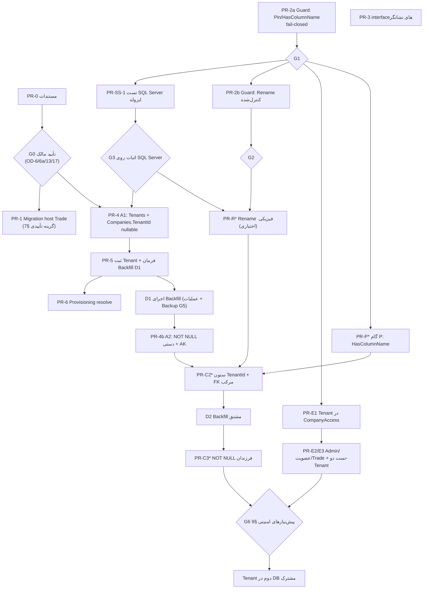

# S3-0h — طرح تلفیقی مهاجرت Tenant/Company (مرجع واحد پیاده‌سازی)

- **Issue:** #397
- **تاریخ:** 2026-11-14
- **نوع کار:** فقط طراحی و مستندسازی. هیچ کد C#/TypeScript، Migration، Schema، داده، Provisioning، Backfill، رکورد Tenant، تغییر امنیتی، Commit، Push، PR یا Merge انجام نشد.
- **مرجع معماری:** D-087 (`Accepted`؛ پیاده‌سازی `NotImplemented`).
- **وضعیت این سند:** `Proposed`. هیچ تصمیم این سند Accepted نیست؛ فقط تصمیم‌هایی که در `docs/DECISIONS.md` با وضعیت `Accepted` ثبت‌اند (D-087، D-013، D-038 و …) الزام‌آورند.
- **جایگزینی:** این سند مرجع تلفیقی S3-0e/S3-0f/S3-0g است. S3-0f و S3-0g جایگزین یا حذف نمی‌شوند؛ در تعارض، این سند مقدم است و تعارض‌ها در §5 فهرست شده‌اند.

## راهنمای برچسب‌ها

هر گزاره در این سند یکی از برچسب‌های زیر را دارد (به‌ویژه در جدول‌ها):

| برچسب | معنا |
|---|---|
| **[V] حقیقت تأییدشده** | از کد، مستندات یا Git همین مخزن خوانده شده؛ مسیر فایل ذکر شده |
| **[E] یافتهٔ آزمایشی** | در S3-0g با اجرای واقعی `dotnet ef`/Python روی کپی ایزوله به‌دست آمده (بدون SQL Server) |
| **[P] طرح پیشنهادی** | Proposed؛ نیازمند تأیید |
| **[D] تصمیم نیازمند تأیید** | در ثبت تصمیم‌ها (§10) آمده؛ تصمیم‌گیر مالک محصول است |
| **[U] فرض اثبات‌نشده** | هنوز شاهد اجرایی ندارد (Not Run) |
| **[G] پیش‌نیاز پیاده‌سازی** | شرط ورود به یک مرحله (§11) |

## 0. وضعیت واقعی مخزن (بررسی مجدد در شروع S3-0h)

| مورد | مقدار |
|---|---|
| شاخهٔ محلی / HEAD | `main` @ `d81bb29dc686d582a57904b2fc5b05ec3b7f45d1` |
| `origin/main` (پس از `git fetch origin main`) | `96b8fd15a995f6d54b7aab85a23db3408fd88e78` — «docs(audit): record first S3-0d data-path inventory pass (#653)» |
| فاصلهٔ HEAD محلی تا `origin/main` | دو کامیت: `8f103aa` «fix(e2e): raise the api-sensitive rate limit … (#654)» و `96b8fd1` (#653). تفاوت فقط `docs/ROADMAP.md`، `docs/WORK_LOG.md`، `ISSUE-397-s3-0-tenant-company-audit.md`، یک handoff e2e و چهار فایل `tests/e2e/*` است. **شاخهٔ محلی `main` عمداً Pull/Checkout نشد** (فقط `fetch` به ref راه‌دور). |
| PR #653 | **[V]** ادغام‌شده (کامیت squash با شناسهٔ `(#653)` روی `origin/main`، SHA `96b8fd1`). وضعیت reviewها/CI از API در دسترس نبود (ابزار `gh` به GraphQL/REST این مخزن دسترسی نداشت)؛ پس «ادغام‌شده» فقط از Git استنباط شده است. |
| PR #654 | **[V]** ادغام‌شده (کامیت `8f103aa`) — مربوط به e2e، بی‌ارتباط با Tenant/Company |
| `git status --short` پیش از شروع S3-0h | سه فایل untracked: S3-0e، S3-0f، S3-0g (`docs/handoffs/ISSUE-397-s3-0{e,f,g}-*.md`) |
| `git stash list` | خالی |
| وضعیت S3-0e / S3-0f / S3-0g | **فقط untracked و محلی**؛ در `origin/main` نیستند و در هیچ شاخهٔ راه‌دور (`git ls-remote`) یافت نشدند |
| S3-0d | **[V]** پس از #653 در `main` ادغام شده، اما به‌صورت **§13 فایل** `ISSUE-397-s3-0-tenant-company-audit.md`، نه فایل مستقل `…s3-0d-data-path-inventory.md` (چنین فایلی وجود ندارد) |
| چک‌سام فایل‌های ورودی | S3-0e `9ab0280d…`، S3-0f `bb1d9824…`، S3-0g `abbccb46…` (برای اثبات اینکه هنگام S3-0h بازنویسی نشدند؛ در §15 دوباره سنجیده شد) |
| تغییرات commit‌نشدهٔ شما روی کامپیوتر خودتان | **بررسی‌نشدنی** (bridge در این session وصل نیست)؛ فقط clone این session بررسی شده است |

**هشدار ناهماهنگی نام‌گذاری [V]:** `docs/ROADMAP.md` در `main` مراحل را چنین تعریف می‌کند: S3-0e «تعیین نگاشت داده»، S3-0f «قرارداد Migration و استقرار (Core و Trade)»، S3-0g «خروجی و گیت (ERD، طرح گذار، PRهای کوچک)». در این گفتگو S3-0f «طرح مهاجرت»، S3-0g «اعتبارسنجی فنی» و S3-0h «طرح تلفیقی» نام گرفته‌اند. پیش از ثبت در `ROADMAP`/`PROJECT_STATUS` باید نام‌ها یکدست شوند (§16).

**گیت موجود در ROADMAP [V]:** ردیف S3-0g در `docs/ROADMAP.md` می‌گوید تا تصویب خروجی آن مرحله «هیچ جدول/ستون Tenant جدید، backfill یا تغییر migration host انجام نشود». پس **PR-1 (migration host) و هر PR Schema تا تأیید صریح مالک بر این طرح مسدود است** (G0 در §11).

## 1. خلاصهٔ اجرایی

1. مدل هدف (D-087) با یک Modular Monolith، بدون جدول تکراری و با تغییرات افزایشی قابل پیاده‌سازی است؛ **اما** پیاده‌سازی پیشنهادی S3-0f بدون اصلاح اجرا نمی‌شد (§5). نسخهٔ اصلاح‌شده در §6 آمده است.
2. **سه اصلاح اساسی نسبت به S3-0f:** (الف) Phase A دوبخشی: A1 بدون کلید جایگزین، A2 پس از Backfill با `NOT NULL` دستی و AK؛ (ب) Rename ستون فقط با Pin نام قیدها و فقط در Migration تک‌منظوره، با گام میانی `HasColumnName`؛ (ج) Guard Migration مخزن قبل از هر Rename باید گسترش یابد (PR-2a و PR-2b جدا).
3. **Trade:** هیچ FK به Core ندارد؛ History جدا دارد؛ و یک ماژول **دارای مجوز** (`TRADE_IMPORT`، با اتصال فعلی `DenyAllTradeModuleEntitlement`) است. بنابراین «اعمال Migration Trade روی همهٔ نصب‌ها» یک تصمیم عملیاتی/محصولی است، نه جزئیات فنی؛ چهار گزینه در §7 آمده و هیچ‌کدام پیش‌فرض نشده است.
4. **امنیت:** سطح مدیر سراسری حدود ۳۱ صفحه/Handler است. **Tenant دوم در دیتابیس مشترک تا برآورده‌شدن پیش‌نیازهای §9 ممنوع است.**
5. **PR بعدی پیشنهادی:** PR-0 (فقط مستندات) — §13. اولین PR فنی پس از تأیید: PR-2a (Guard، بدون Schema/Host).
6. **آمادگی ورود به Schema:** نه. هفت گیت در §11 باید بسته شود؛ مهم‌ترین آن‌ها تأیید مالک بر OD-6/OD-6a/OD-13، اثبات روی SQL Server واقعی و Guard درون مخزن است.

## 2. مبنای معماری (حقایق تأییدشده [V])

| # | واقعیت | مسیر |
|---|---|---|
| V1 | D-087 `Accepted`، پیاده‌سازی `NotImplemented`. Tenant مرز مالکیت/امنیت/چرخهٔ عمر؛ Company شخصیت حقوقی/عملیاتی داخل یک Tenant؛ هر Company دقیقاً یک Tenant؛ یکتایی شمارهٔ پرونده/Proforma/OrderRegistration در سطح Company؛ `CustomerBoundaryId` مفهومی جدا؛ Global Query Filter فقط پس از طراحی context ورود/jobها و تست‌های منفی؛ اجرای Migration روی دیتابیس مشتری نیازمند مجوز جدا | `docs/DECISIONS.md` (D-087) |
| V2 | مدل فعلی: جدول `Tenants` وجود ندارد؛ `Companies` ستون `TenantId` ندارد؛ ستون‌های موسوم به `TenantId` عملاً `Company.Id` را نگه می‌دارند (CompanyRole، UserCompanyMembership، FiscalPeriod، پنج Entity منابع انسانی، SecurityAuditEvent، Trade، و `CompanyMembershipRequest.DestinationTenantId`) | S3-0e §3–§5؛ `Infrastructure/Persistence/Configurations/*` |
| V3 | `CorporateGroupMember.CompanyId`، `OwnershipRelationship.{Parent,Subsidiary}CompanyId`، `CorporateGroup.OwnerCompanyId`، `ConsolidationRunCompany.CompanyId`، `ProvisioningRequestClaim.CompanyId` از ابتدا CompanyId واقعی‌اند | `Domain/CorporateGroups/*`، `ProvisioningRequestClaimConfiguration.cs` |
| V4 | تنها مسیر ایجاد Company در کد تولیدی: `CustomerProvisioningApplyService`؛ `CustomerProvisioningSettings` تک‌مقداری (یک `CustomerReference`/`InstallationId` در هر نمونه) | `Server/Infrastructure/Provisioning/*` |
| V5 | هر Company در Provisioning با `FiscalPeriod`، `CompanyRole` («company-admin»)، کاربر اول (`RoleId = null`) و `UserCompanyMembership` ساخته می‌شود؛ همگی با `TenantId = company.Id` | `CustomerProvisioningApplyService.cs` |
| V6 | مدیر نصب = `User.Role.Name == Constants.Role.Admin` (نقش سراسری legacy)؛ ۳۱ فایل صفحهٔ Razor مدیریتی با `[Authorize(Roles = Constants.Role.Admin)]` و بدون فیلتر Tenant؛ `Pages/Admin/Users/Create.cshtml.cs` با `RoleId = ViewModel.RoleId` هر نقش سراسری را می‌دهد؛ API مدیریت کاربر و Audit نیز سراسری است | `Server/Pages/Admin/**`، `Server/Api/UserAdministrationEndpoints.cs`، `SecurityAuditAdministrationEndpoints.cs` |
| V7 | Username/Email در سطح `User` یکتای سراسری است (Identity Realm)؛ `CustomerBoundaryId` ستون nullable روی `Company` با تخصیص اپراتوری | `Domain/User.cs`، `Domain/Company.cs`، `CustomerBoundaryEndpoints.cs` |
| V8 | `--migrate` فقط `DatabaseContext` (Core) را Migrate می‌کند؛ Trade از `TradeDbContext` با History جدا `dbo.__TradeMigrationsHistory` و Schema `trade` استفاده می‌کند؛ یک Migration Trade وجود دارد (`20261113072823_InitialTradeMasterData`) | `Server/Program.cs`، `DatabaseSchemaMigrator.cs`، `TradeDbContextOptionsConfiguration.cs` |
| V9 | روی `Farano-Local` هیچ جدول `trade` و هیچ `__TradeMigrationsHistory` وجود ندارد؛ ۱۶ Migration Core ثبت است | `docs/ROADMAP.md` (S3-0c-b)، S3-0 §12 |
| V10 | Trade یک ماژول دارای مجوز است: entitlement شرکت‌محور `TRADE_IMPORT`؛ در `Server/Program.cs` به `DenyAllTradeModuleEntitlement` متصل است (fail-closed)؛ پس امروز Trade در همهٔ نصب‌ها بسته است | `docs/LICENSING.md:159`، `Server/Program.cs:284-285`، `Server/Infrastructure/Trade/DenyAllTradeModuleEntitlement.cs` |
| V11 | Migration Trade هیچ FK به `Companies` ندارد؛ فقط FK درون Trade (مثلاً به `Parties`). `docs/TRADE_MODULE.md` می‌گوید هیچ FK از Trade به جداول تراکنشی حسابداری ایجاد نمی‌شود، Trade.Domain/Application به Core ارجاع نمی‌دهند و Host باید تعلق دوره به Company/Tenant را پیش از use case کنترل کند؛ همچنین انتقال Schema `trade` به دیتابیس مستقل به‌عنوان مسیر آینده ذکر شده است | `docs/TRADE_MODULE.md:30-33,62,122` |
| V12 | CI فقط `has-pending-model-changes` Core را اجرا می‌کند؛ Guardهای Python فقط Core را پوشش می‌دهند؛ e2e فقط `Server.dll --migrate` دارد | `.github/workflows/dotnet.yml:134,149,287` |
| V13 | CI ابزار `dotnet-ef 10.0.13` را سراسری نصب می‌کند؛ `Server/.config/dotnet-tools.json` هنوز `6.0.3` را پین کرده است (ناسازگاری ظاهری، خارج از دامنه) | `.github/workflows/dotnet.yml:145`، `Server/.config/dotnet-tools.json` |
| V14 | یک اسکریپت baseline برای Coreِ دیتابیس‌هایی که با `EnsureCreated()` ساخته شده‌اند وجود دارد؛ برای Trade چنین رویه‌ای وجود ندارد و Migration Trade در مستندات باید با Issue مستقل/تست SQL Server/تأیید اجرا شود | `scripts/baseline-existing-database.sql`، `docs/TRADE_MODULE.md:33` |

## 3. یافته‌های آزمایشی S3-0g [E] (خلاصه؛ جزئیات در سند S3-0g §2–§3)

ابزار: .NET `10.0.100`، `dotnet-ef 10.0.13`، EF Core `10.0.14`، روی کپی ایزوله؛ **هیچ SQL Server** در دسترس نبود.

| # | یافته | شواهد |
|---|---|---|
| E1 | Rename property → EF خودکار `RenameColumn` تولید می‌کند | S3-0g §2.2 (R1/R2) |
| E2 | بدون Pin نام FK/AK: `DropForeignKey`/`DropUniqueConstraint` + `Add*` (به‌علاوهٔ `RenameIndex`). FKهای وابسته به AK در Migration نمی‌آیند؛ شکست روی SQL Server **پیش‌بینی** است [U] | R1 |
| E3 | با Pin (`HasConstraintName`/`HasName`/`HasDatabaseName`) فقط یک `RenameColumn`؛ `Down` معکوس دقیق | R2 |
| E4 | `HasColumnName("TenantId")` + تغییر نام property → `Up`/`Down` خالی؛ هیچ تغییر دیتابیس | R3 |
| E5 | AK روی `Companies(Id, TenantId)` ستون را `NOT NULL DEFAULT 0` می‌کند حتی اگر property nullable باشد | `S1_phaseA` |
| E6 | `AlterColumn` به NOT NULL: `UPDATE … = 0 WHERE NULL`، `DEFAULT 0` باقی‌مانده، FK مرکب را قبل از `ALTER COLUMN` برنمی‌دارد | `S3_notNull` (با `int`) |
| E7 | Rename همراه با تغییر دیگر در یک جدول: EF ستون‌ها را اشتباه جفت می‌کند | `E_retype` |
| E8 | Guard مخزن: صفر مورد از `HasConstraintName`/`HasDatabaseName`/`HasName`/`HasColumnName` در چهار اسکریپت؛ فراخوانی ناشناختهٔ زنجیره در `parse_relationship` نادیده گرفته می‌شود؛ هر Rename با پیام «relationship … removed or changed» رد می‌شود | `scripts/*.py` |
| E9 | Guard پایه سبز است: `generate_migrations.py --check` (rc=0)، `verify_migration_model.py` (۲۰ Migration)، ۳۲ + ۳۱ تست | S3-0g §3.1 |
| E10 | Prototype مستقل با ۱۰ تست Mutation قواعد Rename-only را اثبات کرد؛ **Prototype جزو مخزن نیست و معادل تست Guard تولیدی نیست** | S3-0g §3.4 |

## 4. وضعیت یافته‌های S3-0g در این طرح

| یافته | وضعیت | چگونگی ورود به این طرح |
|---|---|---|
| X1 Phase A با AK و nullable ناممکن | **پذیرفته (اصلاح)** | A1/A2 در §6.1 |
| X2 Pin اجباری | **پذیرفته** | §6.2؛ گیت Guard |
| X3 Trade FK به Companies ندارد | **پذیرفته (اصلاح S3-0f)** | §8، §5 |
| X4 Guard فراتر از «پذیرش Rename» نیاز دارد | **پذیرفته** | PR-2a/PR-2b؛ §6.3 |
| X5 NOT NULL خودکار EF خطرناک | **پذیرفته** | A2 دستی؛ §6.1 |
| X6 جفت‌سازی اشتباه Rename | **پذیرفته** | قانون Rename-only |
| S-8 «بستار FK» تعیین‌کنندهٔ اندازهٔ PR | **پذیرفته با اصلاح**: با Pin بستار FK الزام نیست؛ اندازهٔ PR با ریسک تعیین می‌شود. **[U]** تا اجرای SQL Server |
| S-9 سطح ۳۱ صفحهٔ Admin | **پذیرفته** (بازشمارش شد: ۳۱ فایل) | §9 |
| S-10 Rollback پس از Backfill | **پذیرفته** و مطابق تکلیف S3-0h تشدید شد: نگاشت هرگز حذف نشود؛ roll-forward | §6.5 |
| U1–U7 (`sp_rename`، شکست R1، FK با NULL، رفت‌وبرگشت، قفل همزمانی، عملکرد، Guid) | **نیازمند اعتبارسنجی** | گیت G3؛ §12 |
| «Prototype کافی است» | **رد** | تست‌ها باید در مخزن باشند (PR-2a/2b) |
| پیشنهاد S3-0g: «PR-1 قرارداد Migration host با اعمال Trade روی همه» | **اصلاح‌شده**: اعمال Trade روی همه پیش‌فرض نیست؛ گزینه‌ها در §7 | §7 |

## 5. تناقض‌ها و گزاره‌های منسوخ در S3-0f

| # | بخش S3-0f | مشکل | وضعیت صحیح | شدت |
|---|---|---|---|---|
| C-1 | §2، §6 (Phase A)، §5 | «`Companies.TenantId` nullable + AK `(Id,TenantId)` در مرحلهٔ A» | ناممکن در EF (E5). A1 بدون AK؛ AK و NOT NULL در A2 پس از Backfill | بحرانی |
| C-2 | §4.5 | Rename «همهٔ قیدها را همراه می‌کند» و «فرض‌های Pin اختیاری» | بدون Pin، FK/AK Drop/Add می‌شود (E2)؛ Pin اجباری | بحرانی |
| C-3 | §13 جدول PR | PR-2 «می‌تواند موازی باشد» | PR-2a/2b پیش‌نیاز **اجباری** هر Rename است | بحرانی |
| C-4 | §2 | «همگی FK به `Companies.Id` دارند» شامل Trade | Trade هیچ FK به Companies ندارد (V11) | بالا |
| C-5 | §8.4 | NOT NULL با Migration دستی «پیشنهاد» | اجباری است (E6) | بالا |
| C-6 | §11 | `Down` فاز A «بی‌خطر» و رول‌بک Backfill با `UPDATE … SET TenantId = NULL` | پس از Backfill نگاشت منبع حقیقت است؛ حذف/NULL‌کردن آن مجاز نیست؛ Roll-forward (§6.5) | بالا |
| C-7 | §7 جدول Trade | FK مرکب `(CompanyId,TenantId)→Companies` برای Trade به‌عنوان گزینه‌ای در کنار «کنترل منطقی» | در Trade باید فقط پس از ADR صریح ممکن باشد؛ پیش‌فرض Host-level (§8) | بالا |
| C-8 | §3 OD-1 | سطح Admin فقط `UserAdministration` و `SecurityAuditAdministration` | ۳۱ صفحه/Handler؛ ساخت کاربر با نقش سراسری | بالا |
| C-9 | §10 | «Shared آماده می‌شود» | مدل داده آماده می‌شود؛ Provisioning چندمشتری پیاده‌نشده (V4)؛ Shared مجاز نیست تا §9 | متوسط |
| C-10 | §13 PR-1 | «قرارداد Migration host» بدون ذکر مجوز Trade و گیت ROADMAP | PR-1 تا تأیید مالک و تصمیم §7 مسدود است؛ اعمال روی همه نصب‌ها پیش‌فرض نیست | بالا |
| C-11 | §6 مرحلهٔ C | Rename فیزیکی تنها گام C1 | دو گام: P (`HasColumnName`) سپس Rename فیزیکی (اختیاری، OD-12/OD-15) | متوسط |
| C-12 | §0، §1 | «PR-0 … PR-3 را می‌توان آغاز کرد» با PR-2 تک‌پارچه | PR-2a و PR-2b جدا؛ فقط PR-0 و PR-2a/PR-3 بدون گیت Schema‌اند | متوسط |
| C-13 | §0 | «S3-0e فقط محلی» و «SHA main = 8f103aa» | اکنون `origin/main = 96b8fd1`؛ S3-0e/f/g همچنان محلی | پایین |
| C-14 | §0 | نام‌گذاری S3-0f/S3-0g | با ROADMAP ناهمخوان (بالا) | پایین |
| C-15 | §14 K-10، §12 | عملکرد/تعداد ایندکس «بی‌خطر» بدون اندازه‌گیری | اندازه‌گیری نشده [U] | پایین |

## 6. طرح فنی تلفیقی [P] (Proposed — هیچ‌کدام اجرا نشده)

### 6.1 مدل هدف و Phase A

```
Tenants (جدید)                       Companies (موجود)
  Id (Guid) PK                         Id PK; Name; NationalId; CustomerBoundaryId?  (بدون تغییر)
  Name; IsActive; CreatedAtUtc         TenantId  FK→Tenants.Id   (A1: nullable → A2: NOT NULL)
  RowVersion                           AK (Id, TenantId)         (فقط A2)
  [CustomerReference — فقط پس از OD-6/6a]

جدول‌های company-owned (پس از Rename و C2):
  CompanyId  (همان ستون legacy با نام جدید)  FK→Companies.Id (موجود)
  TenantId   (جدید؛ nullable → NOT NULL پس از Backfill)
  FK مرکب (CompanyId, TenantId) → Companies(Id, TenantId)   (فقط پس از A2)
```

- **A1 [P]:** `CreateTable Tenants` + `AddColumn Companies.TenantId` (nullable) + `FK → Tenants` + Index. **بدون AK.** بدون `DEFAULT`. رفتار فعلی بدون تغییر؛ Company با `TenantId = NULL` یعنی «تخصیص‌نیافته».
- **A2 [P] (پس از Backfill تأییدشده، §6.4):** Migration **دستی** (ورودی بازبینی‌شده در `HAND_WRITTEN_SQL`): ابتدا `IF EXISTS (SELECT 1 FROM Companies WHERE TenantId IS NULL) THROW …`، سپس `ALTER COLUMN … NOT NULL` (بدون `UPDATE` پیش‌فرض و بدون `DEFAULT`)، سپس AK `(Id, TenantId)`. EF نباید این Migration را خودکار تولید کند؛ Guard باید `AlterColumn` NOT NULL بدون هر `defaultValue` و بدون ورودی بازبینی‌شده را رد کند. **[U]** رفتار روی SQL Server و نوع `Guid`.
- شکل Tenant (ستون‌های حداقلی، وجود `CustomerReference`) تصمیم مالک است (OD-6، OD-6a).

### 6.2 قانون Rename ستون legacy [P، مبتنی بر E1–E4، E7]

1. **گام P (فقط C#):** نام property به `CompanyId` + `HasColumnName("TenantId")`. Migration خالی؛ ایمنی کامپایل؛ بدون تغییر DB؛ سازگار با نسخهٔ قدیمی برنامه. ستون واقعی جدید تا پایان گام فیزیکی نمی‌تواند `TenantId` نام بگیرد.
2. **گام فیزیکی (اختیاری؛ OD-12/OD-15):** قبل از Rename، نام تمام FK/AK/Index موجود Pin شود (مقدار برابر نام فعلی)؛ سپس Migration **Rename-only**: فقط `RenameColumn` و `RenameIndex` (ایندکس‌های تک‌ستونی FK نام را از `TenantId` به `CompanyId` عوض می‌کنند). هر تغییر دیگر (نوع، nullability، ستون جدید، ایندکس جدید) **ممنوع** در همان Migration.
3. نام‌های Pinشده همچنان واژهٔ `TenantId` را دارند (بدهی ظاهری، OD-15).
4. Guard باید هر Rename را فقط از فهرست بازبینی‌شدهٔ صریح بپذیرد، نه از حدس EF.

### 6.3 تغییرات Guard [P]

- **PR-2a — Pin/`HasColumnName`/fail-closed:** `ef_model.py` سه چیز را بشناسد: `HasConstraintName`، `HasDatabaseName`/`HasName`، `HasColumnName`؛ نام‌ها وارد مدل، snapshot و Designer شوند (AK ضمنی که با Pin صریح می‌شود، نباید تغییر مدل حساب شود)؛ **هر فراخوانی ناشناختهٔ زنجیره `ModelExtractionError` بدهد** (امروز نادیده گرفته می‌شود)؛ هیچ Rename را نمی‌پذیرد؛ تست‌های Mutation درون `scripts/tests/`.
- **PR-2b — Rename کنترل‌شده:** فهرست بازبینی‌شده (مثلاً `RENAMED_COLUMNS`)، `RenameColumn`/`RenameIndex` در `migration_model.py`/`verify_migration_model.py`، تطبیق `Down` معکوس، رد هر عملیات اضافی، پوشش Trade (§7/§8). تست Mutation حداقل: Rename معتبر پذیرفته؛ `DropColumn` ناخواسته رد؛ Drop/Add جای Rename رد؛ `Down` ناقص/معکوس‌نشده رد؛ Rename همراه تغییر facet رد؛ Pin ناشناخته رد.
- **Prototype ≠ تست تولیدی:** `rename_guard_prototype.py` فقط قواعد را معتبر کرده؛ باید با ساختار واقعی `scripts/` بازنویسی و در CI اجرا شود. **ادعای امنیت Migration بر پایهٔ SQL تولیدی یا Prototype ممنوع است**؛ فقط اجرا روی SQL Server واقعی (گیت G3) آن را اثبات می‌کند.

### 6.4 Backfill [P]

- **منبع:** فقط **manifest نگاشت تأییدشدهٔ مالک**. `CustomerBoundaryId`، `CorporateGroup`، `OwnershipRelationship`، نام شرکت و گروه **هرگز** منبع یا شاهد نگاشت نیستند. `ProvisioningRequestClaims.CustomerReference` فقط شاهد تطبیقی غیرمرجع است (و فقط پس از OD-6a).
- **فرمان اپراتوری، نه Migration:** `--dry-run` پیش‌فرض؛ تراکنش Serializable + قفل `sp_getapplock` (الگوی Provisioning)؛ رویداد `SecurityAuditEvent` با SHA256 manifest و شمارها؛ بدون ثبت Secret.
- **اعتبارسنجی پیش از نوشتن:** هر Company موجود دقیقاً یک‌بار در manifest؛ Company ناشناخته در manifest → توقف؛ Company بدون ردیف در manifest → توقف؛ Tenant بدون Company → هشدار؛ Company با Tenant متفاوت از قبل → توقف (بازتخصیص ممنوع).
- **Idempotency:** اجرای مجدد با همان manifest بدون تغییر و با گزارش «no-op».
- **Backfill ستون‌های فرزند (D2):** `UPDATE child SET TenantId = c.TenantId … WHERE child.TenantId IS NULL AND c.TenantId IS NOT NULL` به‌صورت دسته‌ای و قابل ازسرگیری؛ پس از آن راستی‌آزمایی: شمار `child.TenantId IS NULL = 0` و `child.TenantId <> Companies.TenantId = 0` برای همهٔ جدول‌های فرزند **به‌جز `SecurityAuditEvent`**. برای `SecurityAuditEvent` قاعدهٔ جدا (ستون nullable می‌ماند؛ هر دو ستون مالکیت NULL = رویداد سیستمی، OD-5): ردیف‌هایی که `CompanyId` آن‌ها به Company موجود می‌رسد باید `TenantId` غیرخالی و برابر `Companies.TenantId` داشته باشند؛ ردیف‌های سیستمی/بدون Company مجازاً NULL می‌مانند و فقط شمارش و گزارش می‌شوند. NOT NULL (C3) روی این جدول اعمال نمی‌شود. **کد نوشتن `TenantId` در مسیرهای insert باید قبل از D2 مستقر شده باشد** تا ردیف NULL جدید وارد نشود.
- **گزارش:** شمار قبل/بعد هر جدول، فهرست تفاوت‌ها، توقف کنترل‌شده برای هر مجهول؛ خروجی بدون Secret.

### 6.5 Rollback و Recovery [P]

| مرحله | بازگشت |
|---|---|
| A1 قبل از هر Tenant ساخته‌شده | `Down` مجاز |
| **پس از ثبت Tenant یا تخصیص Company** | **نگاشت حذف یا NULL نمی‌شود.** بازگشت = Backup/Restore یا Roll-forward (اصلاح با manifest جدید و رویهٔ حسابرسی‌شده). `Down` فقط در محیط آزمایشی قبل از D1 مجاز است. manifest تأییدشده نزد مالک بایگانی می‌شود. |
| گام P | revert کد؛ بدون اثر DB |
| Rename فیزیکی | `Down` = Rename معکوس + نسخهٔ قدیمی کد؛ ناسازگار با کد جدید؛ نیازمند Backup |
| افزودن ستون `TenantId` فرزند + FK مرکب | `Down` مجاز تا قبل از NOT NULL؛ دادهٔ مشتق‌شده از `Companies.TenantId` بازسازی‌پذیر است |
| A2/NOT NULL فرزندان | Roll-forward ترجیح دارد؛ بازگشت به nullable فقط با تأیید و Backup |

**ریسک نسخهٔ قدیمی برنامه [V/U]:** افزودن ستون nullable سازگار است؛ Rename فیزیکی و NOT NULL با نسخهٔ قدیمی ناسازگارند. در Shared/چندنمونه‌ای ترتیب استقرار: کد جدید (مستقل از ستون جدید) → Migration → کد وابسته. D-087 «عدم downtime غیرضروری» را می‌خواهد؛ گام P همین را فراهم می‌کند.

### 6.6 ماتریس Entity (خلاصهٔ مبنا؛ جزئیات در S3-0f §7)

| گروه | Entityها | دستهٔ هدف | اقدام |
|---|---|---|---|
| A | Tenant (جدید)، Company | ریشه / شرکت | A1، A2 |
| G1 | CompanyRole، UserCompanyMembership، CompanyMembershipRequest(`DestinationTenantId`)، CompanyEmployee/Assignment/Photo/OrgUnit/Position | company-owned | P → Rename → ستون Tenant |
| G2 | FiscalPeriod (+ `ProvisioningRequestClaim`، `ConsolidationRunCompany` که از قبل CompanyId دارند و فقط به AK ارجاع می‌دهند) | company-owned | P → Rename → ستون Tenant |
| G3 | Trade: Party، PartyRoleAssignment، PartyBankAccount، Product، ProductIdentifier | company-owned | P → Rename → ستون Tenant (بدون FK به Core؛ §8) |
| G4 | SecurityAuditEvent | ترکیبی (`TenantId`/`CompanyId` هر دو nullable؛ هر دو null = سیستمی؛ OD-5) | Rename + ستون |
| بدون تغییر | User/UserSession/LoginLog، PermissionDefinition، Installation/License، گروه شرکتی و Consolidation (قاعدهٔ same-Tenant در کد) | سراسری/Realm/نصب | هیچ |

اندازهٔ PR با ریسک تعیین می‌شود. ترتیب پیشنهادی: FiscalPeriod → G1 → HR → SecurityAuditEvent → Trade (آخر؛ خارج از Guard فعلی).

### 6.7 مجوز: فیلتر صریح یا Global Query Filter [P]

پیشنهاد: **فیلتر صریح یکپارچه** (extension و interfaceهای نشانگر `ICompanyOwned`/`ITenantOwned`) + تست‌های دو-Tenant. Global Query Filter فقط پس از طراحی context ورود/jobها/مسیرهای سیستمی و تست‌های منفی (D-087). دلیل: هزینهٔ context، خطر `IgnoreQueryFilters` فراموش‌شده و نبود Background Job/Export Tenant-level فعلی. بازبینی هنگام ورود اولین Job/Export سطح Tenant.

## 7. Migration host مربوط به Trade — گزینه‌ها و پیامدها

### 7.1 واقعیت‌ها [V] و قید

- Trade ماژول دارای مجوز (`TRADE_IMPORT`) است و امروز با `DenyAllTradeModuleEntitlement` بسته است؛ در `Farano-Local` جداول Trade وجود ندارند (شاهد S3-0c-b). وضعیت دیتابیس سایر نصب‌ها **نامعلوم** است (§15) و نباید از این مشاهده تعمیم داده شود.
- نبود `__TradeMigrationsHistory` **اجازهٔ baseline یا فرض وجود Schema نیست.** اگر جداول `trade.*` بدون History یافت شد، باید خطا و گزارش دهد؛ هیچ baseline خودکار نشود. (اسکریپت baseline موجود فقط برای Core دیتابیس‌های `EnsureCreated` است.)
- `docs/TRADE_MODULE.md` اجرای Migration مشتری را مشروط به Issue مستقل، تست SQL Server، rollout/rollback و تأیید می‌کند؛ D-087 نیز اجرای Migration روی دیتابیس مشتری را نیازمند مجوز جدا می‌داند.
- ROADMAP: تغییر migration host تا تأیید S3-0g مسدود است.

### 7.2 گزینه‌ها

| گزینه | شرح | مزیت | پیامد/هزینه | ریسک |
|---|---|---|---|---|
| **H1 — همیشه Trade را هم Migrate کن** | `--migrate` هر دو Context | ساده؛ یک رویه؛ آماده‌بودن Schema هنگام فعال‌سازی مجوز؛ پوشش e2e/CI | **نصب‌های بدون مجوز Trade هم Schema `trade` و History جدا می‌گیرند** (جدول خالی)؛ هر شکست Trade روی همهٔ نصب‌ها اثر می‌گذارد؛ نیاز به تأیید محصولی برای ایجاد Schema برای مشتری بدون مجوز؛ Backup/ممیزی Schema بیشتر | شکست Trade عملیات Core را مسدود می‌کند مگر Core و Trade مستقل گزارش شوند |
| **H2 — فقط به‌صورت صریح (opt-in)** | فرمان جدا (مثلاً `--migrate-trade`) یا پرچم، توسط اپراتور | هیچ تغییری برای نصب‌های بدون مجوز؛ کنترل کامل | یک گام عملیاتی اضافه؛ فراموشی = Trade کار نمی‌کند (ولی fail-closed است)؛ تست e2e باید صریحاً صدا بزند | کم |
| **H3 — فقط وقتی entitlement فعال است** | Migrate Trade مشروط به مجوز معتبر | هیچ Schema برای نصب بدون مجوز | وابسته به اتصال runtime مجوز (#391/#401) که امروز DenyAll است؛ نیاز به بررسی مجوز هنگام Migration (حتی آفلاین)؛ پیچیدگی و وابستگی ساختی بین Licensing و Migration | بالا؛ **امروز ممکن نیست** |
| **H4 — بدون تغییر host؛ Migration Trade فقط از ابزار دستی/CI** | `dotnet ef database update` برای Trade فقط در محیط‌های خاص | هیچ تغییر کد؛ مرز کامل | عدم یکنواختی بین Shared/Dedicated؛ خطای انسانی؛ در CI تست‌ها همین را می‌کنند | متوسط |

**توصیهٔ کم‌پیچیدگی (Proposed، تصمیم با مالک):** H2 — فرمان صریح و جدا، با خروجی و exit code مستقل، تا وقتی entitlement runtime وصل شود؛ H1 را فقط پس از تأیید محصولی برای «Schema خالی در نصب بدون مجوز» در نظر بگیرید. H3 را به بعد از #391/#401 موکول کنید.

### 7.3 رفتار مشترک مستقل از گزینه [P]

- **شکست Core:** Trade اجرا نشود؛ exit code ≠ 0.
- **Core موفق، Trade ناموفق:** Core همان‌گونه که هست بماند (تراکنش مشترک دو-Context ساخته نمی‌شود)؛ گزارش صریح «Core applied / Trade failed»؛ exit code ≠ 0؛ برنامه می‌تواند با Trade بسته بالا بیاید چون Trade fail-closed است؛ ثبت وضعیت در لاگ/Audit.
- **اجرای تکراری:** `MigrateAsync` هر Context idempotent؛ اجرای مجدد فقط pending را ادامه می‌دهد.
- **Trade بدون History ولی با جدول:** توقف با خطا؛ بدون baseline.
- **چند نمونه:** در Shared/Dedicated چندنمونه‌ای، فقط **یک** اجرا (job/pipeline) مجاز است. حفاظت پیشنهادی: رویهٔ عملیاتی «تک‌اجراکننده» + قفل `sp_getapplock` شفاف در `DatabaseSchemaMigrator` (یا اتکا به قفل Migration خود EF) و استارت برنامه **بدون** Migrate خودکار. قفل EF و رفتار همزمانی **اثبات‌نشده** است [U5].
- **هشدار شروع:** `GetPendingMigrationsAsync` برای Core، و برای Trade فقط اگر Trade فعال/Migrate‌شده باشد (در H2 نباید برای هر نصب هشدار Trade داد).
- **این بخش پیاده‌سازی نشود** تا پیامدهای عملیاتی/محصولی بالا مستند و توسط مالک تأیید شود.

## 8. یکپارچگی Tenant در Trade

| معیار | Host-level validation | FK بین‌ماژولی به `Companies` |
|---|---|---|
| مرز ماژول | حفظ؛ هیچ ارجاع Core در Trade (V11) | نقض؛ Trade.Infrastructure/Schema به Core وابسته می‌شود؛ مخالف `TRADE_MODULE.md` مگر ADR صریح |
| انتقال Schema `trade` به دیتابیس مستقل (مسیر آینده، `TRADE_MODULE.md:122`) | سازگار | **ناممکن** (FK بین دیتابیس‌ها وجود ندارد) |
| قدرت تضمین | فقط تا وقتی همهٔ مسیرها از Host عبور کنند؛ SQL مستقیم/ابزار می‌تواند دور بزند | تضمین در سطح DB |
| هزینه | کم: `TradeAccessContext(TenantId, CompanyId)` از `CompanyAccessService`؛ تست‌ها | متوسط: وابستگی Migration، ترتیب، Rename/Backfill هماهنگ |
| تست | تست‌های Integration/SQL Server: Store با `CompanyId` غیرمتعلق به Tenant رد می‌شود؛ درج مستقیم ناسازگار در سطح DB **قابل جلوگیری نیست** (باید به‌صراحت مستند شود) | تست SQL Server: درج ناسازگار رد می‌شود |

**پیشنهاد [P]، تصمیم مالک (OD-11):** Host-level به‌علاوهٔ ستون `TenantId` در Trade، **بدون FK به Core و بدون Reference جدید**، با این الزامات: (۱) Host فقط `(TenantId, CompanyId)` اعتبارسنجی‌شده را به Trade بدهد؛ (۲) Storeها هر دو را در فیلتر و در insert بنویسند؛ (۳) تست SQL Server روی `TradeDbContext`: دو Tenant/Company، نشت‌نکردن، رد درج با `CompanyId` متعلق به Tenant دیگر در سطح Store/Use case؛ (۴) محدودیت صریح «درج مستقیم SQL تضمین نمی‌شود» در مستندات. اگر مالک تضمین سطح DB می‌خواهد، فقط با ADR جدید دربارهٔ وابستگی Core ↔ Trade (مثلاً جدول مرجع `CompanyTenantRef` داخل Trade که توسط Host همگام می‌شود؛ هزینه و ریسک همگام‌سازی) ممکن است. **هیچ وابستگی Core در Trade بدون ADR صریح ایجاد نشود.**

## 9. امنیت — حداقل پیش‌نیازهای پیش از Tenant دوم در دیتابیس مشترک

**قاعدهٔ قطعی [G]:** تا همهٔ موارد زیر پیاده‌سازی و با تست‌های منفی دو-Tenant روی SQL Server واقعی سبز نشده‌اند، ثبت **Tenant دوم** در یک دیتابیس مشترک ممنوع است (در یک نمونهٔ Dedicated تک‌Tenant لازم نیست).

| # | پیش‌نیاز | مبنا |
|---|---|---|
| SP-1 | سیاست Role.Admin (OD-1): تعریف رسمی «مدیر پلتفرم»؛ اطمینان از اینکه نقش سراسری به مشتری داده نمی‌شود؛ یا فیلتر Tenant برای هر ۳۱ صفحه/Handler | V6 |
| SP-2 | ساخت کاربر: `Pages/Admin/Users/Create.cshtml.cs` و `CompanyUserProvisioningEndpoints`/`UserAdministrationEndpoints` نباید بتوانند کاربر/نقش/عضویت خارج Tenant بسازند یا `RoleId` سراسری بدهند مگر مدیر پلتفرم | V6 |
| SP-3 | Export و گزارش‌ها و `SecurityAuditAdministrationEndpoints` (فهرست/Export/`/admin/companies`) با فیلتر Tenant؛ SecurityAuditEvent با `TenantId` | V6 |
| SP-4 | `CompanyMembershipRequestEndpoints` (کشف عضویت) = شرط Tenant **و** شرط `CustomerBoundaryId`؛ بدون کشف بین Tenantها (OD-3) | S3-0f §4.3 |
| SP-5 | `CompanyAccessService`/`WorkContextService`/`DelegationCeilingService`/`TradeAuthorizationAdapter` دارای `TenantId` استخراج‌شده از سرور؛ هیچ TenantId از کلاینت | D-087 بند ۵ |
| SP-6 | HR APIs و Directory با فیلتر Company + مقایسهٔ Tenant | S3-0e |
| SP-7 | Provisioning چندمشتری (OD-14) یا تصمیم «نمونهٔ جدا به‌ازای Tenant» | V4 |
| SP-8 | تست‌های منفی نشت cross-Tenant برای: API، session/cookie انتخاب Company، export، audit، فایل (عکس HR)، jobهای شناخته‌شده | D-087 معیار پذیرش |
| SP-9 | یکتایی `Company.NationalId` سراسری (OD-7) تصمیم‌گیری شود | V7 |

حتی بدون Tenant دوم، این پیش‌نیازها باید پیش از **NOT NULL فرزندان** برای مسیرهای مجوز اصلی (SP-5) بسته شوند.

## 10. ثبت تصمیم‌ها (همه `Proposed/باز` مگر خلاف آن ذکر شود)

اولویت انسداد: **P0** = قبل از هر Schema؛ **P1** = قبل از Backfill/ستون جدید؛ **P2** = قبل از Tenant دوم/Shared؛ **P3** = بعداً.

| ID | تصمیم | وضعیت فعلی | اثر فنی/تجاری | گزینهٔ کم‌پیچیدگی (پیشنهاد، نه تصمیم) | چه چیز باید تأیید شود | اولویت |
|---|---|---|---|---|---|---|
| OD-6 | منبع معتبر Company→Tenant و ایجاد Tenant | باز | تعیین شکل `Tenants`، Provisioning، Backfill | اپراتور Tenant را ثبت می‌کند؛ Provisioning فقط resolve می‌کند و Tenant نمی‌سازد؛ نگاشت از حدس (Boundary/گروه/نام) ممنوع | مالک اصل «Tenant فقط اپراتوری» و رد/پذیرش گزینهٔ بسته امضاشده | **P0** |
| OD-6a | رابطهٔ `CustomerReference`↔Tenant | باز | کلید شناسایی Tenant در Provisioning | فرض ۱:۱ برای نصب‌های فعلی | تأیید صریح ۱:۱ یا روش جایگزین | **P0** |
| OD-13 | مرجعیت manifest Backfill | باز | تنها منبع حقیقت نگاشت | manifest تأییدشدهٔ مالک؛ Claim فقط شاهد | تأیید قالب و مرجع manifest | **P0** |
| OD-17 | سیاست Migration Trade (H1..H4) | **جدید/باز** | Schema Trade برای نصب‌های بدون مجوز، شکست Core/Trade | H2 (opt-in) تا اتصال entitlement | مالک گزینه و پیامد (مجوز/Backup/ممیزی) | **P0** (برای PR-1) |
| OD-12 | تحمل Downtime/پنجرهٔ نگهداری | باز | Rename فیزیکی و NOT NULL با نسخهٔ قدیمی ناسازگارند | گام P (بدون DB)؛ Rename فیزیکی اختیاری | پذیرش پنجرهٔ کوتاه یا حذف گام فیزیکی | P1 |
| OD-10 | نام‌گذاری ستون/Property legacy | باز | بدهی معنایی `TenantId=Company` | تغییر نام property به `CompanyId` + `HasColumnName` | تأیید دو گام | P1 |
| OD-18 | نام فیزیکی ستون legacy `TenantId` | **جدید** (از OD-10 تفکیک شد) | ستون واقعی جدید `TenantId` تا پایان Rename فیزیکی نام آزاد ندارد | Rename فیزیکی قبل از افزودن `TenantId` واقعی | پذیرش ترتیب یا نام موقت دیگر | P1 |
| OD-15 | نام قیدهای legacy | **جدید** | قیدها پس از Pin واژهٔ `TenantId` را نگه می‌دارند | پذیرش بدهی؛ تغییر نام قیدها در PR جدا بعد از مهاجرت | پذیرش یا زمان‌بندی | P3 |
| OD-11 | یکپارچگی Tenant در Trade | **اجباری** | بدون FK؛ مرز ماژول؛ انتقال آیندهٔ Schema | Host-level + ستون Tenant + تست SQL Server؛ بدون FK | رد/پذیرش FK (ADR) | P1 (قبل از PR Trade) |
| OD-1 | دامنه و مجوز Admin سراسری | باز | ۳۱ صفحه/Handler؛ ساخت کاربر با نقش سراسری | `Role.Admin` = مدیر پلتفرم فقط اپراتور؛ مدیر مشتری از `CompanyRole`؛ بدون نقش موازی | تأیید تفکیک و سطح؛ پوشش SP-1..3 | **P2** |
| OD-2 | دامنهٔ یکتایی Username/Email | باز | Login، عضویت چندشرکتی، بازیابی رمز | حفظ Global در Realm | تأیید ماندن | P3 |
| OD-3 | رفتار `CustomerBoundaryId` | باز | کشف عضویت، گروه/مالکیت | مستقل؛ کشف = Tenant AND Boundary | تأیید قاعده | P2 |
| OD-4 | دامنهٔ `CompanyRole` | باز | کلیدهای `(Id, CompanyId)`، `DATABASE.md` | Company-scoped (وضع فعلی) | تأیید | P1 |
| OD-5 | مالکیت `SecurityAuditEvents` | باز | `TenantId`/`CompanyId` nullable؛ فیلتر گزارش | بدون ستون Scope؛ هر دو null = سیستمی | تأیید | P1 |
| OD-7 | یکتایی `Company.NationalId` | باز | در DB مشترک، دو Tenant همان شناسه را نمی‌توانند داشته باشند | بدون تغییر تا مشتری دوم | تأیید قبل از Tenant دوم | **P2** |
| OD-8 | دامنهٔ `ProvisioningRequestClaim` | باز | سطح نصب یا Tenant | سطح نصب؛ Tenant از Company مشتق | تأیید | P3 |
| OD-9 | قواعد گروه/رابطهٔ بین Company | باز | گروه بین Tenantها | فقط same-Tenant | تأیید | P2 |
| OD-14 | مدل برنامهٔ مشترک/چند-Tenant | باز | Provisioning تک‌مشتری | تعیین بین «نمونهٔ جدا به‌ازای Tenant روی DB مشترک» یا «چندمشتری در یک نمونه» | تأیید مدل | P2 |
| OD-16 | اجرای Migration چندنمونه‌ای | **جدید** | رقابت Migrate | تک‌اجراکننده + قفل | تأیید رویه | P2 (در صورت Shared) |

OD-2، OD-8 مسدودکنندهٔ فازهای نزدیک نیستند. هیچ ردیفی در این جدول Accepted نیست.

## 11. توالی پیاده‌سازی وابستگی‌محور

### 11.1 گیت‌ها [G]

| گیت | شرط |
|---|---|
| **G0** | مالک این طرح (S3-0h) را به‌عنوان «خروجی S3-0g» تأیید کند و OD-6، OD-6a، OD-13، OD-17 تعیین‌تکلیف شوند (گیت ROADMAP) |
| **G1** | PR-2a ادغام و تست‌های Mutation آن در `scripts/tests/` اجراشده و سبز |
| **G2** | PR-2b ادغام و تست‌های Mutation Rename در مخزن سبز؛ پوشش Trade |
| **G3** | اجرای واقعی روی SQL Server (`scripts/dev/test-sqlserver.sh` یا CI): `sp_rename` با Pin، رفت‌وبرگشت `Up/Down`، FK مرکب با `NULL`، رفتار R1، NOT NULL با `Guid`، شکست Trade/Core، اجرای تکراری، همزمانی Migrate |
| **G4** | OD-4، OD-5، OD-10، OD-11، OD-12، OD-18 تعیین‌تکلیف |
| **G5** | Backup + رویهٔ بازیابی + manifest بایگانی‌شده برای هر نصب هدف؛ مجوز جدا برای اجرا روی دیتابیس مشتری (D-087) |
| **G6** | پیش‌نیازهای امنیتی §9 (SP-1..SP-9) پیش از Tenant دوم |

### 11.2 دسته‌بندی PRها

| PR | محتوا | دسته | گیت‌های لازم |
|---|---|---|---|
| **PR-0** | ثبت اسناد S3-0e/f/g/h و هم‌ترازی ROADMAP/WORK_LOG (Proposed) | مستندات | تأیید مالک بر ادغام اسناد (G0 به‌معنای تصمیم‌ها نیست) |
| **PR-2a** | Guard: Pin/`HasColumnName`/fail-closed + تست Mutation | ابزار Guard | — (بدون Schema/Host) |
| **PR-3** | interfaceهای `ICompanyOwned`/`ITenantOwned`، extension فیلتر، تست معماری فهرست legacy | کد بدون Schema | — |
| **PR-SS-1** | تست‌های SQL Server آزمایشی: `sp_rename` با Pin، رفت‌وبرگشت، FK مرکب با NULL، NOT NULL/Guid، R1 (روی دیتابیس **ایزوله**، با Migration آزمایشی داخل پروژهٔ تست، نه Migration عملیاتی) | تست SQL Server | G1 |
| **PR-2b** | Guard: Rename کنترل‌شده + Mutation + پوشش Trade | ابزار Guard | G1 |
| **PR-E1** | `CompanyAccess`/`WorkContext` با `TenantId` اختیاری (null تا A) | امنیت (کد) | G1؛ مستقل از Schema |
| **PR-1** | قرارداد Migration host Trade طبق گزینهٔ تأییدشده (§7) | Migration host | **G0**، OD-17 |
| **PR-4 (A1)** | `Tenants` + `Companies.TenantId` nullable + FK + Index (بدون AK) | **Schema** | G0، G3، G4(مرتبط) |
| **PR-5** | ثبت Tenant اپراتوری + فرمان Backfill D1 (dry-run/audit) | کد + (احتمالاً Schema کوچک) | PR-4، OD-6، OD-6a، OD-13 |
| **PR-6** | Provisioning: resolve Tenant؛ ستون Company.TenantId هنگام ایجاد؛ fail-closed | کد | PR-5 |
| **PR-D1** | اجرای Backfill D1 (عملیات، نه PR کد) | **Backfill** | G5، PR-5، **PR-6 مستقر** (Provisioning آگاه از Tenant)؛ نسخه‌های قدیمی که Company می‌سازند تا پایان A2 متوقف/تعویض شوند تا Companyی بدون `TenantId` پس از D1 ساخته نشود |
| **PR-4b (A2)** | NOT NULL دستی + AK روی `Companies` | **Schema** | D1 تأییدشده، G3 |
| **PR-P1..P4** | گام P (C#، Migration خالی) برای FiscalPeriod، G1، HR، Audit، Trade | کد | G1 (برای Pin/HasColumnName) |
| **PR-R1..R4** | Rename فیزیکی Rename-only (در صورت تأیید OD-12/OD-18) | **Schema** | G2، G3 |
| **PR-C2a..d** | ستون `TenantId` فرزند (nullable) + FK مرکب (Trade: فقط ستون) + کد نوشتن Tenant | **Schema** + کد | PR-4b، گام P/R همان گروه |
| **PR-D2** | Backfill مشتق ستون‌های فرزند + راستی‌آزمایی | **Backfill** | کد نوشتن Tenant مستقر؛ G5 |
| **PR-C3a..d** | NOT NULL دستی فرزندان با `THROW` | **Enforcement** | D2 تأییدشده، SP-5 |
| **PR-E2/E3** | Admin/کشف عضویت/`TradeAccessContext` + تست دو-Tenant | امنیت | SP-ها؛ G6 فقط فعال‌سازی Shared را گیت می‌کند، نه ساخت و تست این PRها (که خودشان پیش‌نیازهای G6 را برآورده می‌کنند) |
| **Shared** | فعال‌سازی Tenant دوم | — | G6 کامل |

### 11.3 نمودار وابستگی



### 11.4 توضیح گیت‌های قبل از PR-4 و بعد

- **PR-4 (اولین تغییر Schema)** به G0 (تصمیم مالک)، G3 (اثبات SQL Server)، و آماده‌بودن Guard نیاز دارد؛ A1 سبک است (ستون nullable + جدول جدید) ولی هر Migration باید از Guard عبور کند و روی SQL Server واقعی `Up/Down` شود.
- **PR-5 تا PR-D1** به تأیید OD-6/6a/13 وابسته‌اند؛ **PR-4b** فقط پس از Backfill تأییدشده.
- **Rename فیزیکی و C2** پس از PR-4b‌اند چون FK مرکب به AK روی `Companies` وابسته است.
- **PR-9/Trade** آخرین گروه است و به OD-11 و OD-17 و پوشش Guard برای Trade نیاز دارد.
- **PR-1** با «قرارداد اجرایی» مستقل است ولی **به‌خاطر گیت ROADMAP و OD-17 خودکار شروع نمی‌شود** و لزوماً Trade را روی همهٔ نصب‌ها اعمال نمی‌کند.

## 12. تست و معیار پذیرش

نوع: **U** Unit، **I** Integration (HTTP/TestHost)، **S** SQL Server واقعی. **هیچ‌کدام در S3-0h اجرا نشد** (فقط طراحی).

| # | معیار (D-087) | تست | نوع |
|---|---|---|---|
| 1 | دو Tenant در DB مشترک داده یکدیگر را نمی‌بینند | هر endpoint company-scoped، export، audit، فایل HR، session/cookie؛ کاربران دو Tenant | S + I |
| 2 | هر Company دقیقاً یک Tenant | NOT NULL + FK؛ درج بدون Tenant رد | S |
| 3 | یک Tenant چند Company | دو Company در یک Tenant | S + I |
| 4 | Dedicated همان مدل منطقی | همان مجموعه با یک Tenant و Connection String جدا | S |
| 5 | عدم اشتباه TenantId/CompanyId | تست معماری فهرست legacy؛ کامپایل پس از Rename؛ درج ناسازگار `(CompanyId, TenantId)` رد (Core)؛ برای Trade تست Store | U + S |
| 6 | `CustomerBoundaryId` مستقل | هیچ کدی Tenant را از Boundary/گروه/مالکیت نمی‌سازد؛ Backfill منبع دیگر را نمی‌پذیرد | U + I |
| 7 | مجوز سمت سرور | `tenantId`/`companyId` جعلی در Body/Claim رد؛ 404 یکسان | I |
| 8 | یکتایی تجاری در سطح Company | دو Company یک Tenant با شمارهٔ یکسان مجاز؛ تکرار در یک Company رد | S |
| 9 | Backfill تکرارپذیر و قابل حسابرسی | dry-run بدون نوشتن؛ اجرای دوم no-op؛ بازتخصیص رد؛ manifest ناقص/اضافه توقف؛ شمار قبل/بعد؛ رویداد audit | S + I |
| 10 | عدم شکست رفتار فعلی | مجموعهٔ موجود (HR، CompanyAccess، WorkContext، Trade، SQL Server) پس از هر PR | I + S |
| 11 | Guard Rename | Mutationهای §6.3 درون `scripts/tests/` | U (Python) |
| 12 | Migration host | دیتابیس خالی، فقط Core، بدون History Trade، Trade ناموفق، اجرای دوم، همزمانی | S |
| 13 | A2/NOT NULL | NULL باقی‌مانده → شکست با پیام؛ بدون `DEFAULT 0` در Schema | S |

## 13. توصیهٔ PR بعدی (یک PR)

**PR-0 — «docs(s3-0): ثبت طرح تلفیقی مهاجرت Tenant/Company (فقط مستندات، Proposed)»**

- **دامنه:**
  - افزودن چهار handoff: S3-0e، S3-0f (با یادداشت اصلاحی)، S3-0g، S3-0h به `docs/handoffs/` (بدون تغییر محتوا نسبت به نسخه‌های تحویل‌شده، مگر رفع نقص ارجاعی که مالک تأیید کند).
  - به‌روزرسانی حداقلی `docs/ROADMAP.md` (ردیف‌های S3-0e/f/g با واژهٔ «Proposed» و ارجاع به S3-0h؛ هم‌ترازی نام‌ها) و `docs/PROJECT_STATUS.md` فقط برای اشاره به وجود طرح؛ افزودن ورودی `docs/WORK_LOG.md` (Append؛ فارسی).
  - **بدون** ADR Accepted؛ در صورت تأیید مالک، ADRهای جدا با وضعیت `Proposed` در PR جداگانه.
- **خارج از دامنه:** هر کد، Migration، Schema، تغییر host، تغییر Guard، تغییر تست.
- **معیار پذیرش:**
  1. `git diff --name-only` فقط زیر `docs/` است؛ هیچ فایل `.cs`، `.ts`، `.py`، `.sql`، Migration، `.yml` تغییر نکرده.
  2. هیچ تصمیم `Proposed` در سند به `Accepted` تبدیل نشده؛ D-087 بدون تغییر.
  3. همهٔ ادعاهای اجرا نشده با «Not Run» و برچسب [U] مانده‌اند.
  4. `git diff --check` بدون خروجی؛ `python3 scripts/check_static_assets.py` اجرا و نتیجه‌اش (یا «اجرا نشد» با دلیل) در PR گزارش شود.
  5. قالب handoff/WORK_LOG و فارسی‌بودن سندها طبق `AGENTS.md` رعایت شده.
  6. توضیحات PR فارسی و فنی؛ شامل فهرست گیت‌های §11 و تصمیم‌های P0.
- **چرا PR-0 و نه PR-2a:** ROADMAP برای ورود به هر تغییر مرتبط با Migration به تصویب خروجی S3-0g نیاز دارد؛ ثبت رسمی طرح اولین شرط است و هیچ ریسک فنی ندارد. **اولین PR فنی پس از تأیید:** PR-2a (Guard؛ بدون Schema/Host/Tenant).

## 14. تصمیم‌های نیازمند تأیید مالک به ترتیب اولویت انسداد

1. **OD-6 + OD-6a + OD-13** — منبع/شکل Tenant و manifest (قبل از هر Schema/Backfill).
2. **OD-17** — سیاست Migration Trade (H1..H4) (قبل از PR-1).
3. **تأیید رسمی این طرح به‌عنوان خروجی S3-0g** (گیت ROADMAP) و ادغام PR-0.
4. **OD-12 + OD-10 + OD-18** — Rename فیزیکی در برابر فقط گام P، ترتیب نام ستون.
5. **OD-11** — یکپارچگی Trade (Host-level یا ADR برای FK).
6. **OD-4، OD-5** — دامنهٔ `CompanyRole` و Audit.
7. **OD-1، OD-3، OD-7، OD-9، OD-14، OD-16** — قبل از Tenant دوم/Shared.
8. **OD-15، OD-2، OD-8** — بعداً/بدون انسداد.

## 15. فرض‌های حل‌نشده، شواهد در دسترس‌نبودن، تأیید یکپارچگی

**فرض‌های اثبات‌نشده [U]:** U1 رفتار `sp_rename`؛ U2 شکست Drop AK با FK وابسته؛ U3 FK مرکب با ستون NULL؛ U4 رفت‌وبرگشت `Up/Down` روی SQL Server؛ U5 قفل همزمانی Migrate؛ U6 عملکرد (۱۰۰ کاربر)؛ U7 رفتار NOT NULL با `Guid`؛ U8 رفتار مسیر `Server` کامل با Schema جدید؛ U9 وضعیت مشتریان واقعی/دیتابیس‌های دیگر (فقط metadata `Farano-Local` دیده شده)؛ U10 فرض ۱:۱ `CustomerReference`↔Tenant (OD-6a)؛ U11 **S3-0d-b هنوز کامل نیست [V]** (طبق `PROJECT_STATUS.md` و `ROADMAP.md` در `origin/main`: بررسی کامل endpointهای export/report/raw SQL، تست‌های isolation و داده‌های مرجع global باقی است)؛ بنابراین فهرست SP-3/SP-8 در §9 ممکن است در هنگام تکمیل S3-0d-b گسترش یابد و نباید کامل فرض شود. طبق `PROJECT_STATUS.md` (`origin/main`) S3-0e/f/g هنوز «باز» هستند و این اسناد در مخزن ثبت نشده‌اند.

**شواهد در دسترس‌نبود:** SQL Server/Docker؛ API PRهای GitHub (state/reviews/CI #653/#654 فقط از Git استنباط شد)؛ bridge کامپیوتر کاربر (تغییرات commit‌نشدهٔ محلی بررسی نشد)؛ نسخهٔ جداگانهٔ S3-0d؛ گزارش‌های S3-0e/f/g در `main`.

**اجرا نشد (Not Run):** `dotnet build`، `dotnet test`، ClientApp، e2e، هر تست SQL Server، `scripts/check_static_assets.py` (مخصوص این کار لازم نبود).

## 16. پیشنهاد ثبت در اسناد (فقط Proposed؛ پس از تأیید مالک)

- **`DECISIONS.md`:** ADR(های) جدید `Proposed` برای راهبرد Rename دو‌مرحله‌ای با Pin، Phase A1/A2، OD-6/6a، OD-11، OD-17؛ شماره از انتهای فایل؛ هیچ `Accepted` بدون تأیید.
- **`DATABASE.md`:** بخش «طرح گذار Tenant/Company (Proposed)» با مدل §6.1؛ حفظ جملهٔ «هیچ ستون Tenant جدید ساخته نشود» تا تأیید.
- **`ROADMAP.md`:** هم‌ترازی S3-0e..h با واژهٔ Proposed و ارجاع به این سند؛ ثبت گیت‌های G0..G6.
- **`PROJECT_STATUS.md`:** فقط وجود طرح (NotImplemented برای مدل هدف).
- **`TRADE_MODULE.md`:** پس از تأیید OD-11/OD-17 یک یادداشت دربارهٔ Host-level validation و سیاست Migration.

## 17. فهرست فرمان‌ها و ابزار (S3-0h)

```
git branch --show-current; git rev-parse HEAD; git status --short; git stash list
git fetch origin main            # فقط به‌روزرسانی ref راه‌دور؛ شاخهٔ محلی دست‌نخورده
git rev-parse origin/main; git log origin/main --oneline -6
git ls-tree -r origin/main --name-only | grep ISSUE-397
git ls-remote origin | grep -i "s3-0\|397"
git diff --stat HEAD origin/main
git show origin/main:docs/DECISIONS.md | sed -n 2198,2262p   # D-087
خواندن: docs/ROADMAP.md، docs/TRADE_MODULE.md، docs/LICENSING.md، scripts/baseline-existing-database.sql، Server/Program.cs
```

**ابزار:** استفاده‌شده — git، grep، sed، Read/Write؛ در دسترس ولی استفاده‌نشده — `gh api` (دسترسی نداشت)؛ در دسترس نبود — SQL Server، bridge کاربر؛ اجرا نشد — build/test.
